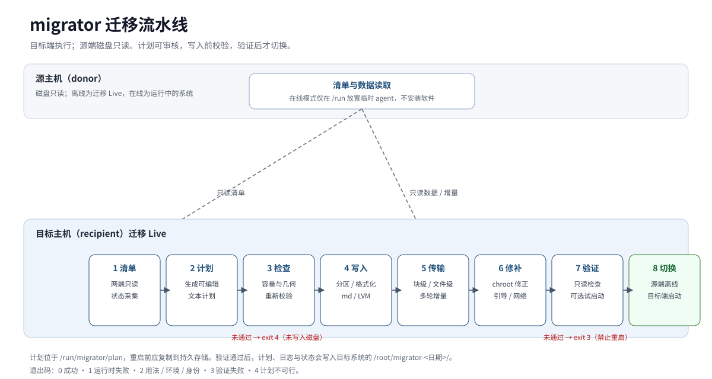

# 产品概览

## 定位

migrator 在两台 Linux 主机之间执行整机迁移：把源主机的磁盘布局、文件系统、文件、服务配置和引导设置迁移到目标主机，使目标主机可以直接启动迁移后的系统。

该工具不是磁盘镜像工具，也不是备份系统。它先读取两端的状态，生成一份可阅读、可编辑的迁移计划；随后按源磁盘的标识和文件系统特性重建目标布局，逐个卷复制数据，在目标系统的 chroot 环境中修正 `fstab`、`mdadm`、initramfs、GRUB 和网络配置，完成验证后再执行切换。

## 工作流程

1. **清单（inventory）**：只读采集源端与目标端的磁盘、分区、md RAID、LVM、文件系统、网络与操作系统信息。
2. **计划（plan）**：根据两端清单和目标磁盘生成计划文件，包括目标分区表、LVM 命令、`mkfs` 命令、卷的复制方式、fstab 标识改写、网络与引导决策。
3. **检查（check）**：重新校验计划与当前清单、目标磁盘几何和卷容量是否一致；不通过时不会写入磁盘。
4. **写入目标盘（apply）**：确认后清空目标盘、分区、创建 md/LVM、格式化，并校验新文件系统的特性掩码与源文件系统一致。
5. **传输（transfer）**：按卷复制数据。块级卷使用 partclone，文件级卷使用 tar；在线模式使用 migrator-agent 多轮增量。
6. **修补（postfix）**：在目标系统的 chroot 中修正 fstab、mdadm 配置、LVM 过滤、内核命令行、initramfs、GRUB、网络和 cloud-init。
7. **验证（verify）**：以只读方式挂载目标系统，检查引导项、initramfs、fstab、内核命令行、文件系统特性、引导器、网络和 RAID 状态。任一致命项失败时退出码为 3。
8. **切换（cutover）**：将源主机移出网络，确认其不再应答，然后启动目标主机进入迁移后的系统。

## 安全边界

- 源主机的磁盘数据始终只读。迁移过程不对源磁盘执行 `fsck`、`resize` 或写入。
- 在线模式会向源主机 root 用户的 `authorized_keys` 追加本次会话公钥，并在 `/run` 下放置临时 agent 程序。这两项不涉及源磁盘数据，但属于对源主机运行环境的修改。
- 目标磁盘写入前必须通过计划检查和人工确认。确认内容包含目标磁盘名称与容量，防止误选磁盘。
- 目标盘上的其它磁盘会被设置为只读，迁移过程不会写入。
- 验证未通过时，工具拒绝切换，并明确提示目标盘已写入、不得重启。

## 两种迁移模式

| 模式 | 源主机状态 | 数据复制 | 停机特征 |
|---|---|---|---|
| 离线（off-line） | 源主机与目标主机都启动到迁移 Live | 每个卷复制一次 | 从源主机离开原系统到目标系统启动期间不提供服务 |
| 在线（on-line） | 源主机继续运行原系统 | 首轮全量复制，随后多轮增量，最后冻结并完成末轮增量 | 仅文件系统冻结窗口内暂停写入，通常为数秒到数十秒 |
| 中继（relay） | 两端不能互相直接访问时，通过第三台主机转发 | 与所选在线或离线模式一致 | 与所选模式一致 |

在线模式的冻结窗口是工具唯一主动造成的服务中断。工具会根据源端写入速率和链路速率估算剩余增量所需时间；本轮增量无法收敛时，不会为了缩短窗口而提前冻结。

## 支持范围

以下为已验证或明确支持的范围。超出该范围的环境不保证可用。

| 项目 | 范围 |
|---|---|
| 源系统 | Debian 10–13、Ubuntu 18.04–26.04、CentOS 7–10、Rocky Linux / AlmaLinux / RHEL 8–10 |
| 目标系统 | 由源系统迁移得到，架构为 x86_64 |
| 磁盘布局 | 普通 MBR/GPT 分区、任意级别 md RAID、LVM、LVM on md |
| 文件系统 | ext2、ext3、ext4、XFS；swap 分区、swap 逻辑卷、swap 文件；EFI 系统分区（ESP） |
| 分区表 | MBR（dos）与 GPT；可在两者之间转换 |
| 固件 | BIOS→BIOS、UEFI→UEFI、BIOS→UEFI、UEFI→BIOS |
| 网络配置 | ifupdown、netplan、systemd-networkd、`ifcfg`、NetworkManager |
| 目标磁盘 | 单盘；或两块磁盘组成 md RAID1（仅 deb 系）；容量可大于或小于源盘，受复制方式约束 |
| 源磁盘数量 | 单盘或多盘；其它源盘上有内容的分区会作为额外槽位追加到目标盘 |

## 明确不支持

- btrfs、ZFS、LUKS、NTFS、F2FS、reiserfs 等文件系统。
- CentOS 6 及更老的 grub-legacy 系统。
- SUSE、Arch Linux、Windows。
- 一个卷组（VG）跨多个物理卷（PV）或跨磁盘。
- 目标端 Secure Boot 已启用、而源端没有 ESP 的情况。
- `-o boot-part=` 新建独立 `/boot` 槽位（当前版本拒绝该选项）。
- 跨迁移 Live 重启的增量续传（E3）。当前仅支持同一次运行内的阶段重试与单卷重做。

## 运行前提

- 目标主机必须启动到完整迁移 Live，且具备 root 权限。
- 源主机必须可通过 SSH 以 root 登录；离线模式要求源主机也启动到完整迁移 Live，在线模式要求源主机运行原系统并具备 bash、findmnt 与 x86_64 架构。
- 两端工具版本应一致。离线模式下 partclone、lz4 等工具版本不一致会被拒绝，除非显式使用 `-o force=1`。
- 目标磁盘必须是非可移动、非 USB、容量不小于 20 GiB，逻辑扇区为 512 或 4096 字节。
- 执行 `apply` 后目标盘原有内容会被清除。迁移前应确认目标盘没有需要保留的数据。

## 关键限制

- **目标盘容量**：块级复制要求目标卷不小于源卷；目标卷更小时，该文件系统必须使用文件级复制。根文件系统可用 `-o root=files` 强制文件级复制。
- **文件级复制容量**：每个文件系统至少需要“已用空间 × 1.10 + 512 MiB”的目标空间。
- **网络地址**：工具会改写网卡名称和 MAC 地址，但保留源系统的 IP、网关和 DNS 配置。迁移到不同网段或不同云平台时，应在迁移后按目标环境修改网络配置。
- **RAID1 目标布局**：`-o raid=1` 仅支持 deb 系源系统；两块目标盘容量不同时按较小盘布局，较大盘的剩余空间不使用。
- **在线模式的源主机**：冻结后不能通过 SSH 登录源主机，因为其根文件系统处于冻结状态。应使用 `migrator -s cutover` 或 `-o cutover=rollback` 处理；轮询超时后源主机会自动解冻。
- **状态目录**：运行状态位于 `/run/migrator`，重启后丢失。需要保留的计划与日志应在重启前复制到持久存储。

## 术语

| 术语 | 含义 |
|---|---|
| donor / 源端 | 被迁移的主机 |
| recipient / 目标端 | 接收迁移结果的主机，运行迁移 Live |
| Live | 带有 `/etc/migrator-live-release` 的完整迁移环境 |
| plan / 计划 | `$RUN/plan`，描述目标布局与全部复制、修补决策 |
| volume / 卷 | 计划中的一个复制单元，可以是分区、逻辑卷、md 阵列或 ESP |
| block / 块级 | 用 partclone 按文件系统镜像复制 |
| files / 文件级 | 用 tar 按目录树复制，可缩小目标容量 |
| freeze / 冻结 | 对源文件系统执行 `fsfreeze`，使写入暂停并取得一致快照 |
| precheck / 预检 | 在线模式下在副本的 dm 快照上提前运行 postfix 与 verify |
| cutover / 切换 | 将源端移出网络并启动目标端 |
| postfix | 在目标系统 chroot 中修正引导与系统配置的阶段 |

## 相关文档

- [安装与构建](02-install.md)
- [快速开始](03-quickstart.md)
- [迁移模式](04-modes.md)
- [阶段与执行流程](05-stages.md)
- [选项参考](06-options.md)
