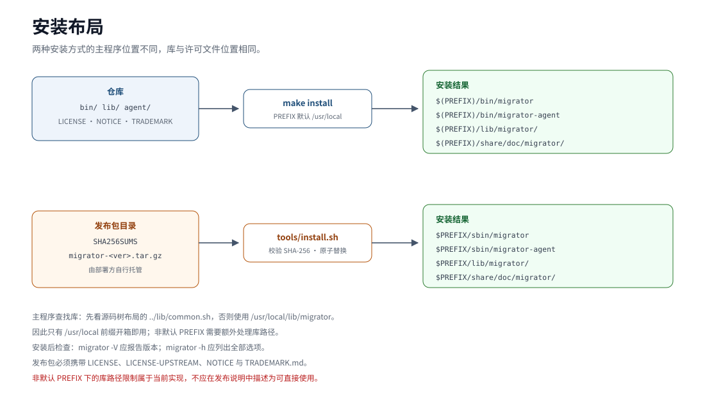

# 安装与构建

migrator 的代码来源为仓库，程序中没有内置的下载地址。安装方式按使用场景分为四类：

- 在已有仓库中构建并安装；
- 装发行版格式的 deb 包（仓库自带打包目录）；
- 在迁移 Live 上从自行托管的发布包安装；
- 构建迁移 Live，使其自带工具与依赖。

以上四种方式安装的工具，其迁移命令都需要在完整的迁移 Live 中执行。目标主机上的工具装在 Live 内：Live 的根文件系统位于内存，重启后需要重新安装。迁移 Live 的制作与引导见[快速开始](03-quickstart.md)第 0 步。

## 用一条命令安装

源码托管在 GitHub。Gitee、jsDelivr 与 GitHub raw 三个服务同步该仓库。`tools/get.sh` 按此顺序逐个请求，使用第一个应答的源。

```sh
curl -fsSL https://gitee.com/tktogether/migrator/raw/master/tools/get.sh | sh
```

`tools/get.sh` 从选定的源逐个读取文件，组成源码树。该脚本按 `tools/install.sh` 要求的格式打包。打包完成后交给 `tools/install.sh` 安装。下载安装与本地 tarball 安装共用同一段安装代码。代码负责暂存、最后一步改名，以及安装后的 `-V` 校验。

安装落点有两套。`tools/get.sh` 与 `make install` 把程序装入 `$PREFIX/sbin`，把库装入 `$PREFIX/lib/migrator`。发行版包按 Debian 策略装入 `/usr/sbin`、`/usr/share/migrator` 与 `/usr/lib/migrator`。两者的文件清单见下文各节。

三个源的适用网络不同。Gitee 在中国大陆境内访问较快，跨境访问存在拥塞与连接重置。jsDelivr 为全球 CDN，中国大陆以外访问较快。GitHub raw 作为兜底。默认从 Gitee 开始，因为文档与主要使用场景都在中国大陆境内。

入口地址只决定这份脚本从哪个地址取到。脚本开始安装时按上面的顺序重新请求三个源，输出中逐条打印尝试的地址。中国大陆以外的网络可直接指定 jsDelivr：

```sh
curl -fsSL https://cdn.jsdelivr.net/gh/tktogether/migrator@master/tools/get.sh | sh -s -- --base jsdelivr
```

指定来源、代理或安装目录时，设置对应的环境变量：

```sh
curl -fsSL .../tools/get.sh | MIGRATOR_PROXY=https://your.proxy/ sh
curl -fsSL .../tools/get.sh | sh -s -- --prefix /opt/migrator --ref 1.2
```

`--ref` 指定抓取的分支、标签或提交号。三个源默认都跟随 `master`，刷新时间不同。GitHub raw 立即返回新提交。Gitee 等待镜像工作流完成。jsDelivr 对分支内容有 CDN 缓存，最长 12 小时。

需要立即取得某个提交，或需要可复现的安装时，用 `--ref` 指定提交号或标签。例如 `--ref 1.2`。提交号形式的地址不会命中缓存。

安装完成后可立即运行 `migrator`，其余参数原样传递：

```sh
curl -fsSL .../tools/get.sh | sh -s -- -s plan root@192.168.1.111
```

## 1. 从仓库安装



在仓库根目录执行：

```sh
make install
```

默认安装到 `/usr/local`。可通过 `PREFIX` 改变前缀：

```sh
make install PREFIX=/opt/migrator
```

主程序按以下顺序查找库目录，使用第一个包含 `common.sh` 的目录：

1. `MIGRATOR_LIB`；
2. `$HERE/../lib`；
3. `$HERE/../lib/migrator`；
4. `$HERE/../share/migrator`；
5. `/usr/local/lib/migrator`；
6. `/usr/lib/migrator`；
7. `/usr/share/migrator`。

源码树布局、`/usr/local` 安装与发行版包布局都在其中，因此 `PREFIX=/opt/migrator` 下也可运行。以上路径都不存在时，程序报错退出。此时需用 `MIGRATOR_LIB` 指定库目录。

安装内容：

| 路径 | 内容 |
|---|---|
| `$(PREFIX)/sbin/migrator` | 主程序 |
| `$(PREFIX)/sbin/migrator-agent` | 在线迁移使用的静态 agent |
| `$(PREFIX)/sbin/relay-tunnel.sh` | 中继隧道脚本，在源端手工执行 |
| `$(PREFIX)/lib/migrator/*.sh` | 被主程序加载的库 |
| `$(PREFIX)/lib/migrator/VERSION` | 安装版本 |
| `$(PREFIX)/share/doc/migrator/` | `LICENSE`、`LICENSE-UPSTREAM`、`NOTICE`、`TRADEMARK.md` |

`/usr/local/sbin` 位于 root 的默认 `PATH` 中。使用其他前缀时，需把该前缀的 `sbin` 加入 `PATH`。

`make install` 依赖 `make agent`。`make agent` 需要 C 编译器和 libzstd 静态库；生成的是运行时零依赖的 x86_64 静态二进制。

安装版本号取 `git describe --always --dirty`。从 Git 工作区安装时，该命令返回提交标识。工作区没有 Git 信息时，回退到 `VERSION` 文件。检查安装结果：

```sh
migrator -V
migrator -h
```

`-V` 输出主程序版本、库目录和 Live 构建标识。`-h` 列出全部选项、阶段和退出码。

## 2. 从 deb 安装

仓库带 `debian/` 打包目录，可以生成发行版格式的包：

```sh
make deb
```

`dpkg-buildpackage` 把成果放在仓库的上一级目录。默认文件名为 `migrator_1.2-1_all.deb` 与
`migrator-agent_1.2-1_amd64.deb`。安装时用 apt，让依赖一并安装：

```sh
sudo apt install ../migrator_1.2-1_all.deb ../migrator-agent_1.2-1_amd64.deb
```

| 包 | 架构 | 路径 | 内容 |
|---|---|---|---|
| `migrator` | all | `/usr/sbin/migrator` | 主程序 |
| `migrator` | all | `/usr/share/migrator/*.sh` | 被主程序加载的库 |
| `migrator` | all | `/usr/share/migrator/VERSION` | 安装版本 |
| `migrator` | all | `/usr/lib/migrator/relay-tunnel.sh` | 中继隧道脚本，在源端手工执行 |
| `migrator` | all | `/usr/share/man/man8/migrator.8` | 手册页，`man migrator` |
| `migrator-agent` | any | `/usr/lib/migrator/migrator-agent` | 在线迁移使用的静态 agent |

两个包的版本互锁，升级时一并处理。`migrator` 依赖 `bash`、`coreutils`、`util-linux`、
`openssh-client`、`tar`、`gzip`、`awk`；`partclone`、`xfsprogs`、`mdadm`、`lvm2`、`zstd`、
`lz4`、`initramfs-tools` 等放在 `Recommends`，`qemu-system-x86`、`gdisk`、`grub2-common`
在 `Suggests`。工具在 bootstrap 阶段还会按缺失项用 apt 补齐，不必为一次迁移预先安装全部工具。

进入发行版归档后安装方式为 `apt install migrator`。当前尚未提交归档，只能从本地包安装。

## 3. 从发布包安装

`tools/install.sh` 从 `MIGRATOR_URL` 指向的目录获取发布物。该目录必须包含：

- `SHA256SUMS`；
- 一个 `migrator-<ver>.tar.gz`，且 `SHA256SUMS` 只列出这一个 tarball。

压缩包内应包含：

- `migrator-<ver>/bin/migrator`；
- `migrator-<ver>/bin/migrator-agent`（可选）；
- `migrator-<ver>/lib/`；
- `migrator-<ver>/tools/relay-tunnel.sh`（可选）；
- `LICENSE`、`LICENSE-UPSTREAM`、`NOTICE`、`TRADEMARK.md`。

示例：

```sh
MIGRATOR_URL=file:///srv/migrator/releases sh tools/install.sh
MIGRATOR_URL=https://download.example.com/migrator sh tools/install.sh
```

安装器下载 `SHA256SUMS` 与 tarball，并校验 SHA-256。解压到临时目录后，以原子替换方式安装到：

| 路径 | 内容 |
|---|---|
| `$PREFIX/sbin/migrator` | 主程序 |
| `$PREFIX/sbin/migrator-agent` | agent（tarball 中存在时） |
| `$PREFIX/sbin/relay-tunnel.sh` | 中继隧道脚本（tarball 中存在时） |
| `$PREFIX/lib/migrator/` | 库与版本文件，旧目录整体替换 |
| `$PREFIX/share/doc/migrator/` | 许可与来源文件（tarball 中存在时） |

`$PREFIX` 默认为 `/usr/local`，可用 `MIGRATOR_PREFIX` 覆盖。

`make install` 与 `tools/install.sh` 的落点相同：`$PREFIX/sbin` 与 `$PREFIX/lib/migrator`。发行版包的路径不同，见上一节的表格。

安装器支持安装后立即运行：

```sh
MIGRATOR_URL=https://download.example.com/migrator \
  sh tools/install.sh -y -i /root/key root@10.0.0.12
```

`tools/install.sh` 只依赖 shell、`curl` 或 `wget`、`tar` 与 `sha256sum`。迁移 Live 的根文件系统位于内存，重启后安装内容丢失。每次启动 Live 后，需要重新安装。

## 4. 构建 agent

```sh
make agent
```

产物为 `agent/migrator-agent`。该程序同时用于源端的 `serve` 与目标端的 `pull`。程序采用静态链接，源端不需要安装依赖。

在开发主机上验证 agent：

```sh
make agent-test
```

该测试需要 root、loop 设备、`losetup`、`mkfs.ext4` 与 `sfdisk`。测试覆盖 ext4 整盘与分区、块设备目标、cutover 轮询，以及不可冻结的 vfat 场景。eBPF 与 ftrace 两种跟踪方式均有覆盖。该测试不修改真实磁盘，但会创建和销毁 loop 设备。

## 5. 构建迁移 Live

从零开始的操作顺序见[快速开始](03-quickstart.md)第 0 步。本节列出构建的全部选项与约束。

仓库提供两份构建脚本：

| 脚本 | 适用环境 | 说明 |
|---|---|---|
| `rig/build-live.sh` | 具备 mmdebstrap 的 Debian 系构建机 | 使用 mmdebstrap、live-boot、mksquashfs、xorriso 生成 BIOS 引导 ISO |
| `rig/build-live-debootstrap.sh` | 无 mmdebstrap、但有 root 与 debootstrap 的 Debian/Ubuntu 构建机 | 使用 debootstrap 生成同样结构的 ISO，并额外输出 `vmlinuz-live`、`initrd-live.img` 与 squashfs 供自包含引导使用 |

两份脚本都支持 `LIVE_PROFILE` / `PROFILE`：

- `slim`：不包含 QEMU，squashfs 使用 xz 压缩，适合 1 GiB 内存的目标端；无法执行试启动验证。
- `full`：包含 QEMU 与 QEMU 工具，squashfs 使用 zstd 压缩，可执行 `-o boottest=1`。

构建前需要先编译 agent，否则 ISO 中不会包含在线迁移所需的二进制。

简要步骤：

```sh
make agent
LIVE_PROFILE=slim bash rig/build-live.sh
```

或：

```sh
git archive HEAD > /tmp/migrator.tar.gz
BUILD_DIR=/data/live-build TARBALL=/tmp/migrator.tar.gz \
  PROFILE=slim bash rig/build-live-debootstrap.sh
```

产物位置、依赖包与构建约束见 [迁移 Live 构建](maintainers/live-build.md)。自包含引导方法见同一页。

## 6. 在迁移 Live 中准备工具

自建镜像已包含工具，本节用于镜像中没有工具的情况。

现成的迁移 Live 中若没有 migrator，可在 Live 内执行：

```sh
MIGRATOR_URL=file:///run/media/usb/migrator sh /path/to/install.sh
```

也可从仓库复制后执行 `make install`。安装后确认：

```sh
migrator -V
```

迁移开始前，工具会检查两端缺失的运行时工具，并从镜像安装。离线环境或不希望运行期安装时，使用 `-o offline=1`。此时缺失的工具只产生警告。核心工具缺失时，后续阶段拒绝执行。

## 7. 版本一致性

离线模式要求两端使用同一次构建的 Live。`bootstrap` 阶段会比较 partclone、lz4 等工具版本；不一致时默认拒绝继续。只有确认兼容性后，才可使用 `-o force=1` 跳过该检查。

在线模式要求目标端的 `migrator-agent` 与源端运行的 agent 版本一致。agent 由目标端上传到源端的 `/run` 临时目录，版本不一致会被拒绝。

## 8. 常见安装问题

| 现象 | 原因 | 处理 |
|---|---|---|
| `当前系统不是迁移 Live：找不到 /etc/migrator-live-release` | 当前系统不是完整迁移 Live | 启动迁移 Live 后再执行，见[快速开始](03-quickstart.md)第 0 步 |
| `当前系统是精简 Live，缺少 systemctl、bash 或 apt-get` | 使用了基础 Live（`boot=base`） | 改用完整 Live |
| `migrator: command not found` | 未安装或不在 `PATH` | 使用 `make install`，或把安装目录加入 `PATH` |
| `cannot log in ... without a terminal` | 非交互环境缺少密钥 | 使用 `-i KEYFILE`，或在执行前转发 SSH agent |
| `tool versions differ` | 两端 Live 构建不同 | 使用同一份 ISO；确认后才使用 `force=1` |

## 相关文档

- [快速开始](03-quickstart.md)
- [迁移模式](04-modes.md)
- [迁移 Live 构建](maintainers/live-build.md)
- [发布与安装布局](maintainers/release.md)
