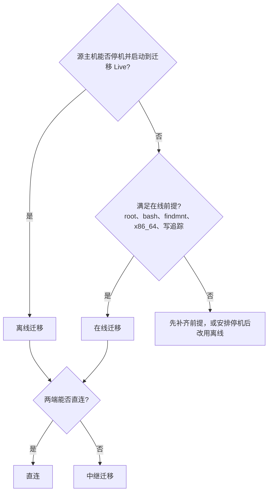
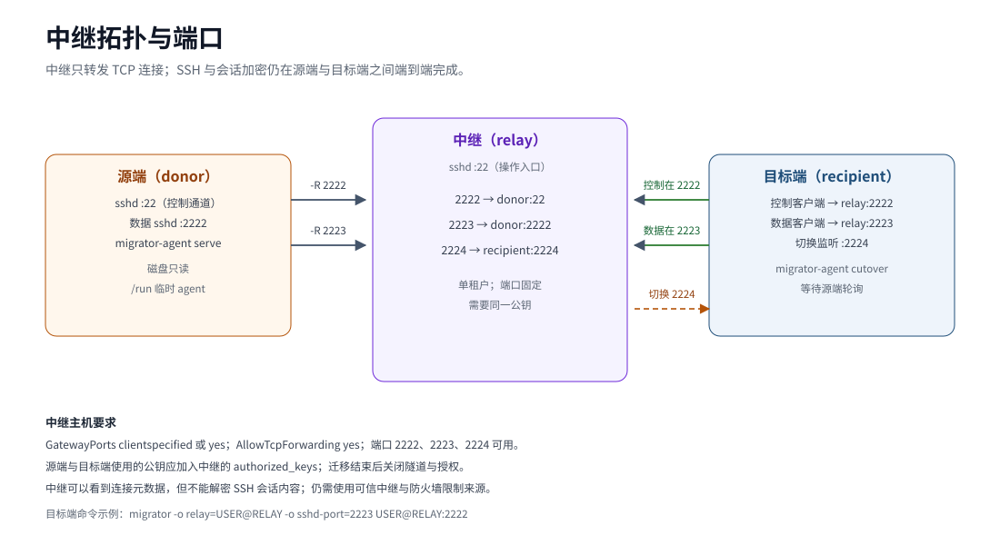

# 快速开始

本页给出三种典型场景的最小操作步骤：在线迁移、离线迁移与中继迁移。所有命令均在目标主机的迁移 Live 中执行。

## 通用前提

1. 目标主机已启动到完整迁移 Live，并以 root 登录。
2. 源主机可通过 SSH 以 root 登录。建议准备专用密钥：

```sh
ssh-keygen -t ed25519 -N '' -f /root/migrator-key
```

将该公钥加入源主机 root 的 `authorized_keys`。也可使用 SSH agent 转发，或在交互终端中输入密码。

3. 确认目标磁盘未被挂载、没有需要保留的数据。工具会再次要求确认磁盘名称与容量。
4. 确认源端与目标端网络可达。中继场景另见下文。

`-y` 表示不进行人工确认。首次使用建议不加 `-y`，以便在写入目标盘前检查提示。

## 先检查，再执行

无法确定本机能否完成一次迁移时，先运行检查脚本。脚本为单个文件，一条命令即可执行。检查过程不挂载磁盘，不写入磁盘，不修改网络配置，也不安装软件包。

```sh
sh -c "$(curl -fsSL https://gitee.com/tktogether/migrator/raw/master/tools/preflight.sh)"
sh -c "$(curl -fsSL https://cdn.jsdelivr.net/gh/tktogether/migrator@master/tools/preflight.sh)"
```

两个地址指向同一份文件，使用其中可访问的一个。源端地址可以省略。脚本先读取 `/run/migrator/state` 中上次连接的主机。该文件不存在时，只检查本机。脚本不扫描网段。首次运行时，目标端没有源端的密钥，扫描无法得到可用地址。

每项输出一行，结果分为 `PASS`、`WARN`、`FAIL` 三档。末尾给出汇总与下一步命令。`WARN` 不阻止继续，但相关步骤可能变慢或不可用。`FAIL` 使本次迁移失败，退出码为 1。脚本同时打印补齐缺失软件包的 `apt-get install` 命令。

检查目标磁盘时，正被当前运行的系统占用的磁盘会单独列出。进入迁移 Live 后，该磁盘即可作为目标盘。

目标盘是迁移后承接新系统并从它启动的磁盘，通常就是机器原有的系统盘位。脚本只能判断磁盘此刻是否被占用，不能判断它在硬件中的角色。

三个开关：

| 开关 | 作用 |
|---|---|
| `--go` | 没有 FAIL 时进入迁移向导，源端地址已填入 |
| `--fix` | 安装缺失的软件包。安装后脚本退出，需重新运行以确认结果 |
| `--check` | 仅检查：安装工具后也不进入向导，供脚本调用 |

使用 `--go` 时，采用上文的 `sh -c ...` 形式。`curl ... | sh` 形式下，标准输入由脚本本身占用，向导无法读取键盘输入。

### 输出格式

在交互终端上运行时，脚本输出标志块与颜色。网络检查进行期间显示旋转指示。输出被重定向或经管道传给其他程序时，脚本只输出纯文本。`TERM` 为 `dumb` 时同样如此。纯文本模式不输出颜色、标志块与动画，边框使用 ASCII 字符，宽度固定。每一行仍是完整的句子。判断与退出码不受输出方式影响。

| 开关 | 作用 |
|---|---|
| `--plain` | 纯文本输出，用于日志与逐行比对 |
| `--no-color` | 不输出颜色。与设置环境变量 `NO_COLOR` 相同 |
| `--color` | 输出颜色。输出不是终端时默认关闭，该选项将其打开 |

`--color` 只影响颜色。输出不是终端时，标志块与动画仍然关闭。

日志中需要保留检查结果时，用 `--plain` 并重定向：

```sh
sh -c "$(curl -fsSL https://gitee.com/tktogether/migrator/raw/master/tools/preflight.sh)" --plain > preflight.log 2>&1
```

需要由脚本选择源并在多个源之间回落时，使用安装脚本的检查模式，结果相同：

```sh
curl -fsSL https://cdn.jsdelivr.net/gh/tktogether/migrator@master/tools/get.sh | sh -s -- --check
```

## 用一条命令安装

工具本身也可用一条命令安装。源码托管在 GitHub，三个源按顺序回落。中国大陆境内通常使用 Gitee。

```sh
curl -fsSL https://cdn.jsdelivr.net/gh/tktogether/migrator@master/tools/get.sh | sh
```

## 交互式运行

在带终端的机器上，不带参数运行 `migrator`。程序逐项询问以下内容：源端地址、在线或离线、目标磁盘、压缩方式、完成后源端的操作、是否试启动。目标磁盘列表包含本机全部磁盘，并标记当前运行系统所在的磁盘。

回答完毕后，程序先打印等价的完整命令，再打印一份可保存的参数文件。确认后开始执行。迁移计划仍然打印，目标磁盘名称仍需手工输入。问答只省略参数记忆，不省略确认步骤。

## 参数式运行

将问答打印的参数文件保存后，可用 `-f` 读取：

```sh
migrator -f migrate.conf
```

文件一行一个 `key=value`，`#` 开头是注释：

```ini
donor=root@192.168.1.111
disk=/dev/sda
mode=online
compress=zstd:3
```

除 `donor`、`disk`、`step`、`key`、`yes`、`dry` 六行外，每一行都当作 `-o` 的键。命令行参数覆盖文件中的值。更换目标磁盘时，只需覆盖 `disk`：

```sh
migrator -f migrate.conf -d /dev/sdb
```

键名写错会在开始前报错，并给出最接近的正确写法，不会被静默忽略。

## 选择场景



## 场景一：在线迁移

适用条件：源主机继续运行原系统，且满足以下要求：

- root 权限；
- bash 与 findmnt 可用；
- x86_64 架构；
- 内核支持 eBPF 写追踪，或支持 ftrace 回退（最老到 CentOS 7 的 3.10）。

在目标主机执行：

```sh
DONOR=root@10.0.0.12
migrator -y -i /root/migrator-key -d /dev/sda "$DONOR"
```

工具会自动完成：

1. 连接源端并识别为在线模式；
2. 采集两端清单并生成计划；
3. 检查计划；
4. 写入目标盘；
5. 首轮全量复制与多轮增量；
6. 冻结源端文件系统，完成末轮增量，并在目标端执行预检（默认开启）；
7. 修补目标系统；
8. 验证；
9. 切换源端并启动目标端。

若不使用 `-y`，工具会在清空目标盘前要求输入磁盘名称与容量，并在切换前再次确认。

### 在线迁移的计划审核流程

需要逐阶段审核时，可分开执行：

```sh
DONOR=root@10.0.0.12
migrator -s plan "$DONOR"
cp /run/migrator/plan /root/plan.review
vi /run/migrator/plan
migrator -s check
migrator -s apply
migrator -s transfer
migrator -s postfix
migrator -s verify
migrator -s cutover
```

注意事项：

- `transfer` 完成后源端处于冻结状态。应尽快执行 `postfix`、`verify` 与 `cutover`，不要在冻结状态下长时间停留。
- 如需放弃本次迁移，执行 `migrator -o cutover=rollback -s cutover` 解冻源端。源端解冻后继续运行，目标端的副本保留。
- 冻结期间不能通过 SSH 登录源端。登录会在 PAM 写入日志时阻塞。
- 若目标端轮询进程在 1800 秒内未联系源端，源端会自动解冻。

## 场景二：离线迁移

适用条件：源主机可以停止服务，并启动到与目标端相同的迁移 Live。

1. 将源主机启动到迁移 Live。确认存在标记文件：

```sh
test -r /etc/migrator-live-release && echo live
```

2. 在目标主机执行与在线模式相同的命令：

```sh
DONOR=root@10.0.0.12
migrator -y -i /root/migrator-key -d /dev/sda "$DONOR"
```

工具通过源端是否存在 `/etc/migrator-live-release` 判定为离线模式。每个卷只复制一次，不进行多轮增量，也不执行冻结。

离线模式的停机时间等于从源主机离开原系统到目标系统启动完成的时间。数据传输期间源主机不提供服务。

### 强制指定模式

若自动判定不符合预期，可显式指定：

```sh
migrator -o mode=online "$DONOR"
migrator -o mode=offline "$DONOR"
```

指定模式与源端实际状态不一致时，工具会拒绝执行并说明原因。

## 场景三：中继迁移

适用条件：源端与目标端不能互相访问，但都能访问第三台中继主机。



中继主机需满足：

- 运行 sshd；
- 配置 `GatewayPorts clientspecified` 或 `yes`；
- 配置 `AllowTcpForwarding yes`；
- root 的 `authorized_keys` 包含本次迁移使用的公钥。

在源主机上启动反向隧道：

```sh
/usr/local/sbin/relay-tunnel.sh -i /root/migrator-key root@relay.example
```

该命令建立：

- `relay:2222` → `donor:22`（控制通道）；
- `relay:2223` → `donor:2222`（数据通道）。

在目标主机执行：

```sh
DONOR=root@relay.example:2222
migrator -y -i /root/migrator-key \
  -o relay=root@relay.example \
  -o sshd-port=2223 \
  "$DONOR"
```

`-o relay=` 让目标端通过中继反向转发在线模式的切换轮询端口。默认映射为 `relay:2224` 到目标端 `2224`。中继主机的 SSH 端口不是 22 时，在 `relay=` 中写明端口。例如 `-o relay=root@relay.example:2222`。

中继实现为单租户模型，端口固定为 2222、2223、2224。多租户部署需要另行规划端口与隔离。

## 迁移后的检查

切换完成后，目标主机启动进入迁移后的系统。应确认：

- 主机名与预期一致；
- 网络接口已启动并获得预期地址；
- 关键服务处于 `active`；
- 业务数据可读，校验和或抽样检查通过；
- 计划中列出的手动后续事项已处理；
- 原源主机已离线，不会与新主机同时使用同一 IP。

验证阶段会在目标系统中写入迁移记录：

- `/etc/migrator-migrated`：迁移完成标记；
- `/root/migrator-<日期>/`：计划、日志、状态与清单副本。

目标系统的 `/var/lib/migrator/orig/` 保留被修改配置文件的原始版本。

## 运行状态与日志

| 路径 | 内容 |
|---|---|
| `/run/migrator/log` | 完整执行日志 |
| `/run/migrator/plan` | 当前计划 |
| `/run/migrator/state` | 阶段与卷状态 |
| `/run/migrator/failure` | 失败原因、阶段与退出码 |
| `/run/migrator/summary` | 验证摘要 |
| `/run/migrator/verify.log` | 验证明细 |

`/run` 是内存文件系统，重启后内容丢失。需要保留时，在重启前复制到持久存储。

长阶段在 tmux 会话 `migrator` 中运行，SSH 断线不会终止传输。重新连接后执行：

```sh
migrator -s attach
```

## 相关文档

- [迁移模式](04-modes.md)
- [阶段与执行流程](05-stages.md)
- [选项参考](06-options.md)
- [验证与验收](10-verify-and-acceptance.md)
