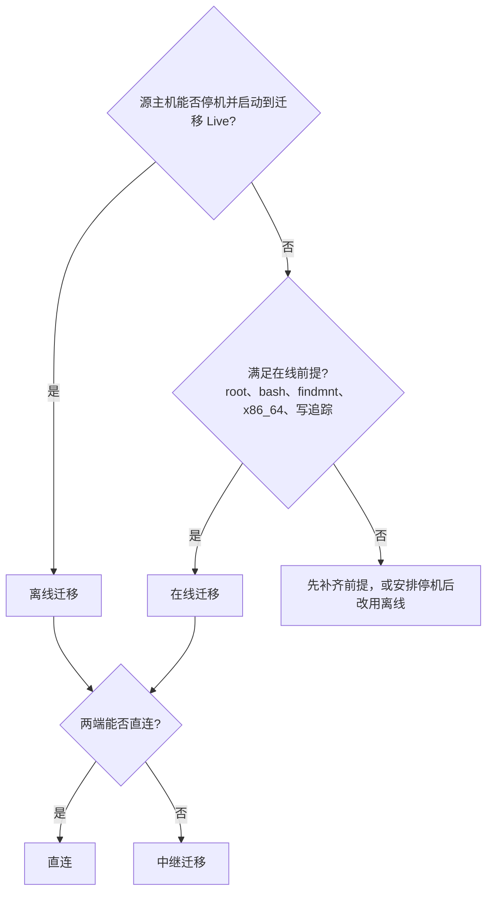

# 快速开始

本页按执行顺序说明一次迁移，从进入迁移 Live 开始，到新系统启动为止。每一步都注明在哪台机器上执行，以及这一步结束后应当看到什么。只走一遍最短路径时，使用仓库根目录 `README.md` 的三步；本页补充每一步的条件、判断依据与替代做法。

三种迁移场景在第 4 步分开。第一次使用建议先读[产品概览](01-overview.md)。

## 机器与角色

| 角色 | 用途 | 需要准备 |
|---|---|---|
| 源主机 | 要迁走的那台机器 | root 的 SSH 访问；离线模式下还需从同一份迁移 Live 引导 |
| 目标主机 | 承接迁移结果，迁移命令在这里执行 | 能从迁移 Live 引导，并能用私钥 SSH 登录 |

一次迁移只涉及这两台机器。迁移 Live 在目标主机上就地构建，不需要第三台机器。

## 第 0 步 进入迁移 Live（目标主机）

迁移命令只在迁移 Live 中执行。`apply` 会清空目标盘、重建分区并格式化，在运行中的系统上执行会破坏该系统。执行顺序因此固定为：先把目标主机引导进迁移 Live，再在其中执行迁移。

在目标主机上以 root 执行一条命令：

```sh
curl -fsSL https://gitee.com/tktogether/migrator/raw/master/tools/live-boot.sh | bash
```

脚本分三段：预检、构建、引导。预检之后问两项设置，再确认一次；构建完成后打印登录信息，再确认一次。

| 段 | 做什么 | 停在哪里 |
|---|---|---|
| 预检 | 只读检查，逐项打印结果 | 有未通过项时停止，本机没有任何改动 |
| 设置 | 询问登录方式与端口，取不到地址时补问 | 直接回车取默认值 |
| 构建 | 安装依赖、取得源码树、编译 agent、构建迁移 Live | 构建完成后打印登录信息并停下 |
| 引导 | 写入 GRUB 引导项并设为默认，然后重启 | 写入之前再询问一次 |

### 预检

第一处停顿在预检之后：先问答设置，再确认是否开始。预检表格与 `tools/preflight.sh` 同一形态，每项一行，取值为 PASS、WARN 或 FAIL。

| 检查项 | 判据 |
|---|---|
| 运行身份 | 当前用户为 root |
| 当前系统 | 本机不在迁移 Live 中。已经在 Live 中时不需要再次构建 |
| 发行版 | Debian 或 Ubuntu 及其衍生发行版 |
| 架构 | x86_64 |
| 内存 | 不少于 1536 MiB。少于 2048 MiB 时提醒，切换前不要运行其他占用内存的程序 |
| 放置位置 | 存在可放置引导文件的非 LVM 分区，且该分区有 3 GiB 可用空间 |
| 已有产物 | 产物目录中是否已有上一次构建的产物，以及引导要用的五项是否齐备。齐备时可以直接使用，跳过构建 |
| 产物空间 | 默认产物目录 `/var/tmp/migrator-live` 所在分区可用空间足够。与放置位置在同一分区时按两份计算 |
| 构建依赖 | 构建后端与 `squashfs-tools`、`make`、`gcc`、`ssh-keygen`、`openssl`、`libzstd-dev` 是否齐备。缺少的确认后自动安装；后端有 `mmdebstrap` 就用它，否则用 `debootstrap`，两者产物相同 |
| 源码树 | 用 `-s` 指定的源码树可用，或镜像地址可访问 |
| 网络参数 | 能从本机推出 Live 使用的静态地址、网关与 DNS。推不出时不拦下整次执行，改在设置段补问 |
| 引导 | 本机使用 GRUB，且能执行 `update-grub` |

WARN 不阻止执行，FAIL 会。有 FAIL 时脚本打印合计后停止，退出码为 2，本机没有改动。

只看预检、什么都不做：

```sh
curl -fsSL https://gitee.com/tktogether/migrator/raw/master/tools/live-boot.sh | bash -s -- -n
```

`-n` 不提问：它打印执行时会用到的取值，并说明执行时会问哪几项。

### 设置

预检只判断这台机器能不能做，具体取值在这里定。问几项取决于产物目录，每一问都可以直接回车取默认值：

| 问项 | 出现条件 | 取值 |
|---|---|---|
| 上一次的产物 | 产物目录中有上一次构建 | 1 直接使用（默认）2 重新构建，保留现有产物 3 重新构建，替换现有产物 |
| 私钥 | 重新构建，且已有私钥 | 1 继续使用现有私钥（默认）2 重新生成私钥 |
| 登录方式 | 重新构建 | 1 只用私钥（默认）2 私钥加密码 |
| 端口 | 始终询问 | 1 随机选取 2 22 3 指定 |
| 地址 | 预检不能确定地址 | 格式 `IP/前缀,网关,DNS`，无默认值 |

- **上一次的产物**。默认直接使用，跳过构建，省去十几分钟。现有产物不完整（缺少引导文件或私钥）时不给这一项；可用空间不足以同时保存两份时不给「保留」。后两种情形的取值由预检的「已有产物」与「产物空间」两行给出。
- **私钥**。继续使用时，上一次构建打印的私钥对新的镜像有效，因为 `rig/build-live.sh` 发现密钥已经存在就使用它。重新生成时，旧私钥对新镜像无效，需要重新保存。
- **登录方式**。默认只接受私钥。选第二项时为 root 生成 20 位随机密码并允许密码登录，密码与私钥一起在构建结束时打印。问答里不提供手打密码：这里没有回显与二次确认，敲错一个字符就进不去。使用现有产物时不问这一项，密码在构建时写入镜像。
- **端口**。默认 22；已经选过密码登录时默认随机，因为 22 是常规扫描的第一站。选第三项可以输入一个具体端口，直接回车则退回随机。
- **地址**。预检不能确定本机地址时，在其他问项之前要求输入。

问答之后打印取值，例如 `本次：只接受私钥，sshd 监听 22`，需要时再补一行现有产物的处置与私钥的取舍。这是改动本机之前最后一次核对的时机。

选择「重新构建并替换」时，开始之前的那次确认写明替换的对象，例如 `开始执行，替换 /var/tmp/migrator-live 中的现有产物 [y/N]`。回答 N，脚本结束，本机没有任何改动。选择保留时，现有产物的目录在原名称后加时间戳改名，新的产物写入原路径。

命令行给了的取值不再追问：`-p` 跳过端口，`-P` 跳过登录方式，`-i` 跳过地址，`-b` 与 `-k` 跳过现有产物的处置，`-r` 跳过私钥。`-y` 不提问也不确认，一律取默认值：产物目录中有完整的现有产物时直接使用，否则重新构建并替换；给了 `-b`、`-k`、`-r` 或 `-P` 时改为重新构建，因为这四者都要求重新构建才成立。若地址推不出来，脚本会以退出码 2 结束并提示加 `-i`。

### 第二处停顿

构建完成后，脚本先打印私钥，再询问是否写入引导项并重启。写入引导项会改变下次开机的去处，因此这一步单独确认。

此时回答否，本机仍从当前系统启动，分区与数据都没有改动，构建产物保留在 `/var/tmp/migrator-live`。日后要继续，执行：

```sh
bash /var/tmp/migrator-live/live-entry.sh -s -f /var/tmp/migrator-live -i <地址> -p <端口>
```

确认无误并希望无人值守执行时，用 `-y` 一并跳过两项设置与两处确认。`-y` 会一直执行到写入引导项并重启。

构建使用本机当前运行的系统，产物随后从内存运行，因此构建它的系统被替换不影响结果。主要耗时在下载与解压基础系统。根文件系统位于 LVM 时，预检的「放置位置」为 FAIL，处理方式见[安装](02-install.md)第 5 节。

### 端口与密码

默认只接受私钥，端口 22。两个取值都可以在设置段回答，也可以用参数直接给，用了参数就不再问：

```sh
curl -fsSL https://gitee.com/tktogether/migrator/raw/master/tools/live-boot.sh | bash -s -- -p 46496 -P random
```

| 参数 | 取值 | 作用 |
|---|---|---|
| `-p PORT` | 1 至 65535 之间的数字，或 `random` | sshd 监听的端口。写 `random` 时在构建阶段从 20000 至 60000 之间选取 |
| `-P PASS` | 一个字面值，或 `random` | 为 root 设置密码并允许密码登录。写 `random` 时生成 20 位随机密码 |

开启密码登录后，`ssh -p 46496 root@192.168.1.50` 即可进入，不需要私钥。

三点需要说明：

- 端口通过引导参数 `migrator.ssh_port=` 传给 Live，本机的任何用户都能从 `/proc/cmdline` 读到这一行。它的作用是减少被扫描命中的次数，不是访问控制。
- 密码写入镜像，该镜像构建出的每台机器共用同一个密码。它提供访问，不提供保密。只在可信网络中使用，或在使用后重新构建。
- 两者都在构建时确定，改动需要重新构建。构建完成后脚本打印端口与密码，与私钥一并交给你。

改动端口后，用普通方式登录的命令也要带上 `-p`。密码登录开启时，密码比私钥更容易在传输途中被记录，长期使用的机器仍以私钥为主。

### 重启之前：保存登录信息

脚本在重启之前打印地址、端口、密码与私钥的路径和内容。目标盘随后会被整体替换，保存在这台机器上的副本不会留下，因此需要复制到其他设备或终端记录中：

```sh
ssh -i ~/.ssh/migrator-live -p 22 root@192.168.1.50
```

私钥丢失后无法登录迁移 Live。在有控制台的机器上，可以在 GRUB 菜单中选回原系统，重新执行第 0 步得到新的一份。没有控制台时只能重新引导，因此保存这一步不能跳过。开启了密码登录时，密码是私钥丢失后的第二条路，同样需要保存。

### 重启之后：确认已进入 Live

| 命令 | 期望结果 |
|---|---|
| `cat /etc/migrator-live-release` | 输出构建编号 |
| `migrator -V` | 输出工具版本 |
| `swapon --show` | 列出 zram 交换区 |
| `findmnt -S /dev/sda` | 没有输出，目标盘未被挂载 |

最后一条有输出时不要继续：目标盘仍被挂载，`apply` 会擦除正在运行的 Live 自身。`migrator: command not found` 说明镜像中没有工具，见第 1 步。

目标盘是迁移后承接新系统并从它启动的那块磁盘。迁移 Live 从内存运行，引导参数 `toram` 使引导介质与磁盘都不再被占用；不要为省内存去掉它，内存不足时改用内存更大的机器。

### 其他进入方式

上一条命令是默认路径。下列情形改用其他方式，构建参数与全部开关见[安装](02-install.md)第 5 节，约束及其原因见[迁移 Live 构建](maintainers/live-build.md)。

| 情形 | 做法 |
|---|---|
| 已有 ISO，且能插 U 盘或挂光驱 | `dd` 写入 U 盘后从 U 盘引导。UEFI 固件需开启 CSM 或 legacy 支持 |
| 已有其他机器构建好的三件产物 | 把产物放到目标机，执行 `tools/live-entry.sh -i <地址> -s`。加 `-p <端口>` 可在引导时改变端口 |
| 想从构建机远程完成，不在目标机上操作 | `tools/live-cycle.sh -H root@<目标机> -S root@<构建机>:<产物目录>`。端口不变时需要传入 `-p <端口>`，否则等待会一直落在 22 上 |
| 云主机没有控制台，也不想重启固件 | `tools/live-kexec.sh -u <产物地址>`，保留原 IP，不经过 GRUB |
| 需要自己控制构建参数 | `git clone` 后执行 `rig/build-live.sh`，见[安装](02-install.md)第 5 节 |

网络没有 DHCP 时，上述方式都要给出静态地址，格式为 `IP/前缀,网关,DNS`，例如 `192.168.1.50/24,192.168.1.1,114.114.114.114`。离线模式下源主机使用同一份产物引导，两端的构建编号需要一致。

## 第 1 步 安装工具（目标主机，可选）

自建镜像已包含 `migrator`，可跳过这一步。需要安装时，在 Live 内执行：

```sh
curl -fsSL https://gitee.com/tktogether/migrator/raw/master/tools/get.sh | sh
```

也可从随身介质安装：

```sh
MIGRATOR_URL=file:///run/media/usb/migrator sh /path/to/install.sh
```

安装到 `/usr/local/sbin` 与 `/usr/local/lib/migrator`。Live 的根文件系统在内存中，重启后安装内容丢失，每次启动后都要重新安装。

## 第 2 步 准备源端访问（源主机与目标主机）

1. 在目标主机的 Live 中生成密钥：

```sh
ssh-keygen -t ed25519 -N '' -f /root/migrator-key
```

2. 把公钥加入源主机 root 的 `authorized_keys`：

```sh
ssh-copy-id -i /root/migrator-key.pub root@10.0.0.12
```

3. 确认可以免密登录：

```sh
ssh -i /root/migrator-key root@10.0.0.12 true && echo ok
```

也可使用 SSH agent 转发，或在交互终端中输入密码；非交互执行需要密钥。

离线模式另有一步：源主机也引导到迁移 Live，使用与目标端相同的产物，见第 0 步。两端构建编号不一致时会被拒绝。

## 第 3 步 体检（目标主机）

无法确定本机能否完成一次迁移时，先运行检查脚本。脚本为单个文件，一条命令即可执行。检查过程不挂载磁盘，不写入磁盘，不修改网络配置，也不安装软件包。

```sh
sh -c "$(curl -fsSL https://gitee.com/tktogether/migrator/raw/master/tools/preflight.sh)"
sh -c "$(curl -fsSL https://cdn.jsdelivr.net/gh/tktogether/migrator@master/tools/preflight.sh)"
```

两个地址指向同一份文件，使用其中可访问的一个。源端地址可以省略。脚本先读取 `/run/migrator/state` 中上次连接的主机。该文件不存在时，只检查本机。脚本不扫描网段。首次运行时，目标端没有源端的密钥，扫描无法得到可用地址。

每项输出一行，结果分为 `PASS`、`WARN`、`FAIL` 三档。末尾给出汇总与下一步命令。`WARN` 不阻止继续，但相关步骤可能变慢或不可用。`FAIL` 使本次迁移失败，退出码为 1。脚本同时打印补齐缺失软件包的 `apt-get install` 命令。

检查目标磁盘时，正被当前运行的系统占用的磁盘会单独列出。进入迁移 Live 后，该磁盘即可作为目标盘。

目标盘是迁移后承接新系统并从它启动的磁盘，通常就是机器原有的系统盘位。脚本只能判断磁盘此刻是否被占用，不能判断它在硬件中的角色。

三个开关：

| 开关 | 作用 |
|---|---|
| `--go` | 没有 FAIL 时进入迁移向导，源端地址已填入 |
| `--fix` | 安装缺失的软件包。安装后脚本退出，需重新运行以确认结果 |
| `--check` | 仅检查：安装工具后也不进入向导，供脚本调用 |

使用 `--go` 时，采用上文的 `sh -c ...` 形式。`curl ... | sh` 形式下，标准输入由脚本本身占用，向导无法读取键盘输入。

### 输出格式

在交互终端上运行时，脚本输出标志块与颜色。网络检查进行期间显示旋转指示。输出被重定向或经管道传给其他程序时，脚本只输出纯文本。`TERM` 为 `dumb` 时同样如此。纯文本模式不输出颜色、标志块与动画，边框使用 ASCII 字符，宽度固定。每一行仍是完整的句子。判断与退出码不受输出方式影响。

| 开关 | 作用 |
|---|---|
| `--plain` | 纯文本输出，用于日志与逐行比对 |
| `--no-color` | 不输出颜色。与设置环境变量 `NO_COLOR` 相同 |
| `--color` | 输出颜色。输出不是终端时默认关闭，该选项将其打开 |

`--color` 只影响颜色。输出不是终端时，标志块与动画仍然关闭。

日志中需要保留检查结果时，用 `--plain` 并重定向：

```sh
sh -c "$(curl -fsSL https://gitee.com/tktogether/migrator/raw/master/tools/preflight.sh)" --plain > preflight.log 2>&1
```

需要由脚本选择源并在多个源之间回落时，使用安装脚本的检查模式，结果相同：

```sh
curl -fsSL https://gitee.com/tktogether/migrator/raw/master/tools/get.sh | sh -s -- --check
```

## 第 4 步 执行迁移（目标主机）

先按下列问题选择场景：



`-y` 表示不进行人工确认。首次使用建议不加 `-y`，以便在写入目标盘前检查提示。

### 场景一：在线迁移

适用条件：源主机继续运行原系统，且满足以下要求：

- root 权限；
- bash 与 findmnt 可用；
- x86_64 架构；
- 内核支持 eBPF 写追踪，或支持 ftrace 回退（最老到 CentOS 7 的 3.10）。

在目标主机执行：

```sh
DONOR=root@10.0.0.12
migrator -y -i /root/migrator-key -d /dev/sda "$DONOR"
```

工具会自动完成：

1. 连接源端并识别为在线模式；
2. 采集两端清单并生成计划；
3. 检查计划；
4. 写入目标盘；
5. 首轮全量复制与多轮增量；
6. 冻结源端文件系统，完成末轮增量，并在目标端执行预检（默认开启）；
7. 修补目标系统；
8. 验证；
9. 切换源端并启动目标端。

若不使用 `-y`，工具会在清空目标盘前要求输入磁盘名称与容量，并在切换前再次确认。

#### 在线迁移的计划审核流程

需要逐阶段审核时，可分开执行：

```sh
DONOR=root@10.0.0.12
migrator -s plan "$DONOR"
cp /run/migrator/plan /root/plan.review
vi /run/migrator/plan
migrator -s check
migrator -s apply
migrator -s transfer
migrator -s postfix
migrator -s verify
migrator -s cutover
```

注意事项：

- `transfer` 完成后源端处于冻结状态。应尽快执行 `postfix`、`verify` 与 `cutover`，不要在冻结状态下长时间停留。
- 如需放弃本次迁移，执行 `migrator -o cutover=rollback -s cutover` 解冻源端。源端解冻后继续运行，目标端的副本保留。
- 冻结期间不能通过 SSH 登录源端。登录会在 PAM 写入日志时阻塞。
- 若目标端轮询进程在 1800 秒内未联系源端，源端会自动解冻。

### 场景二：离线迁移

适用条件：源主机可以停止服务，并启动到与目标端相同的迁移 Live。

1. 将源主机启动到迁移 Live。确认存在标记文件：

```sh
test -r /etc/migrator-live-release && echo live
```

2. 在目标主机执行与在线模式相同的命令：

```sh
DONOR=root@10.0.0.12
migrator -y -i /root/migrator-key -d /dev/sda "$DONOR"
```

工具通过源端是否存在 `/etc/migrator-live-release` 判定为离线模式。每个卷只复制一次，不进行多轮增量，也不执行冻结。

离线模式的停机时间等于从源主机离开原系统到目标系统启动完成的时间。数据传输期间源主机不提供服务。

#### 强制指定模式

若自动判定不符合预期，可显式指定：

```sh
migrator -o mode=online "$DONOR"
migrator -o mode=offline "$DONOR"
```

指定模式与源端实际状态不一致时，工具会拒绝执行并说明原因。

### 场景三：中继迁移

适用条件：源端与目标端不能互相访问，但都能访问第三台中继主机。


中继主机需满足：

- 运行 sshd；
- 配置 `GatewayPorts clientspecified` 或 `yes`；
- 配置 `AllowTcpForwarding yes`；
- root 的 `authorized_keys` 包含本次迁移使用的公钥。

在源主机上启动反向隧道：

```sh
/usr/local/sbin/relay-tunnel.sh -i /root/migrator-key root@relay.example
```

该命令建立：

- `relay:2222` → `donor:22`（控制通道）；
- `relay:2223` → `donor:2222`（数据通道）。

在目标主机执行：

```sh
DONOR=root@relay.example:2222
migrator -y -i /root/migrator-key \
  -o relay=root@relay.example \
  -o sshd-port=2223 \
  "$DONOR"
```

`-o relay=` 让目标端通过中继反向转发在线模式的切换轮询端口。默认映射为 `relay:2224` 到目标端 `2224`。中继主机的 SSH 端口不是 22 时，在 `relay=` 中写明端口。例如 `-o relay=root@relay.example:2222`。

中继实现为单租户模型，端口固定为 2222、2223、2224。多租户部署需要另行规划端口与隔离。

## 第 5 步 切换与验收

切换完成后，目标主机启动进入迁移后的系统。应确认：

- 主机名与预期一致；
- 网络接口已启动并获得预期地址；
- 关键服务处于 `active`；
- 业务数据可读，校验和或抽样检查通过；
- 计划中列出的手动后续事项已处理；
- 原源主机已离线，不会与新主机同时使用同一 IP。

验证阶段会在目标系统中写入迁移记录：

- `/etc/migrator-migrated`：迁移完成标记；
- `/root/migrator-<日期>/`：计划、日志、状态与清单副本。

目标系统的 `/var/lib/migrator/orig/` 保留被修改配置文件的原始版本。

验收清单与回滚方式见[验证与验收](10-verify-and-acceptance.md)。

## 交互式运行与参数文件

在带终端的机器上，不带参数运行 `migrator`。程序逐项询问以下内容：源端地址、在线或离线、目标磁盘、压缩方式、完成后源端的操作、是否试启动。目标磁盘列表包含本机全部磁盘，并标记当前运行系统所在的磁盘。

回答完毕后，程序先打印等价的完整命令，再打印一份可保存的参数文件。确认后开始执行。迁移计划仍然打印，目标磁盘名称仍需手工输入。问答只省略参数记忆，不省略确认步骤。

将问答打印的参数文件保存后，可用 `-f` 读取：

```sh
migrator -f migrate.conf
```

文件一行一个 `key=value`，`#` 开头是注释：

```ini
donor=root@192.168.1.111
disk=/dev/sda
mode=online
compress=zstd:3
```

除 `donor`、`disk`、`step`、`key`、`yes`、`dry` 六行外，每一行都当作 `-o` 的键。命令行参数覆盖文件中的值。更换目标磁盘时，只需覆盖 `disk`：

```sh
migrator -f migrate.conf -d /dev/sdb
```

键名写错会在开始前报错，并给出最接近的正确写法，不会被静默忽略。

## 运行状态与日志

| 路径 | 内容 |
|---|---|
| `/run/migrator/log` | 完整执行日志 |
| `/run/migrator/plan` | 当前计划 |
| `/run/migrator/state` | 阶段与卷状态 |
| `/run/migrator/failure` | 失败原因、阶段与退出码 |
| `/run/migrator/summary` | 验证摘要 |
| `/run/migrator/verify.log` | 验证明细 |

`/run` 是内存文件系统，重启后内容丢失。需要保留时，在重启前复制到持久存储。

长阶段在 tmux 会话 `migrator` 中运行，SSH 断线不会终止传输。重新连接后执行：

```sh
migrator -s attach
```

## 相关文档

- [迁移模式](04-modes.md)
- [阶段与执行流程](05-stages.md)
- [选项参考](06-options.md)
- [验证与验收](10-verify-and-acceptance.md)
- [迁移 Live 构建](maintainers/live-build.md)
