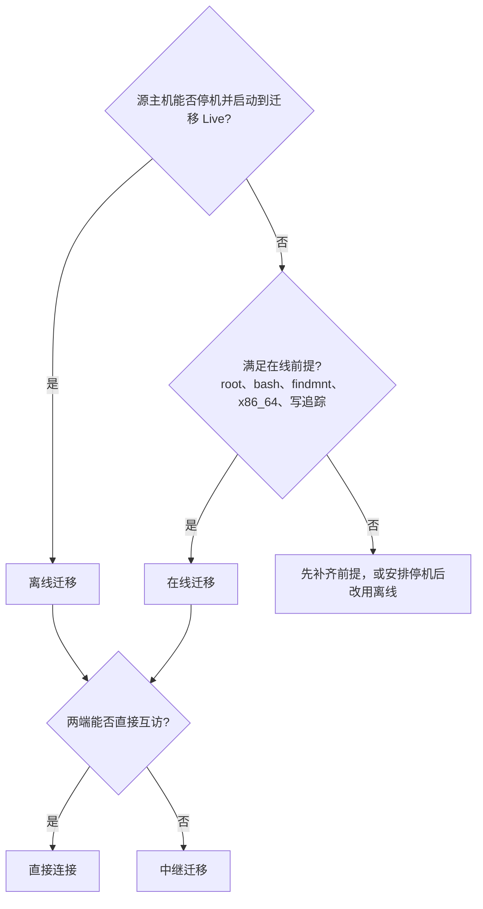

# 快速开始

本页给出三种典型场景的最小操作步骤：在线迁移、离线迁移与中继迁移。所有命令均在目标主机的迁移 Live 中执行。

## 通用前提

1. 目标主机已启动到完整迁移 Live，并以 root 登录。
2. 源主机可通过 SSH 以 root 登录。建议准备专用密钥：

```sh
ssh-keygen -t ed25519 -N '' -f /root/migrator-key
```

将该公钥加入源主机 root 的 `authorized_keys`。也可使用 SSH agent 转发，或在交互终端中输入密码。

3. 确认目标磁盘未被挂载、没有需要保留的数据。工具会再次要求确认磁盘名称与容量。
4. 确认源端与目标端网络可达。中继场景另见下文。

`-y` 表示不进行人工确认。首次使用建议不加 `-y`，以便在写入目标盘前检查提示。

## 先探测，再动手

不确定这台机器能不能跑完一次迁移时，先探测。它只有一个文件，一条命令，**不安装任何东西**：不挂载、不写盘、不改网络、不装包。

```sh
sh -c "$(curl -fsSL https://gitee.com/tktogether/migrator/raw/master/tools/preflight.sh)"
sh -c "$(curl -fsSL https://cdn.jsdelivr.net/gh/tktogether/migrator@master/tools/preflight.sh)"
```

两个地址是同一份文件，哪个能通就用哪个。源机地址可以不给：脚本先看 `/run/migrator/state` 里上次连过的那台，没有就只查本机。它不扫描网段——第一次运行时收端还没有源机的密钥，扫也扫不出来，而地址本来就在操作者手上。

每项一行，结果分 `PASS`、`WARN`、`FAIL` 三档，末尾汇总，并给出下一步那一行。`WARN` 不挡路但会让某一步变慢或不可用，`FAIL` 会让这次迁移直接失败，此时退出码为 1，并打印补齐缺包的 `apt-get install` 命令。

三个开关：

| 开关 | 作用 |
|---|---|
| `--go` | 没有 FAIL 就直接进迁移向导（源机已填好，其余照问） |
| `--fix` | 把缺的包装上，然后重跑一次 |
| `--check` | 明确「只检查」：装了工具也不进向导，供脚本调用 |

要 `--go` 请用上面 `sh -c "$(curl ...)"` 的写法。写成 `curl ... | sh` 时标准输入被脚本本身占用，向导读不到键盘。

希望由脚本自己选源、并且从多个镜像回落时，用安装脚本的检查模式，效果相同：

```sh
curl -fsSL https://cdn.jsdelivr.net/gh/tktogether/migrator@master/get.sh | sh -s -- --check
```

## 一条命令安装

工具本身也可以一条命令安装。源码在 GitHub，三个镜像按顺序自动回落，国内网络通常走 Gitee：

```sh
curl -fsSL https://cdn.jsdelivr.net/gh/tktogether/migrator@1.2/get.sh | sh
```

## 交互式运行

不带参数、在有终端的机器上运行 `migrator`，它逐项提问：源机地址、在线还是离线、目标磁盘（列出本机所有磁盘，并标出正在运行的那一块）、压缩、完成后源机做什么、要不要先试启动。

答完先打印等价的完整命令，再打印一份可保存的参数文件，确认后才开始。计划照旧打印，目标盘照旧要手打一遍：问答只省掉记参数，不跳过任何确认。

## 参数式运行

把问答打印出来的内容存成文件，之后直接读文件：

```sh
migrator -f migrate.conf
```

文件一行一个 `key=value`，`#` 开头是注释：

```ini
donor=root@192.168.1.111
disk=/dev/sda
mode=online
compress=zstd:3
```

除 `donor`、`disk`、`step`、`key`、`yes`、`dry` 六行外，每一行都当作 `-o` 的键。命令行参数覆盖文件，所以"同一套设置、换一块盘"只改一个参数：

```sh
migrator -f migrate.conf -d /dev/sdb
```

键名写错会在开始前报错，并给出最接近的正确写法，不会被静默忽略。

## 选择场景



## 场景一：在线迁移

适用条件：源主机继续运行原系统，且满足以下要求：

- root 权限；
- bash 与 findmnt 可用；
- x86_64 架构；
- 内核支持 eBPF 写追踪，或支持 ftrace 回退（最老到 CentOS 7 的 3.10）。

在目标主机执行：

```sh
DONOR=root@10.0.0.12
migrator -y -i /root/migrator-key -d /dev/sda "$DONOR"
```

工具会自动完成：

1. 连接源端并识别为在线模式；
2. 采集两端清单并生成计划；
3. 检查计划；
4. 写入目标盘；
5. 首轮全量复制与多轮增量；
6. 冻结源端文件系统，完成末轮增量，并在目标端执行预检（默认开启）；
7. 修补目标系统；
8. 验证；
9. 切换源端并启动目标端。

若不使用 `-y`，工具会在清空目标盘前要求输入磁盘名称与容量，并在切换前再次确认。

### 在线迁移的计划审核流程

需要逐阶段审核时，可分开执行：

```sh
DONOR=root@10.0.0.12
migrator -s plan "$DONOR"
cp /run/migrator/plan /root/plan.review
vi /run/migrator/plan
migrator -s check
migrator -s apply
migrator -s transfer
migrator -s postfix
migrator -s verify
migrator -s cutover
```

注意事项：

- `transfer` 完成后源端处于冻结状态。应尽快执行 `postfix`、`verify` 与 `cutover`，不要在冻结状态下长时间停留。
- 如需放弃本次迁移，执行 `migrator -o cutover=rollback -s cutover` 解冻源端。源端解冻后继续运行，目标端的副本保留。
- 冻结期间不能通过 SSH 登录源端。登录会在 PAM 写入日志时阻塞。
- 若目标端轮询进程在 1800 秒内未联系源端，源端会自动解冻。

## 场景二：离线迁移

适用条件：源主机可以停止服务，并启动到与目标端相同的迁移 Live。

1. 将源主机启动到迁移 Live。确认存在标记文件：

```sh
test -r /etc/migrator-live-release && echo live
```

2. 在目标主机执行与在线模式相同的命令：

```sh
DONOR=root@10.0.0.12
migrator -y -i /root/migrator-key -d /dev/sda "$DONOR"
```

工具通过源端是否存在 `/etc/migrator-live-release` 判定为离线模式。每个卷只复制一次，不进行多轮增量，也不执行冻结。

离线模式的停机时间等于从源主机离开原系统到目标系统启动完成的时间。数据传输期间源主机不提供服务。

### 强制指定模式

若自动判定不符合预期，可显式指定：

```sh
migrator -o mode=online "$DONOR"
migrator -o mode=offline "$DONOR"
```

指定模式与源端实际状态不一致时，工具会拒绝执行并说明原因。

## 场景三：中继迁移

适用条件：源端与目标端不能直接互相访问，但都能访问第三台中继主机。


中继主机需满足：

- 运行 sshd；
- 配置 `GatewayPorts clientspecified` 或 `yes`；
- 配置 `AllowTcpForwarding yes`；
- root 的 `authorized_keys` 包含本次迁移使用的公钥。

在源主机上启动反向隧道：

```sh
/usr/local/sbin/relay-tunnel.sh -i /root/migrator-key root@relay.example
```

该命令建立：

- `relay:2222` → `donor:22`（控制通道）；
- `relay:2223` → `donor:2222`（数据通道）。

在目标主机执行：

```sh
DONOR=root@relay.example:2222
migrator -y -i /root/migrator-key \
  -o relay=root@relay.example \
  -o sshd-port=2223 \
  "$DONOR"
```

`-o relay=` 用于让目标端把在线模式的切换轮询端口通过中继反向转发（默认 `relay:2224` → 目标端 `2224`）。中继主机的 SSH 端口不是 22 时，在 `relay=` 中写明端口，例如 `-o relay=root@relay.example:2222`。

中继实现为单租户模型，端口固定为 2222、2223、2224。多租户部署需要另行规划端口与隔离。

## 迁移后的检查

切换完成后，目标主机启动进入迁移后的系统。应确认：

- 主机名与预期一致；
- 网络接口已启动并获得预期地址；
- 关键服务处于 `active`；
- 业务数据可读，校验和或抽样检查通过；
- 计划中列出的手动后续事项已处理；
- 原源主机已离线，不会与新主机同时使用同一 IP。

验证阶段会在目标系统中写入迁移记录：

- `/etc/migrator-migrated`：迁移完成标记；
- `/root/migrator-<日期>/`：计划、日志、状态与清单副本。

目标系统的 `/var/lib/migrator/orig/` 保留被修改配置文件的原始版本。

## 运行状态与日志

| 路径 | 内容 |
|---|---|
| `/run/migrator/log` | 完整执行日志 |
| `/run/migrator/plan` | 当前计划 |
| `/run/migrator/state` | 阶段与卷状态 |
| `/run/migrator/failure` | 失败原因、阶段与退出码 |
| `/run/migrator/summary` | 验证摘要 |
| `/run/migrator/verify.log` | 验证明细 |

`/run` 是内存文件系统，重启后内容丢失。需要保留时，在重启前复制到持久存储。

长阶段会自动在 tmux 会话 `migrator` 中运行，以免 SSH 断线终止传输。重新连接后执行：

```sh
migrator -s attach
```

## 相关文档

- [迁移模式](04-modes.md)
- [阶段与执行流程](05-stages.md)
- [选项参考](06-options.md)
- [验证与验收](10-verify-and-acceptance.md)
