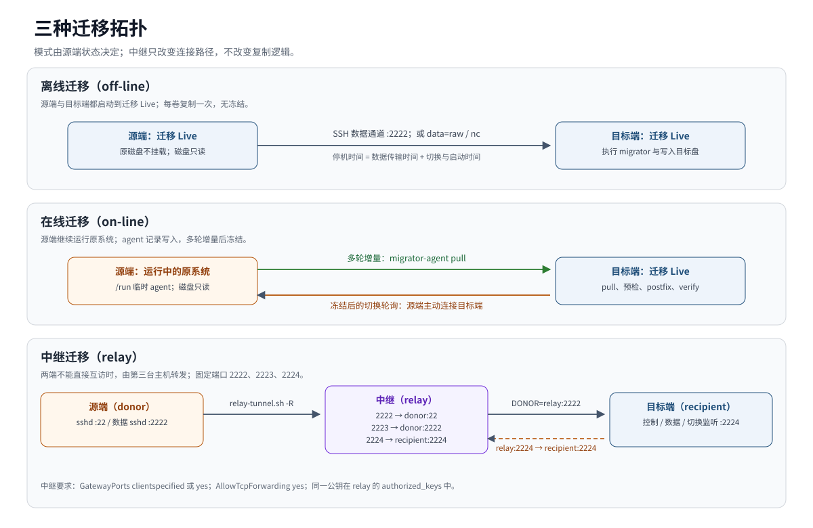
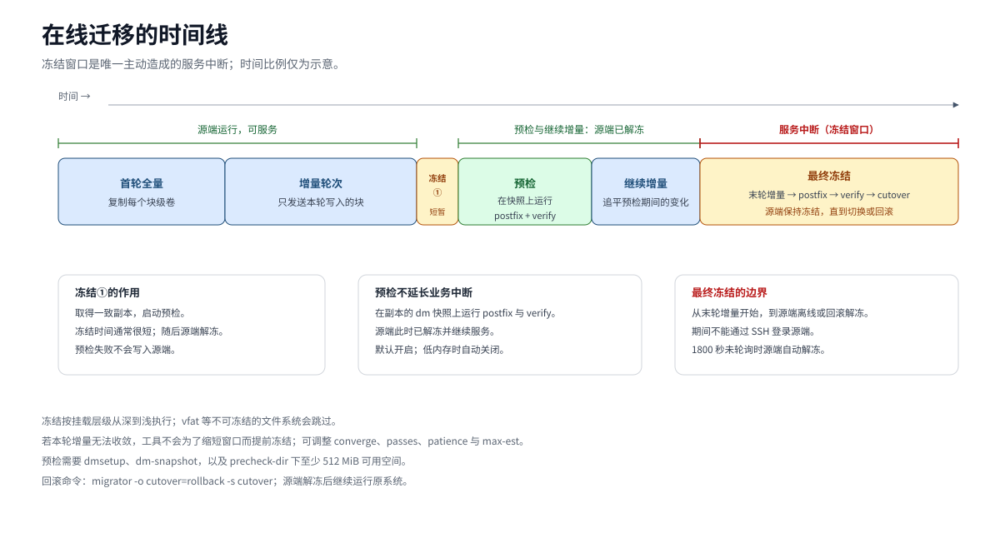

# 迁移模式

migrator 支持两种数据复制模式，以及一种用于受限网络的中继拓扑。



| 模式 | 源主机运行状态 | 数据复制 | 停机特征 | 主要前提 |
|---|---|---|---|---|
| 离线 | 迁移 Live | 每卷一次 | 从离开原系统到目标系统启动 | 两端均为完整 Live |
| 在线 | 原系统 | 全量 + 多轮增量 + 冻结末轮 | 仅冻结窗口内暂停写入 | 源端 root、bash、findmnt、写追踪能力 |
| 中继 | 取决于底层模式 | 取决于底层模式 | 取决于底层模式 | 第三台 sshd 可被两端访问 |

## 模式判定

连接源端后，工具检查 `/etc/migrator-live-release`：

- 存在：源端处于 Live，判定为离线模式；
- 不存在：源端运行原系统，判定为在线模式。

也可显式指定：

```sh
migrator -o mode=offline DONOR
migrator -o mode=online DONOR
```

指定值与实际状态不一致时，工具退出码为 2，并说明源端当前状态。模式判定结果写入 `/run/migrator/state` 的 `mode` 键，后续阶段据此选择迁移路径。

## 离线模式

### 前提

- 源端与目标端均启动到完整迁移 Live；
- 两端 Live 构建一致，运行时工具版本一致；
- 源端磁盘未挂载为运行中的系统。

### 过程

1. 采集两端清单；
2. 生成并检查计划；
3. 写入目标盘；
4. 按计划顺序逐卷复制，每个卷一次；
5. 在目标端执行文件系统检查与扩容；
6. 修补目标系统、验证、切换。

### 数据通道

默认使用源端第二个 sshd 实例，监听 2222 端口：

- 仅允许密钥认证；
- 每个卷建立独立连接；
- 使用 `aes128-gcm@openssh.com` 密码套件；
- 连接中断不会影响其它卷。

可使用 `-o data=raw` 改为 busybox `nc` 直连。该方式不加密，也没有额外完整性保护，只适用于可信局域网。

### 停机特征

离线模式不冻结文件系统，因为源端并未运行原系统。停机时间等于源端离开原系统到目标系统启动完成的时间，数据传输越慢，停机越长。

### 对源端的修改

源端运行的是 Live，其原磁盘不被挂载或写入。工具可能：

- 将源端 Live 的临时主机名改为 `source.migrator`；
- 在缺少运行时工具时通过 apt 安装到 Live 的内存文件系统；
- 在 `/run` 下写入状态与日志。

这些修改都位于 Live 的临时环境，不涉及源端原磁盘。

## 在线模式



### 前提

源端运行原系统，并满足：

- root 权限；
- bash；
- util-linux 的 findmnt；
- x86_64 架构；
- 内核可跟踪块设备写入：优先 eBPF，必要时使用 ftrace。

源端不需要安装 agent。目标端将静态 agent 上传到源端的 `/run/migrator` 临时目录。该目录以独立 tmpfs 挂载，权限为 0700，重启后消失。

### 过程

1. 采集源端清单时，读取的是运行中的文件系统；
2. 写入目标盘；
3. agent 对每个块级卷执行首轮全量复制；
4. 源端继续运行，agent 记录写入的块；
5. 按轮次只复制本轮变化；
6. 当估算的末轮增量可在收敛阈值内完成时，冻结源端文件系统；
7. 冻结后完成最后一轮块级增量与文件级增量；
8. 在副本的 dm 快照上执行预检（默认开启）；
9. 源端保持冻结并轮询目标端的切换端口；
10. 目标端完成 postfix、verify 与 cutover。

### 写追踪

agent 以固定大小的块为单位维护位图，默认块大小为 64 KiB。位图记录自上一轮以来发生写入的块。支持两种实现：

- **eBPF**：在块设备提交路径上记录写入，开销低；
- **ftrace**：在缺少 BPF 支持的内核上使用，兼容到较老的内核。

`-o tracker=auto` 为默认值，由 agent 选择可用实现；也可固定为 `bpf` 或 `ftrace`。

### 冻结窗口

冻结窗口是工具唯一主动造成的服务中断。冻结操作按挂载层级从深到浅执行，对每个可冻结的文件系统调用 `fsfreeze`。冻结后：

- 写入暂停；
- 文件系统处于一致状态；
- 源端的 SSH 会话可能在 PAM 写入日志时阻塞，因此不应再通过 SSH 登录源端；
- 目标端完成末轮复制与预检后，通过轮询通道发送切换、关机或解冻命令。

冻结持续时间取决于末轮增量大小、链路速率和目标端写入速度，不应假定为固定值。工具通过以下参数控制收敛行为：

- `-o converge=`：估算剩余发送时间低于该值时进入冻结；
- `-o passes=`：最大增量轮数；
- `-o max-est=`：无法收敛但末轮估算低于该值时仍允许冻结；
- `-o patience=`：用于缩短冻结窗口的额外复制时间预算。

若本轮增量无法收敛，工具不会为了缩短窗口而提前冻结。

### 预检

在线模式在首轮冻结后，会对目标副本创建 dm 快照，并在快照上运行 postfix 与 verify。此时源端已解冻并继续服务，预检结果代表最终冻结后修补与验证的结果。

预检失败不会写入源端，也不会破坏副本；工具会终止传输并解冻源端，操作人员修复原因后可重新执行 `transfer`。

预检需要：

- `dmsetup` 与 dm-snapshot；
- `precheck-dir` 下至少 512 MiB 可用空间；
- 足够的 COW 空间，默认每个快照 2 GiB。

内存低于 1536 MiB 时，预检默认关闭；可使用 `-o precheck=1` 强制开启。

### 冻结后的恢复

- **正常切换**：`migrator -s cutover` 通知源端移出网络或关机，然后启动目标端。
- **回滚**：`migrator -o cutover=rollback -s cutover` 通知源端解冻。目标端不启动，副本保留。
- **轮询超时**：源端在 1800 秒内未收到目标端的轮询，会自动解冻。

冻结期间不应在源端控制台以外执行需要写根文件系统的操作。

## 中继模式

中继模式适用于两端都位于 NAT 后、不能直接互访的情况。该模式只改变连接路径，数据复制逻辑与所选在线或离线模式一致。

### 拓扑

```text
                    +----------------+
                    |  relay host    |
                    |  sshd          |
                    +-------+--------+
                            |
          relay:2222 -> donor:22
          relay:2223 -> donor:2222
          relay:2224 <- recipient:2224
                            |
              +-------------+-------------+
              |                           |
        +-----+-----+               +-----+-----+
        |   donor   |               | recipient |
        +-----------+               +-----------+
```

### 操作

在源端启动 `tools/relay-tunnel.sh`，由它建立两条反向隧道。装入发行版包时该脚本位于
`/usr/lib/migrator/relay-tunnel.sh`。

- 控制通道：`relay:2222` → `donor:22`；
- 数据通道：`relay:2223` → `donor:2222`。

目标端把中继地址作为 DONOR 参数，并指定数据通道端口：

```sh
migrator -o relay=USER@RELAY -o sshd-port=2223 USER@RELAY:2222
```

`-o relay=` 让目标端为在线切换建立第三条反向隧道：`relay:2224` → 目标端 `2224`。源端冻结后的轮询通过该隧道回到目标端。

### 中继主机要求

- `GatewayPorts clientspecified` 或 `GatewayPorts yes`；
- `AllowTcpForwarding yes`；
- 源端与目标端使用的公钥都在中继的 `authorized_keys` 中；
- 端口 2222、2223、2224 未被占用。

`relay-tunnel.sh` 与目标端都会预先检查 `GatewayPorts` 与 `AllowTcpForwarding`。配置不合格时直接退出，避免出现“隧道已建立但外部不可达”的静默失败。

### 限制

当前实现为单租户中继，端口固定。多个迁移同时使用同一中继会发生端口冲突。

## 模式选择建议

| 条件 | 建议 |
|---|---|
| 源主机可以停机，且能启动到 Live | 离线模式：逻辑简单，无冻结窗口 |
| 源主机不能停机，且满足在线前提 | 在线模式：仅冻结窗口内中断写入 |
| 源主机写入量很大或磁盘很大 | 在线模式并调整 `converge`、`passes`、`patience` |
| 源主机内核不支持 eBPF | 在线模式使用 ftrace，或改为离线模式 |
| 两端不能直接互访 | 中继模式 |

## 相关文档

- [传输与一致性](09-transfer-and-consistency.md)
- [选项参考](06-options.md)
- [验证与验收](10-verify-and-acceptance.md)
- [故障排查](11-troubleshooting.md)
