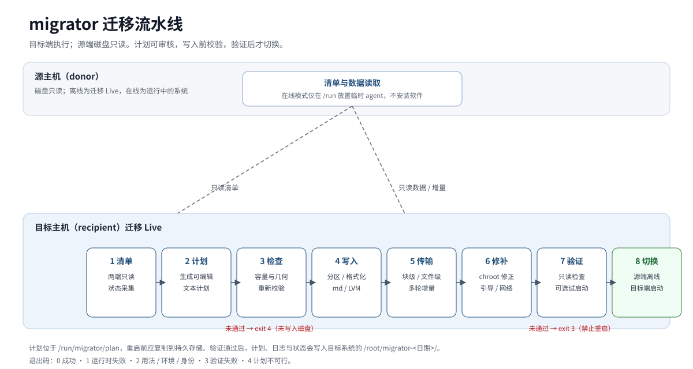
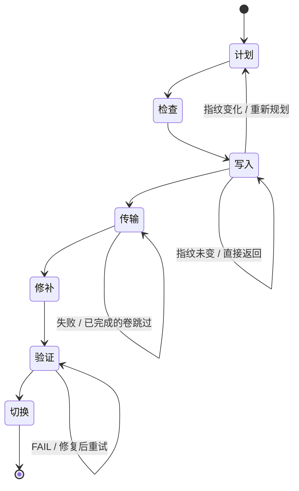

# 阶段与执行流程

## 完整流程



不带 `-s` 时，工具依次执行以下阶段：

```text
bootstrap -> inventory -> plan -> check -> apply -> transfer -> postfix -> verify -> cutover
```

其中 `apply` 之前还有一次 family gate：确认源系统属于 deb 或 rhel 家族；若计划要求从 Live 安装 GRUB（固件变更），会在此刻从镜像获取所需软件包。这样镜像不可用会在写入目标盘之前失败。

| 阶段 | 主要动作 | 写入位置 | 前置条件 |
|---|---|---|---|
| bootstrap | 检查并补齐两端运行时工具；建立 SSH 控制通道 | 两端 Live 或源端 `/run` | 可 SSH 登录源端 |
| inventory | 只读采集两端清单 | `$RUN/*.inv` | bootstrap 完成 |
| plan | 生成计划文件 | `$RUN/plan` | 两端清单存在 |
| check | 校验计划与清单、磁盘几何、容量 | 无 | 计划存在 |
| apply | 清空并重建目标盘布局、md/LVM、文件系统 | 目标磁盘 | check 通过、人工确认 |
| transfer | 逐卷复制数据并检查副本 | 目标卷、`$RUN` | apply 完成 |
| postfix | 修正 fstab、mdadm、LVM、cmdline、initramfs、GRUB、网络 | 目标系统 | transfer 完成 |
| verify | 只读检查目标系统是否可启动 | `$RUN`，验证通过后写入目标系统记录 | postfix 完成 |
| cutover | 源端离线，目标端启动 | 源端网络状态、目标端启动状态 | verify 完成（可用 `force=1` 覆盖） |

## 单独执行阶段

每个阶段都可以单独运行：

```sh
migrator -s plan DONOR
migrator -s check
migrator -s apply
migrator -s transfer
migrator -s postfix
migrator -s verify
migrator -s cutover
```

适用场景：

- 逐步审核计划；
- 失败后从某个阶段重试；
- 在 rescue 环境中只执行 postfix 或 verify。

`-s postfix` 与 `-s verify` 可接受一个已挂载的系统树：

```sh
migrator -s postfix /mnt/target
migrator -s verify /mnt/target
```

该模式下工具不自行挂载或卸载目标树。postfix 要求该树已绑定 `/dev`、`/proc`、`/sys`、`/run`，否则 chroot 步骤无法执行。

## 其它命令

| 命令 | 作用 |
|---|---|
| `migrator -s inventory [DONOR]` | 输出本机或源端的原始清单记录 |
| `migrator -s attach` | 连接到 tmux 会话；没有会话时显示状态并跟踪日志 |
| `migrator -s cleanup` | 撤销挂载、LVM 激活、只读标记、源端数据 sshd 与 SSH 主连接 |
| `migrator -V` / `migrator -s version` | 输出版本、库目录与 Live 构建标识 |

## 幂等性与重试



各阶段按以下方式支持重复执行：

- **apply**：若阶段已标记完成，且目标盘指纹仍与记录一致，则直接返回；指纹不一致时重新执行。`force=1` 会强制重做。
- **transfer**：已标记完成的卷会跳过；失败的卷会重做。`-o redo=` 可指定重做单个卷。
- **postfix**：所有文件改写都是幂等的；第二次执行不会再产生差异。
- **verify**：可以重复执行，结果写入状态与摘要。
- **cutover**：要求 verify 已完成；`force=1` 可跳过该要求，但不建议。

重新执行完整命令时，工具会重新生成计划，然后继续执行后续阶段。若目标盘已写入且指纹未变，不会再次清空。

注意：`/run/migrator` 位于内存文件系统。目标端 Live 重启后，阶段状态、计划与日志都会丢失，无法从上次中断处继续。跨 Live 重启的增量续传（E3）尚未实现。

## 计划审核

推荐流程：

```sh
migrator -s plan DONOR
cp /run/migrator/plan /root/plan.review
vi /run/migrator/plan
migrator -s check
migrator -s apply
```

`check` 会重新计算 apply 将要信任的内容，并拒绝不一致的计划。若计划生成后两端清单发生变化，`check` 会报告 `inv_sha256` 不一致；此时应重新生成计划。只有明确知道变化不影响迁移时，才使用 `-o force=1` 跳过。

计划文件格式与可编辑项见 [计划文件](07-plan-file.md)。

## 空运行

`-n` 为空运行模式：

- 打印将要执行的命令，前缀为 `(dry)`；
- 不写入目标磁盘；
- 不建立真实阶段状态；
- 生成计划的阶段把计划写到 `/run/migrator/dry/plan`；
- 其它阶段优先读取真实计划，不存在时读取空运行计划；
- 仍会读取设备信息，以便展示将要执行的操作。

空运行不能替代验证。它不会证明分区、格式化、复制和引导配置能够成功。

## 无人值守

`-y` 对全部确认回答“是”。没有终端且未指定 `-y` 时，工具拒绝猜测，退出码为 2。

在线模式下，`-y` 还会让 agent 在无法收敛时按 `-o max-est=` 自动决定冻结，而不是在终端询问。

## tmux 与断线保护

在交互终端中执行完整流程、`apply`、`transfer` 或 `postfix` 时，工具会自动进入名为 `migrator` 的 tmux 会话：

- SSH 断线不会终止阶段；
- 重新连接后执行 `migrator -s attach` 返回；
- 使用 `Ctrl-B D` 脱离；
- `-y` 或非交互环境不启用 tmux。

同一 Live 中只允许一个 migrator 实例。第二个实例会因锁失败而退出，并提示使用 `-s attach`。

## 退出码

| 退出码 | 含义 | 后续动作 |
|---|---|---|
| 0 | 成功 | 可以继续下一阶段或验收 |
| 1 | 运行时失败 | 检查日志与 `failure` 文件，修复后重试 |
| 2 | 用法、环境或身份错误 | 修正参数、Live 状态、SSH 连接或主机身份 |
| 3 | 验证失败 | 目标盘已写入，禁止重启；修复后重新执行 `verify` |
| 4 | 计划不可行或被编辑后的计划被拒绝 | 未写入磁盘；重新生成或修正计划 |

失败时，`/run/migrator/failure` 记录：

```text
exit=<退出码> phase=<阶段> volume=<卷> reason=<原因> log=<日志路径>
```

日志最后一行是失败原因，便于脚本或监控系统读取。

## 日志与状态

| 路径 | 内容 |
|---|---|
| `$RUN/log` | 完整日志，包含每条执行命令 |
| `$RUN/state` | 阶段状态、卷状态、目标盘指纹、模式 |
| `$RUN/failure` | 最近一次失败记录 |
| `$RUN/summary` | verify 摘要 |
| `$RUN/verify.log` | 验证明细 |
| `$RUN/vol-N.log` | 单卷传输日志 |
| `$RUN/online.out` | 在线 agent 输出 |

日志中的命令以 `+ ` 或 `+ donor: ` 为前缀，可以按原样重放。该设计用于在工具不可信或需要人工接管时提供操作依据。

## 清理

迁移中断、验证失败或操作人员取消后，执行：

```sh
migrator -s cleanup
```

该命令会：

- 卸载 `/mnt/migrator` 下的挂载；
- 停止计划中的卷组与 md 阵列；
- 将 apply 设置为只读的其它磁盘恢复为读写；
- 关闭源端的数据 sshd；
- 关闭 SSH 主连接；
- 释放迁移锁。

清理是幂等的，可以在任意阶段执行。

## 相关文档

- [计划文件](07-plan-file.md)
- [选项参考](06-options.md)
- [验证与验收](10-verify-and-acceptance.md)
- [故障排查](11-troubleshooting.md)
