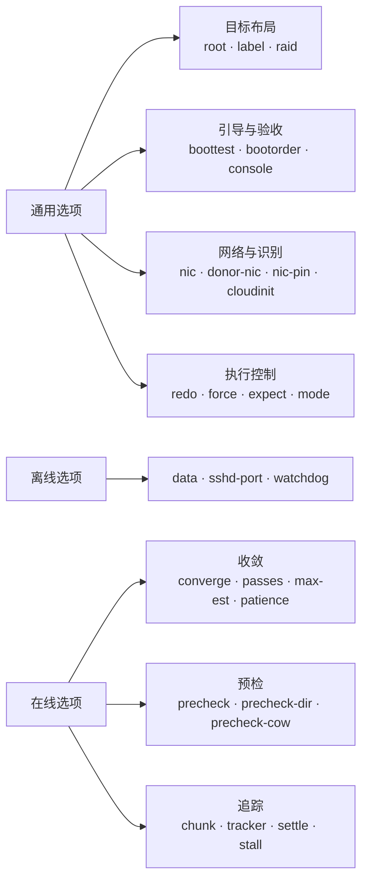

# 选项参考

## 语法

选项通过 `-o key=value` 传入，每项一个 `-o`：

```sh
migrator -o compress=none -o patience=600 root@10.0.0.12
```

规则：

- 逗号属于值本身，不作为多个选项的分隔符。`driver=mod1,mod2`、`console=ttyS0,115200` 都是合法值。
- 键名使用连字符。历史脚本中的下划线形式会被归一化，例如 `max_est` 等价于 `max-est`。
- 未知键会被拒绝，退出码为 2，并在可能时提示相近的键名。
- 把两个选项用逗号连接会被识别并拒绝，例如 `-o compress=none,patience=600`。
- 选项值不做隐式类型转换；非法值会在对应阶段拒绝。

## 两种模式通用



| 键 | 取值 | 默认 | 说明 |
|---|---|---|---|
| `boot-part=` | 容量 | 未设置 | 预留：新建独立 `/boot` 槽位。当前版本拒绝任何非空值；请保持不设置。 |
| `bootorder=` | `pxe` / `local` | `pxe` | UEFI 目标端新增启动项后的 BootOrder 处理。`pxe` 恢复原有顺序，通常网络启动项在前；`local` 让新写入的本地启动项保持在前。 |
| `boottest=` | `1` / `0` | `0` | 验证通过后，用 QEMU 叠加盘试启动目标磁盘，并以串口输出判断是否到达多用户。目标磁盘不写入。内存低于 3072 MiB 或可用内存低于 1536 MiB 时自动跳过并警告。 |
| `cipher=` | OpenSSH 密码套件 | `aes128-gcm@openssh.com` | 数据通道使用的密码套件。控制通道不受影响。 |
| `cloudinit=` | `disable` / `keep` | `disable` | 仅当源系统安装了 cloud-init 时生效。`disable` 写入 `/etc/cloud/cloud.cfg.d/99-migrator.cfg`，禁止 cloud-init 重新配置网络并保留主机名；`keep` 不修改。 |
| `compress=` | 离线：`lz4` / `zstd` / `none`；在线：`auto` / `zstd[:级别]` / `none` | 离线 `lz4`；在线 `auto` | 离线模式为流压缩。在线模式由 agent 对每个数据帧压缩；`auto` 根据源端 CPU 与链路速率调整级别，`zstd:N` 固定级别（0–19）。在线模式的文件卷仍使用源端已有的 zstd、lz4 或 gzip。 |
| `console=` | 内核控制台参数 | 未设置 | 追加为 `console=VALUE` 到目标系统的内核命令行，例如 `ttyS0,115200n8`。追加项位于末尾；Linux 以最后一个 `console=` 作为 `/dev/console`。 |
| `cutover=` | `netdown` / `poweroff` / `kexec` / `none`；在线另支持 `rollback` | `netdown` | `netdown` 关闭源端全部非 lo 网卡；`poweroff` 关闭源端电源；`kexec` 在目标端直接 kexec 进入已验证的内核（Live 需安装 kexec）；`none` 只打印手动步骤；`rollback` 仅用于在线模式，解冻源端并放弃本次切换。 |
| `donor-nic=` | 网卡名 | 自动探测 | 覆盖源端主网卡名称。源端清单无法识别主网卡时使用，例如源端有多个默认网关或配置格式特殊。 |
| `driver=` | 逗号分隔的模块名 | 未设置 | 额外加入目标 initramfs 的驱动模块。硬件探测得到的驱动若在全部源端内核中都不存在，计划会拒绝；由 `driver=` 显式指定而全部内核都不存在时只产生警告。 |
| `expect=` | DMI 序列号或 MAC | 未设置 | 校验源端身份。序列号只保留字母、数字与连字符；MAC 使用冒号分隔。不匹配时退出码为 2。 |
| `force=` | `0` / `1` | `0` | 跳过多项一致性或顺序保护，包括清单哈希不一致、apply 已完成、verify 未完成、两端工具版本不一致。不改变复制与验证逻辑，仅在确认风险后使用。 |
| `fsck=` | `quick` / `full` | `quick` | ext2/3/4 副本的检查方式。`quick` 运行 `e2fsck -n`；源文件系统标记为 dirty 时仍会修复。`full` 强制 `e2fsck -f -y`。XFS 始终在 dirty 时重放日志并运行 `xfs_repair -n`。 |
| `label=` | `auto` / `gpt` / `dos` | `auto` | 目标分区表类型。`auto` 继承源端；UEFI 目标端、目标盘大于 2 TiB、或槽位超过 4 个时改用 GPT。 |
| `mode=` | `online` / `offline` | 自动判定 | 强制指定迁移模式。与源端实际状态不一致时退出码为 2。 |
| `nic=` | 网卡名 | `eth0` | 目标系统中主网卡的名称。工具只改写网卡名称与 MAC，不改写 IP、网关和 DNS。 |
| `nic-pin=` | `1` / `0` | `1` | `1` 写入 `/etc/udev/rules.d/70-persistent-net.rules`，按 MAC 固定网卡名称；`0` 删除该文件。多网卡时还会为其它网卡生成 `eth1x` 等名称，属于尽力而为。 |
| `offline=` | `1` / `0` | 未设置 | 禁止运行期通过 apt 安装缺失工具。缺失的非核心工具只产生警告；核心工具缺失会导致 apply/transfer 拒绝执行。该选项与“离线迁移模式”无关。 |
| `raid=` | `1` / `0` | `0` | `1` 使用两块目标磁盘组成按槽位的 md RAID1。仅支持 deb 系源系统。两块盘容量不同时按较小盘布局，较大盘的剩余空间不使用。 |
| `raw=` | 目录 | 未设置 | 在目标端保留清单解析所用的原始命令输出和源端配置文件树，用于诊断或制作测试夹具。 |
| `redo=` | `all`、卷 ID、源路径，逗号分隔 | 未设置 | 重做指定卷。卷 ID 为分区号，逻辑卷使用卷名（例如 `centos-root`）；也可写源路径（例如 `/dev/vg/root`）。 |
| `relay=` | `USER@HOST[:SSHPORT]` | 未设置 | 中继主机的 SSH 端点。目标端通过它建立切换轮询的反向隧道（`relay:2224` → 目标端 `2224`）。使用该选项时必须提供 `-i KEYFILE`。 |
| `root=` | `auto` / `block` / `files` | `auto` | 根文件系统的复制方式。`block` 要求目标卷不小于源文件系统；`files` 强制按目录树复制，要求目标空间满足“已用 × 1.10 + 512 MiB”；`auto` 在空间足够时选择块级，否则选择文件级。 |

## 仅离线模式

| 键 | 取值 | 默认 | 说明 |
|---|---|---|---|
| `data=` | `ssh` / `raw` | `ssh` | 数据通道。`ssh` 使用源端第二个 sshd 实例（默认 2222，独立连接、密钥认证、指定密码套件）；`raw` 使用 busybox `nc`，不加密，仅适用于可信局域网。 |
| `sshd-port=` | 端口 | `2222` | 源端数据 sshd 的端口。中继场景中应设为中继映射后的端口，例如 `2223`。与控制通道的端口无关。 |
| `watchdog=` | 分钟 | `15` | 离线传输中，管道无进展超过该时间即终止该卷。该值为 0 时会在首次检查时立即判定超时，因此不应设为 0。 |

## 仅在线模式

| 键 | 取值 | 默认 | 说明 |
|---|---|---|---|
| `chunk=` | 2 的幂，4K–8M | `64K` | agent 记录脏块的粒度。粒度越小，末轮增量越精确，但位图与追踪开销越大。 |
| `converge=` | 秒 | `10` | 当估算的待发送增量在该时间内可以完成时，进入冻结。 |
| `cutover-port=` | 端口 | `2223` | 目标端监听切换轮询的端口。中继模式下由工具改为 `2224`。 |
| `dpkg-wait=` | 秒 | `600` | 冻结前等待源端 dpkg 事务结束的最长时间。`0` 表示不等待。冻结半个配置的软件包数据库会导致目标系统无法完成 postfix。 |
| `max-est=` | 秒 | `100` | 无法收敛时，若末轮发送估算不超过该值，仍允许冻结。 |
| `passes=` | 轮数 | `8` | 最大增量轮数。agent 可在 `patience` 预算内自动提高该上限。 |
| `patience=` | 秒 | `1800` | 为换取更短冻结窗口而额外复制的总时间预算。agent 用该预算判断是否增加轮数。 |
| `precheck=` | `1` / `0` | `1` | 在副本的 dm 快照上提前运行 postfix 与 verify。内存低于 1536 MiB 时默认改为 `0`；显式设置可覆盖。 |
| `precheck-cow=` | 容量 | `2G` | 每个预检快照的 copy-on-write 文件大小。 |
| `precheck-dir=` | 目录 | `/var/tmp/migrator` | 预检 COW 文件的存放目录，至少需要 512 MiB 可用空间。不要放在 `/run`，其容量通常不足。 |
| `settle=` | 毫秒 | `1000` | 每个增量轮次结束后的结算等待时间。等待至少为该值，直到在途写入清空；实际最长等待为其 10 倍且不少于 10 秒。 |
| `stall=` | 秒 | `300` | 完全收不到源端数据的持续时间超过该值即判定链路异常并失败，避免无限等待。`0` 表示永不超时。 |
| `tracker=` | `auto` / `bpf` / `ftrace` | `auto` | 写追踪实现。`auto` 优先 eBPF，不可用时回退 ftrace。 |
| `verify-hash=` | `1` / `0` | `0` | 对每个冻结卷计算 SHA-256 并与副本比较。会显著增加读取量和时间。 |

## 常用组合

### 在线迁移，缩短冻结窗口

```sh
migrator -o converge=5 -o passes=12 -o patience=3600 -o max-est=60 root@10.0.0.12
```

该组合允许更多轮增量，并以更小的剩余量进入冻结。实际窗口仍取决于源端写入速率与链路速率。

### 在线迁移，减少目标端内存占用

```sh
migrator -o precheck=0 -o boottest=0 root@10.0.0.12
```

关闭预检与试启动。预检的价值是在源端解冻时提前发现问题，关闭后问题会推迟到最终冻结之后才暴露。

### 缩容迁移

```sh
migrator -o root=files -o label=auto -d /dev/sda root@10.0.0.12
```

根文件系统按目录树复制，目标卷可以小于源卷。其它块级卷仍要求目标卷不小于源卷；若其中某个卷无法缩小，应调整目标布局或该卷的复制方式。

### 两块目标盘 RAID1

```sh
migrator -o raid=1 -d /dev/sda,/dev/sdb root@10.0.0.12
```

仅支持 deb 系源系统。目标布局按两块盘中较小的一块计算。

### 中继

```sh
migrator -i /root/migrator-key \
  -o relay=root@relay.example \
  -o sshd-port=2223 \
  root@relay.example:2222
```

`relay=` 指向中继的 SSH 端点；DONOR 参数指向中继转发后的控制通道端口。

### 调试清单

```sh
migrator -s inventory -o raw=/var/tmp/migrator-raw root@10.0.0.12
```

原始输出保留在目标端的指定目录，可用于分析识别错误或制作测试夹具。

## 相关文档

- [阶段与执行流程](05-stages.md)
- [计划文件](07-plan-file.md)
- [迁移模式](04-modes.md)
- [传输与一致性](09-transfer-and-consistency.md)
