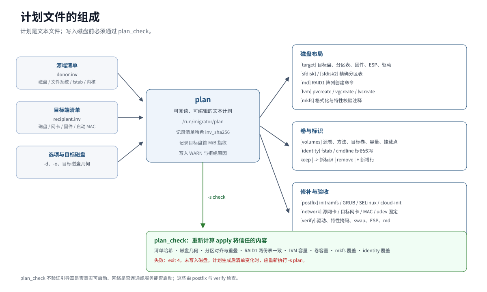

# 计划文件

## 位置与生命周期

计划由 `-s plan` 生成，默认路径为：

```text
/run/migrator/plan
```



空运行模式写入：

```text
/run/migrator/dry/plan
```

计划位于内存文件系统，目标端 Live 重启后丢失。需要留档时，应在重启前复制到持久存储。验证通过后，工具会把计划、日志、状态与清单复制到目标系统的 `/root/migrator-<日期>/`。

## 文件结构

计划是分段文本文件。每段以 `[段名]` 开始，段内每行是一个或一组 `key=value` 字段。`[volumes]` 与 `[identity]` 使用制表符分隔字段。

文件头包含：

```text
# migrator plan  donor=<地址>/<主机名> (<机型与序列号>, <系统>)  recipient=<主机名> (<机型与序列号>, boot=<网卡/MAC>)
# inv_sha256=<源端清单哈希>:<目标端清单哈希>  migrator=<版本>  live=<Live 构建>  date=<UTC 时间>
# WARN: <生成计划时的警告>
```

`inv_sha256` 将计划与生成时的两份清单绑定。`check` 会重新计算清单哈希；不一致时默认拒绝继续。

字段中的空格编码为 `%20`，逗号编码为 `%2C`。读取时应按编码还原。

## 各段说明

### `[target]`

目标磁盘与固件决策。

| 字段 | 含义 |
|---|---|
| `disk=` | 目标磁盘设备 |
| `id=` | 磁盘标识，`wwn:`、`serial:` 或 `model:` |
| `size=` | 磁盘容量（字节） |
| `lsec=` / `psec=` | 逻辑扇区 / 物理扇区大小 |
| `ptuuid=` | 原分区表标识 |
| `head=` | 目标盘首 1 MiB 的 SHA-256，用于写入前的指纹校验 |
| `currently=` | 当前用途，例如 `free`、`old-os`、`md`、`lvm` |
| `label=` | 目标分区表：`gpt` 或 `dos` |
| `firmware=` | 目标固件：`bios` 或 `uefi` |
| `bios_grub=` | BIOS+GPT 时 `bios_grub` 分区号；无则为 `-` |
| `esp=` | ESP 分区号；无则为 `-` |
| `driver=` | 目标 initramfs 需要的驱动模块 |
| `data=` | 离线数据通道：`ssh` 或 `raw` |
| `compress=` | 离线流压缩：`lz4`、`zstd` 或 `none` |
| `pmbr_boot=1` | 需要设置保护性 MBR 的启动标志 |
| `grub_from_live=1` | 固件变更，GRUB 从迁移 Live 安装 |
| `raid=1` | 使用两块磁盘组成 md RAID1 |
| `mode=online` | 在线迁移计划 |

`raid=1` 时另有：

| 字段 | 含义 |
|---|---|
| `disk2=` / `id2=` / `size2=` / `ptuuid2=` / `head2=` | 第二块磁盘的信息 |
| `geometry=` | 两块盘共同使用的布局容量（取较小盘） |
| `md=` | 本计划创建的 md 阵列设备列表 |
| `esp2=` | 第二块盘上的 ESP 分区 |

### `[volumes]`

每个卷一行，字段顺序为：

```text
src kind fs size used method target tsize mount num notes
```

| 字段 | 含义 |
|---|---|
| `src=` | 源设备或挂载点 |
| `kind=` | `part`、`md`、`lv`、`pv`、`swap`、`esp` |
| `fs=` | 文件系统类型，例如 `ext4`、`xfs`、`vfat`、`swap`、`lvm` |
| `size=` | 源卷容量（字节） |
| `used=` | 已用空间；无意义时为 `-` |
| `method=` | `block`、`files`、`esp`、`mkswap`、`pv` |
| `target=` | 目标设备 |
| `tsize=` | 目标卷容量（字节） |
| `mount=` | 挂载点；swap 为 `swap`，无挂载为 `-` |
| `num=` | 分区号；逻辑卷为 `-` |
| `notes=` | 附注，见下表 |

`notes` 中可能出现：

| 值 | 含义 |
|---|---|
| `grow` | 复制后扩展到目标卷大小 |
| `dirty` | 源文件系统非干净，需要日志重放或修复 |
| `errors` | 源文件系统报告错误 |
| `elastic` | 弹性槽位，占用磁盘剩余空间 |
| `raid1` | 目标卷位于 md RAID1 阵列 |
| `esp-mirror` | 第二块盘上的 ESP 副本 |
| `from-other-disk` | 来自源端其它磁盘的额外槽位 |
| `swap-lv` | swap 逻辑卷 |
| `100%FREE` | 根逻辑卷使用卷组剩余空间 |
| `renumbered` | 分区号发生变化 |

卷的传输顺序为：PV 优先，其次 swap 与 ESP，再按文件系统大小，根最后。`root=` 决定根卷采用块级还是文件级；其它卷在空间足够时使用块级，空间不足时使用文件级。

### `[sfdisk]`

直接传给 `sfdisk` 的分区表：

```text
label: gpt
label-id: <UUID>
unit: sectors
sector-size: 512
/dev/vda1 : start=2048, size=1048576, type=<GUID>, uuid=<UUID>, name="EFI System Partition"
/dev/vda2 : start=1050624, size=2097152, type=<GUID>, uuid=<UUID>
```

`raid=1` 时另有 `[sfdisk2]`，描述第二块盘的相同布局，但使用独立的表标识与分区 GUID。

### `[md]`

`raid=1` 时，每个数据槽位一行 `mdadm --create`：

```text
mdadm --create /dev/md2 --run --level=1 --raid-devices=2 --metadata=1.2 --data-offset=8M --homehost=<host> --name=<N> --uuid=<UUID> <member1> <member2>
```

阵列容量等于槽位容量减去 8 MiB 的 data offset。

### `[lvm]`

按顺序执行的 LVM 命令：

```text
pvcreate -ff -y --uuid <UUID> --norestorefile /dev/vda3
vgcreate <VG> /dev/vda3
lvcreate -y -n <LV> -L <bytes>b <VG>
lvcreate -y -n <LV> -l 100%FREE <VG>
```

计划保留源端 PV 与文件系统的 UUID，以维持 fstab 中的 `UUID=` 引用。LVM 自身的 VG/LV UUID 由创建过程决定，不保证与源端一致。

### `[mkfs]`

只为 `files`、`mkswap`、`esp` 卷生成格式化命令。`block` 与 `pv` 卷不格式化。

格式：

```text
mkfs.ext4 -F -U <UUID> -L <label> -b 4096 -I 256 -N <inodes> -O none,<features> <target>
mkfs.xfs -f -m crc=...,finobt=...,reflink=...,rmapbt=...,bigtime=...,inobtcount=...,uuid=<UUID> ... <target>
mkfs.vfat -F32 -i <volid> -n <label> <target>
mkswap -U <UUID> -L <label> <target>
```

每个文件系统命令后可能跟随一行 `# guard:` 注释，说明源文件系统特性需要的最老内核。若特性新于源端最老内核，注释标记为 `EXCEEDS`，并产生警告。

### `[identity]`

描述 fstab 与内核命令行中的设备标识如何改写。每行是两个制表符分隔的字段：

```text
<spec>	<action>
```

动作：

| 动作 | 含义 |
|---|---|
| `keep` | 保持原标识 |
| `-> <new spec>` | 改写为新的标识 |
| `remove` | 删除该引用 |
| `+ <fstab line>` | 新增一行 fstab |

改写规则：

- 保留的文件系统 UUID 继续使用 `UUID=`。
- PARTUUID 在分区表变化或分区号变化时改写为文件系统 UUID。
- LVM 的 `dm-uuid-*` 路径在目标端必然变化，因此改写为文件系统 UUID（D28）。
- 不存在的 swap 或 `resume=` 引用会被删除。
- `rd.md.uuid=`、`rd.md=`、`rd.md.conf=` 会被删除。
- 目标端新建 ESP 时，按系统家族追加对应的 `/boot/efi` 行。

`plan_check` 要求源端 fstab 中的每个 `UUID=`、`LABEL=`、`PARTUUID=`、`/dev/*` 标识都在本段有对应行。

### `[postfix]`

目标系统修补决策。

| 字段 | 含义 |
|---|---|
| `family=` | `deb` 或 `rhel` |
| `initramfs=` | `initramfs-tools` 或 `dracut` |
| `grub=` | `i386-pc` 或 `x86_64-efi` |
| `bls=` | 使用 Boot Loader Specification 条目 |
| `lvm_devices_file=` | `delete` 表示删除源端的 `/etc/lvm/devices/system.devices` |
| `lvm_filter=` | `neutralise` 表示注释源端 LVM 过滤器 |
| `selinux=` | `autorelabel` 或 `none` |
| `cloudinit=` | `disable` 或 `keep` |
| `os_root=` | 目标根设备 |
| `boot=` | 目标 `/boot` 设备 |
| `esp=` | 目标 ESP 设备 |
| `raid=1` / `disk2=` / `esp2=` / `mdadm=` | RAID1 目标信息 |
| `grub_pkgs=` | rhel 固件变更时需要安装的 GRUB 软件包 |

### `[network]`

```text
donor=<nic>/<mac>/<config-kind> target=<name> mac=<recipient-mac> cmdline=<tokens> pin=1|0
pins=<name:mac,...>
```

`donor` 的三部分为源端主网卡名、MAC 和网络配置类型。`target` 是目标系统中的网卡名，默认 `eth0`。`cmdline` 是要加入内核命令行的网络相关参数，通常为 `net.ifnames=0 biosdevname=0`。`pins` 列出要写入 udev 规则的名称与 MAC 对。

### `[verify]`

验证阶段期望满足的条件。

| 字段 | 含义 |
|---|---|
| `drivers=` | initramfs 必须包含的驱动 |
| `features=` | 各目标文件系统的特性掩码 |
| `fstab=` | 源端 fstab 条目数 |
| `swap=` | swap UUID 列表 |
| `esp=` | 目标 ESP 设备 |
| `cmdline_forbid=` | 内核命令行中禁止出现的模式 |
| `md=` / `esp2=` | RAID1 的阵列与第二 ESP |

## 编辑计划

推荐先使用选项调整计划，再在文件中做少量修正。常用选项包括 `-d`、`-o root=`、`-o label=`、`-o raid=`、`-o nic=`、`-o donor-nic=`。

可安全修改并可由 `check` 验证的内容：

- `[identity]` 中某个引用的处理方式，但必须保证 fstab 不留下无法解析的条目；
- `[network]` 中的目标网卡名，但应同时确认 `nic-pin` 与 udev 规则；
- 新增的 fstab 行，前提是目标设备与文件系统类型正确。

不应直接修改的内容：

- `[sfdisk]` 的起始位置、容量、分区号或顺序；
- `[volumes]` 的 `tsize`、`method`、`target`；
- `[lvm]` 与 `[mkfs]` 的容量和 UUID；
- `[md]` 的成员与阵列参数。

这些字段由规划阶段根据容量、槽位和源布局计算。直接修改容易产生不可引导或容量不一致的目标盘。需要改变目标布局时，应重新执行 `-s plan`。

## 计划校验

`migrator -s check` 重新计算 apply 将要信任的内容：

1. 两份清单的哈希是否与计划头一致；
2. 目标磁盘参数（容量、逻辑扇区）是否与分区表一致；
3. 分区是否按 MiB 对齐、是否在磁盘可用范围内、是否重叠；
4. dos 分区表是否超过 4 个主分区；
5. RAID1 的两份分区表是否逐分区一致，md 阵列的成员与容量是否匹配；
6. LVM 的 PV、VG、LV 大小是否与 `[volumes]` 一致；
7. 每个卷的目标容量是否满足其复制方式；
8. 每个 `files`、`mkswap`、`esp` 卷是否有且仅有一条格式化命令；
9. `[identity]` 是否覆盖源端 fstab 的每个设备标识。

校验失败时退出码为 4，且不会写入磁盘。

校验不覆盖：

- 引导器与 GRUB 配置是否真实可启动；
- 网络配置改写后的实际连通性；
- 目标内核是否包含所需驱动；
- 服务是否能在新系统上启动。

这些由 `postfix` 与 `verify` 检查。

## 指纹校验

- 生成计划时，`[target] head=` 记录目标盘首 1 MiB 的 SHA-256。
- `apply` 在写入前校验磁盘身份、容量、分区表标识与首 MiB 哈希；不一致时拒绝写入。
- `apply` 完成后记录目标盘指纹。
- `transfer` 在写入每个卷前再次校验指纹；目标盘被外部改动时拒绝继续。

指纹机制用于防止计划生成后目标盘被替换或被其它进程改写。

## 相关文档

- [阶段与执行流程](05-stages.md)
- [选项参考](06-options.md)
- [网络与固件](08-network-and-firmware.md)
- [验证与验收](10-verify-and-acceptance.md)
