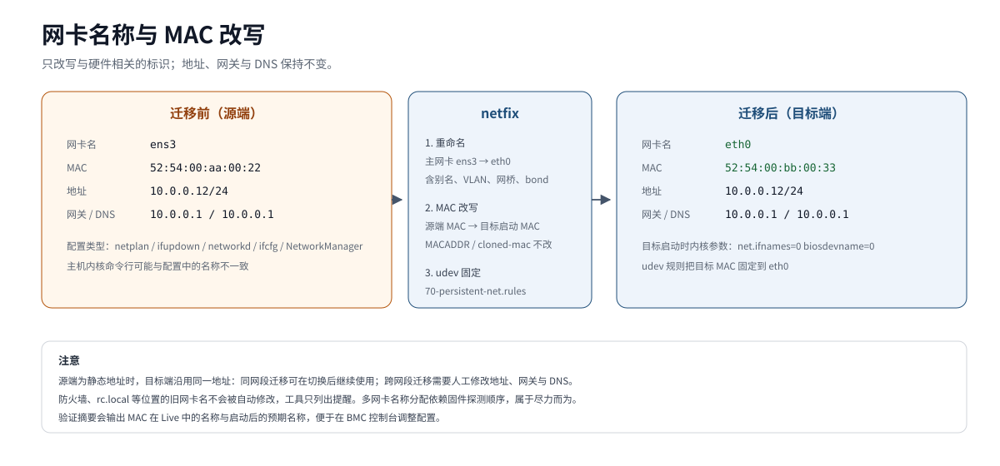
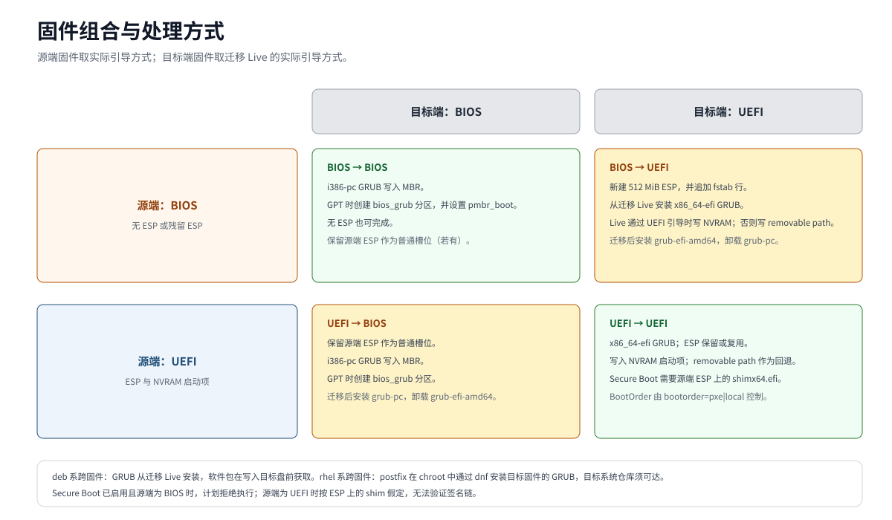

# 网络与固件

## 网络配置的范围



迁移后的系统沿用源系统的网络配置内容，但工具会调整两处与硬件相关的部分：

1. **网卡名称**：源端主网卡名称改为目标名称，默认 `eth0`；
2. **MAC 地址**：配置中绑定的源端 MAC 改为目标主机启动网卡的 MAC 地址。

工具不会修改：

- IP 地址、前缀长度；
- 网关；
- DNS 服务器；
- 路由规则的具体地址；
- 防火墙、`rc.local` 等非网络配置文件中出现的旧网卡名。

因此：

- 源端使用 DHCP 时，目标端在新网络中会重新获取地址；
- 源端使用静态地址时，目标端会沿用同一地址。若目标端位于同一网段，源端在切换后离线，地址不会冲突；若目标端位于不同网段，迁移后需要手工修改地址、网关与 DNS。

## 支持的配置类型

| 类型 | 文件位置 |
|---|---|
| ifupdown | `/etc/network/interfaces`、`/etc/network/interfaces.d/*` |
| netplan | `/etc/netplan/*.yaml` |
| systemd-networkd | `/etc/systemd/network/*.network`、`*.link` |
| ifcfg | `/etc/sysconfig/network-scripts/ifcfg-*` |
| NetworkManager keyfile | `/etc/NetworkManager/system-connections/*` |

工具对每种类型执行两个独立步骤：

1. **重命名**：将源端主网卡名替换为目标网卡名，包括别名、VLAN、网桥、bond、路由与规则文件中的引用；
2. **MAC 改写**：将主配置中绑定的源端 MAC 替换为目标端启动 MAC。对主网卡配置块内部的其它源端硬件 MAC 也做替换。

以下内容不会被改写：

- `MACADDR=` 与 `cloned-mac-address=`：表示有意伪造的 MAC，保留原值并产生警告；
- 注释中的 MAC；
- 防火墙、`rc.local` 等位置出现的旧网卡名：只列出提醒，不自动修改。

## 网卡命名

目标网卡名称由 `-o nic=` 指定，默认 `eth0`。工具会把以下参数加入目标系统内核命令行：

```text
net.ifnames=0 biosdevname=0
```

这样目标系统启动时不会使用可预测网卡命名（如 `ens3`、`enp0s3`），而是使用传统名称。

目标主机有多个物理网卡时，计划会为启动网卡分配 `eth0`，并为其它网卡生成 `eth1x` 等名称。该分配依赖固件探测顺序，属于尽力而为。`-o nic-pin=1` 会写入：

```text
/etc/udev/rules.d/70-persistent-net.rules
```

按 MAC 固定名称。`-o nic-pin=0` 会删除该文件。

验证阶段会输出 MAC 地址在 Live 中的名称、启动后的预期名称，以及目标端没有网络时在 BMC 控制台可执行的修复提示。

## 源端主网卡识别

默认使用源端网络配置中的主接口。以下情况可能导致识别失败：

- 多个默认网关；
- 配置由外部系统生成；
- 配置文件格式无法确定主接口。

此时使用 `-o donor-nic=<接口名>` 指定。计划中的 `[network] donor=` 会记录最终选择。

## cloud-init

源系统安装 cloud-init 时，默认执行 `-o cloudinit=disable`，写入：

```text
/etc/cloud/cloud.cfg.d/99-migrator.cfg
```

内容禁止 cloud-init 重新配置网络，并保留主机名。该处理用于防止目标端启动后被云平台重新初始化，覆盖迁移后的网络与主机名。

需要保留 cloud-init 行为时使用 `-o cloudinit=keep`。此时云平台可能在首次启动时重新生成网络配置与主机名，应确认该行为符合预期。

## 固件判定

### 源端固件

源端固件来自清单中的实际引导方式：

- 通过 UEFI 引导：`uefi`；
- 通过 BIOS 引导：`bios`。

判定不使用“是否存在 ESP”。部分 BIOS 机器上仍残留 ESP，若按 ESP 判定会错误地把 BIOS 当作 UEFI。

### 目标端固件

目标端固件来自迁移 Live 的实际引导方式：

- `/sys/firmware/efi` 存在：UEFI；
- 不存在：BIOS。

### 固件组合



| 源端 → 目标端 | 处理 |
|---|---|
| BIOS → BIOS | 写入 i386-pc GRUB；GPT 时创建 `bios_grub` 分区并设置保护性 MBR 启动标志 |
| UEFI → UEFI | 保留或复用 ESP；安装 x86_64-efi GRUB，写入 NVRAM 启动项 |
| BIOS → UEFI | 新建 512 MiB ESP；从迁移 Live 安装 GRUB；若 Live 通过 UEFI 引导，则写入 NVRAM；否则写入可移除路径 `\EFI\BOOT\BOOTX64.EFI` |
| UEFI → BIOS | 保留源端 ESP 作为普通槽位；写入 i386-pc GRUB；GPT 时创建 `bios_grub` 分区 |

固件变更时，deb 系由计划设置 `grub_from_live=1`，所需 GRUB 软件包在写入目标盘之前从镜像获取。这样镜像不可用不会等到传输完成后才暴露。

rhel 系由 postfix 在 chroot 中通过 `dnf` 安装目标固件所需的 GRUB 软件包。目标系统的软件仓库必须可达。计划中的 `[postfix] grub_pkgs=` 列出所需软件包。

### 迁移后的 GRUB 软件包

deb 系跨固件迁移完成后，目标系统安装的是与目标固件匹配的 GRUB。源系统原有的另一套 GRUB 软件包可能仍然存在。计划会在警告中提示：在迁移后的系统中安装匹配的 `grub-pc` 或 `grub-efi-amd64`，并卸载另一套，以避免后续内核更新写入错误的引导器。

## Secure Boot

目标端启用 Secure Boot 时：

- 源端必须是 UEFI，且其 ESP 上存在 `shimx64.efi`；
- 源端为 BIOS 时，计划拒绝执行，因为没有可用的 shim；
- 计划无法从清单中确认 shim 是否存在，只产生警告；
- 迁移后若 Secure Boot 校验失败，应在目标端固件中暂时禁用 Secure Boot，确认系统可启动后再处理签名链。

## RAID1 目标的引导

`-o raid=1` 时：

- 每个数据槽位创建 md RAID1；
- ESP 与 `bios_grub` 分区保留在两块盘上；
- postfix 会把第一块 ESP 的内容复制到第二块 ESP，并在两个 ESP 上安装引导器；
- UEFI 下为两块盘分别创建 NVRAM 启动项；
- BIOS 下向两块盘写入引导代码；
- 初始同步在复制完成后于后台进行。

单块盘故障时，另一块盘应能独立引导。验收时应分别测试两个启动项，并测试移除一块盘后的降级启动。

## UEFI BootOrder

新增 UEFI 启动项后：

- `-o bootorder=pxe`（默认）：恢复原有 BootOrder，通常网络启动项在前；
- `-o bootorder=local`：让新写入的本地启动项保持在前。

该选项只影响 BootOrder 的顺序，不改变启动项本身。

## 迁移 Live 的静态网络

自包含引导的迁移 Live 支持内核参数：

```text
migrator.ip=IP/PREFIX,GATEWAY,DNS1[,DNS2]
```

该参数由 Live 中的一次性 systemd 单元解析，配置 Live 的网卡。它只影响迁移 Live，不写入迁移后的系统。该机制用于目标端无法依赖 DHCP 的环境。

## 网络验收

验证阶段检查：

- 主网络配置指向目标网卡名；
- 源端 MAC 已从主配置中消失；
- 内核命令行包含 `net.ifnames=0 biosdevname=0`；
- 内核命令行中没有 md 相关残留。

验证不检查：

- 目标网络是否真实可达；
- 网关与 DNS 是否有效；
- 服务端口是否可访问。

这些应在目标系统首次启动后检查。若目标端没有网络，应通过 BMC 或虚拟化控制台登录，按验证摘要给出的网卡名与 MAC 对应关系调整配置。

## 相关文档

- [计划文件](07-plan-file.md)
- [验证与验收](10-verify-and-acceptance.md)
- [故障排查](11-troubleshooting.md)
- [维护者：清单记录格式](maintainers/inventory-format.md)
