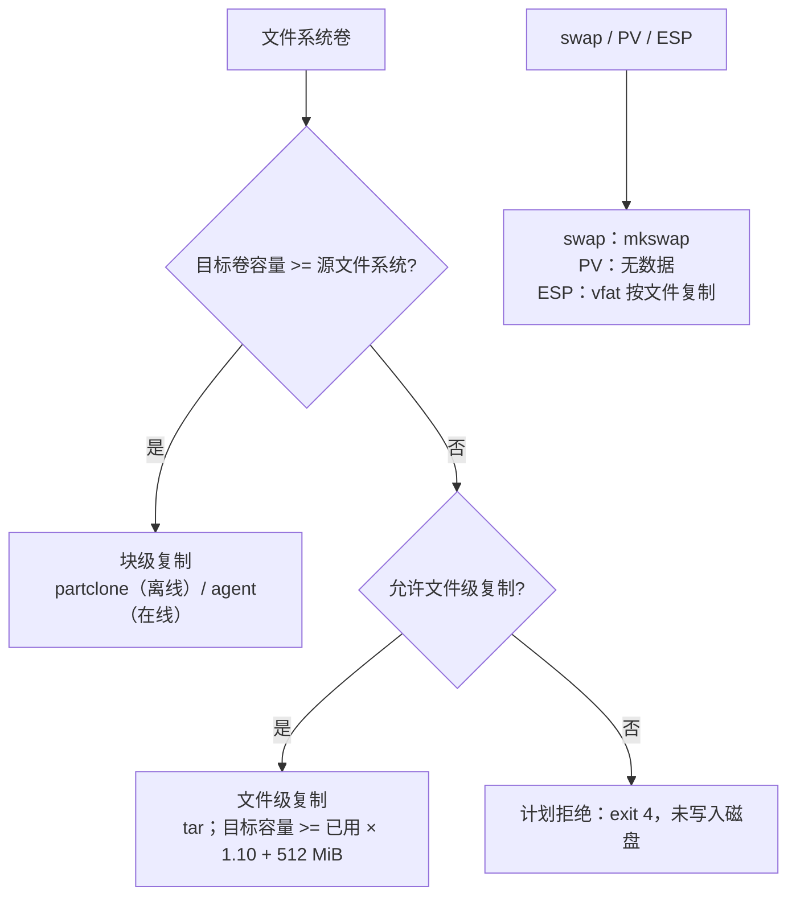
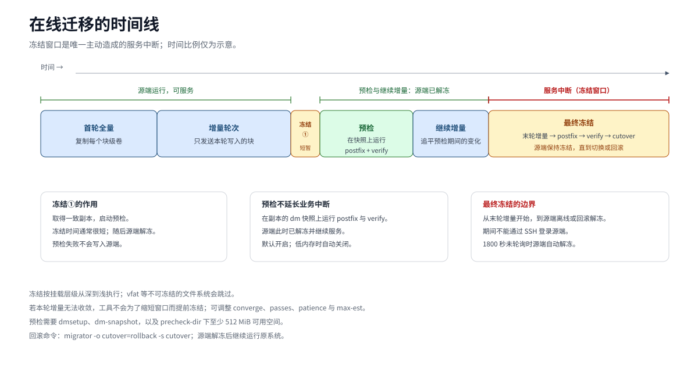
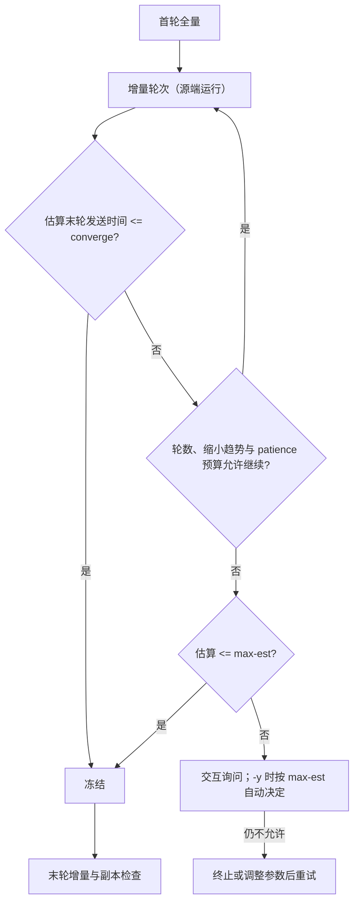

# 传输与一致性

## 卷的复制方式



计划为每个卷指定一种方法：

| 方法 | 适用对象 | 工具 | 说明 |
|---|---|---|---|
| `block` | ext2/3/4、XFS 文件系统 | partclone（离线）、agent（在线） | 按文件系统镜像复制，目标卷不得小于源卷 |
| `files` | ext2/3/4、XFS 文件系统 | tar | 按目录树复制，目标卷可小于源卷 |
| `esp` | vfat ESP | tar 或 agent | FAT 无属主与扩展属性，复制方式不同 |
| `mkswap` | swap 分区或逻辑卷 | `mkswap` | 不传输数据，只按源 UUID 重建 |
| `pv` | LVM 物理卷 | 无 | 不传输数据，由目标盘上的 LV 承载内容 |

`auto` 的根卷选择规则：

- 目标卷不小于源文件系统：块级复制；
- 目标卷小于源文件系统：文件级复制。

`-o root=block` 强制块级，空间不足时计划拒绝；`-o root=files` 强制文件级，空间不足时按文件级容量规则拒绝。

文件级复制的目标容量要求：

```text
已用空间 × 1.10 + 512 MiB
```

若文件系统记录了最小容量，取二者较大值。

## 离线传输

### 数据通道

默认使用源端第二个 sshd 实例：

- 端口 2222；
- 仅密钥认证；
- 每个卷建立独立连接；
- 数据流通过指定密码套件加密；
- 控制通道与数据通道分离，控制通道中断不会终止已建立的数据连接。

每个卷的传输链为：

```text
源端 partclone 读取文件系统 → 压缩 → SSH → 目标端解压 → partclone 写回目标卷
```

成功判定同时要求：

- 源端与目标端的进程退出码为 0；
- 源端 partclone 状态文件为 0；
- 目标端日志包含恢复成功标记；
- 副本通过文件系统检查。

任何一项失败，该卷视为失败，会从头重做。块级卷重做时 partclone 覆盖目标卷；文件级卷重做时重新格式化或清空目标卷。

### 原始数据通道

`-o data=raw` 使用 busybox `nc`：

- 不加密；
- 无额外完整性保护，仅依赖 partclone 自身校验；
- 仅适用于可信局域网。

### watchdog

`-o watchdog=` 指定管道无进展的超时时间，默认 15 分钟。超时后终止该卷的传输，避免因链路假死而无限等待。

## 在线传输



在线传输分为块级卷与文件级卷两条路径。

### 块级卷

所有块级卷在同一个 agent 会话中处理：

1. **首轮全量**：读取每个卷的全部已用块；
2. **增量轮次**：源端记录每轮写入的块，agent 只发送这些块；
3. **收敛判断**：根据源端写入速率与链路速率估算末轮所需时间；
4. **冻结**：估算满足 `converge` 时冻结源文件系统；
5. **末轮增量**：冻结后发送最后一个增量；
6. **副本检查**：在目标端执行 fsck、日志重放和扩容。

块级数据以帧为单位传输。每个数据帧独立压缩，不使用会话级流压缩。这样做的原因是 agent 会话是交互式的：命令与应答必须即时到达，而流压缩器会缓存短写，导致首条应答无法送出。

`-o compress=auto` 由源端报告压缩耗时，agent 结合链路速率选择级别；`-o compress=zstd:N` 固定级别；`-o compress=none` 关闭帧压缩。

### 文件级卷

文件级卷使用 tar 多轮增量：

1. **首轮**：源端文件系统在线时执行 level 0；
2. **增量轮**：在冻结前按修改时间与状态变化执行增量，直到单轮数据量足够小或不再明显缩小；
3. **冻结**：与块级卷同一冻结窗口；
4. **末轮**：在冻结后的文件系统上执行最终增量；
5. **计数校验**：在冻结树上统计条目数与表观大小，与目标副本比较。

在线文件级复制要求源端安装 `tar`。若目标卷小于根文件系统且源端无 `tar`，计划会拒绝。

在线文件级复制对硬链接的处理限制：复制期间内容发生变化的硬链接文件，在副本中可能成为独立文件。

### 收敛参数



| 参数 | 作用 |
|---|---|
| `converge=` | 末轮估算低于该秒数时进入冻结 |
| `passes=` | 最大增量轮数 |
| `patience=` | 为换取更短冻结窗口可额外复制的总时间 |
| `max-est=` | 无法收敛时仍允许冻结的末轮估算上限 |
| `settle=` | 每轮结束后的结算等待，确保在途写入计入下一轮 |
| `stall=` | 完全无数据的超时，超过即判定链路异常 |

当增量不再缩小、轮数超过上限或继续复制的时间超过 `patience` 预算时，agent 判定为无法收敛。此时：

- 末轮估算不超过 `max-est`：立即冻结；
- 交互模式下：询问操作人员；
- `-y` 或非交互模式：按 `max-est` 自动决定。

## 冻结与解冻

冻结操作：

- 对每个已挂载且可冻结的文件系统调用 `fsfreeze`；
- 按挂载层级从深到浅执行；
- vfat 等不支持冻结的文件系统跳过；
- 冻结期间源端写入暂停，文件系统保持一致状态。

冻结后：

- 源端保持冻结，等待目标端的切换命令；
- 源端通过独立轮询进程连接目标端的切换端口；
- 目标端完成末轮复制、postfix 与 verify；预检已在更早的冻结轮次完成；
- 目标端发送 `netdown`、`poweroff` 或 `thaw` 命令。

若目标端在 1800 秒内未联系源端，源端自动解冻。该机制用于避免目标端崩溃后源端永久冻结。

冻结期间不能通过 SSH 登录源端。SSH 登录会在 PAM 写入 `wtmp` 时阻塞，表现为认证通过但命令不执行。

## 预检

预检在首轮冻结后执行：

1. 对每个有文件系统的目标卷创建 dm 快照；
2. 在快照上运行 postfix；
3. 在快照上运行 verify；
4. 删除快照，恢复状态。

预检期间源端已解冻并继续服务，因此预检不延长业务中断。预检的价值是提前发现 postfix 或 verify 的问题，而不是等到最终冻结后才发现。

预检要求：

- `dmsetup` 与 dm-snapshot；
- `precheck-dir` 下至少 512 MiB 可用；
- `precheck-cow` 足够容纳 postfix 的写入，默认 2 GiB。

预检会跳过 swap 文件的创建，因为大文件写入会填满 COW，导致快照失效。swap 文件在最终冻结后的真实文件系统上创建。

低内存环境：

- 内存低于 1536 MiB 时默认关闭预检；
- 可使用 `-o precheck=1` 强制开启，但需要确认 COW 空间与内存充足。

## dpkg 事务

冻结前，工具检查源端：

- dpkg 锁是否被持有；
- `dpkg --audit` 是否报告未完成事务。

若存在未完成事务，工具等待至 `dpkg-wait=` 指定的上限，默认 600 秒。超过上限仍存在事务时拒绝冻结，因为冻结半个配置的软件包数据库会导致目标系统在 postfix 阶段无法安装所需软件包。

常见原因是 `unattended-upgrades` 正在重建 initramfs。处理方式：

```sh
systemctl stop unattended-upgrades
dpkg --configure -a
dpkg --audit
```

## 副本检查与扩容

块级复制完成后，目标端执行：

| 文件系统 | 检查 | 扩容 |
|---|---|---|
| ext2/3/4 | 干净时 `e2fsck -n`；dirty 或 `fsck=full` 时 `e2fsck -f -y` | `resize2fs` |
| XFS | dirty 时挂载并卸载以重放日志；随后 `xfs_repair -n` | `xfs_growfs` |

计划中的 `grow` 标记表示目标卷大于源文件系统，需要扩容。扩容前必须确保文件系统检查通过。

XFS 在冻结状态下仍保留需要重放的日志，因此在线模式会把 XFS 副本视为 dirty 并执行日志重放。

## 文件复制的排除项

文件级复制不会包含：

```text
/dev
/proc
/sys
/run
/boot/efi
/snap
/var/lib/lxcfs
```

原因：

- `/dev`、`/proc`、`/sys`、`/run` 是运行期文件系统；
- `/boot/efi` 由 ESP 卷单独处理；
- `/snap` 是 snapd 的挂载点；
- `/var/lib/lxcfs` 是 lxcfs 的挂载点。

postfix 会在目标系统中重新创建这些挂载点目录。否则依赖它们的服务会在新系统启动时报错，例如 lxcfs 因缺少目录而无法启动。

## swap 文件

文件级复制会排除源端的 swap 文件，避免复制无意义的大文件。postfix 在目标系统中按源端清单记录的路径与大小重建：

```sh
dd if=/dev/zero of=<path> bs=1M count=<size> conv=fsync
chmod 600 <path>
mkswap <path>
```

若目标空间不足，工具产生警告并记录手工后续事项。XFS 上不使用 `fallocate`，因为预分配区不能用于 swap。

## RAID1 同步

`-o raid=1` 时：

- apply 创建阵列时将初始同步暂停，避免与数据复制争用磁盘；
- transfer 完成后恢复同步；
- 同步在后台继续，可用 `cat /proc/mdstat` 查看进度；
- verify 允许同步仍在进行，但要求两个成员都在阵列中。

## 完整性校验

`-o verify-hash=1` 在最终冻结后对每个块级卷计算 SHA-256，并与目标副本比较。该选项：

- 增加源端读取量与目标端读取量；
- 延长冻结窗口；
- 提供逐字节级别的完整性证据。

默认关闭。对数据完整性要求高的迁移建议开启，并预留足够的冻结时间。

## 失败与重试

| 阶段 | 失败后的状态 | 重试方式 |
|---|---|---|
| 离线单卷 | 该卷标记失败，其它卷不受影响 | 重新执行 `-s transfer`，或 `-o redo=` 指定卷 |
| 在线传输 | agent 退出，源端未冻结（除非已进入冻结） | 修复原因后重新执行 `-s transfer` |
| 在线冻结后 | 源端保持冻结并轮询 | 执行 `cutover` 或 `cutover=rollback` |
| 预检失败 | 源端已解冻，副本保留 | 修复原因后重新执行 `-s transfer` |

卷状态记录在 `/run/migrator/state`。已完成的卷在重试时跳过。

## 相关文档

- [迁移模式](04-modes.md)
- [选项参考](06-options.md)
- [验证与验收](10-verify-and-acceptance.md)
- [故障排查](11-troubleshooting.md)
