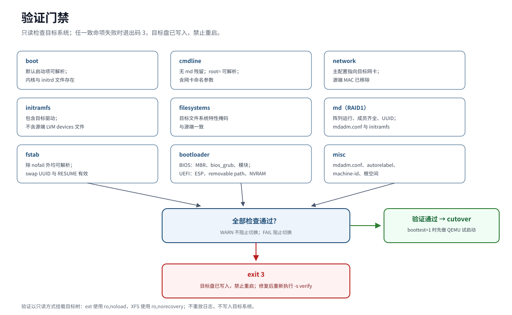
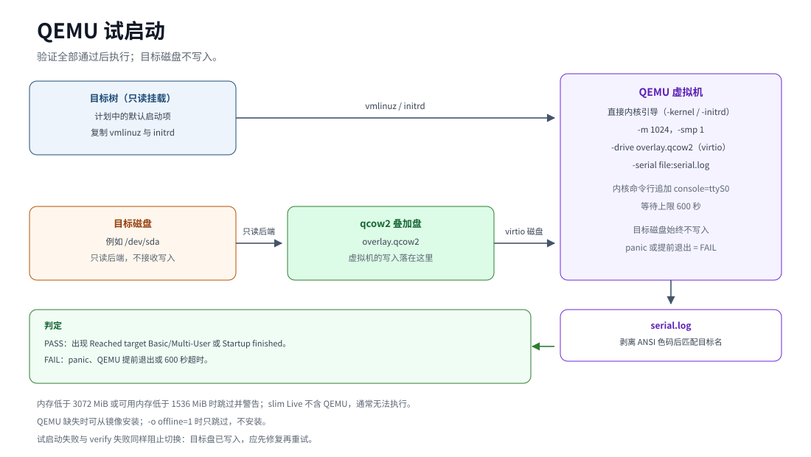

# 验证与验收

## 验证的目标



`verify` 在目标系统首次启动前检查：该磁盘能否在本机完成引导、找到根文件系统并启动主要服务。

验证以只读方式挂载目标系统：

- ext2/3/4 使用 `ro,noload`；
- XFS 使用 `ro,norecovery`；
- 不重放日志，不写入目标系统。

任一致命检查失败时，工具以退出码 3 结束，并明确提示目标盘已写入、不得重启。

## 检查项

检查顺序为：

```text
boot -> initramfs -> fstab -> cmdline -> filesystems -> bootloader -> network -> md -> misc
```

| 检查 | 内容 |
|---|---|
| `boot` | 默认启动项可解析；其内核与 initrd 文件存在；启动项来源与计划一致 |
| `initramfs` | 每个 initramfs 包含目标硬件所需驱动；不包含源端的 LVM devices 文件；udev 固定规则已写入 |
| `fstab` | 每个没有 `nofail` 的条目在当前目标树上可解析；swap UUID 存在；`RESUME=` 指向有效 swap |
| `cmdline` | 所有内核命令行来源中不含 md 残留；`root=` 可解析；包含 `net.ifnames=0 biosdevname=0` |
| `filesystems` | 目标文件系统的原始特性掩码与源端一致 |
| `bootloader` | BIOS：MBR 启动代码存在；GPT 时 `bios_grub` 存在；GRUB 模块存在。UEFI：ESP 上有引导器、存在可移除路径、NVRAM 有启动项、BootOrder 合理 |
| `network` | 主网络配置指向目标网卡名；源端 MAC 已从主配置中移除 |
| `md` | RAID1 时每个阵列处于运行状态且两个成员都在；阵列 UUID 与计划一致；`mdadm.conf` 只列出本计划的阵列；默认 initramfs 包含 mdadm、配置与 raid1 模块；引导器同时检查第二块盘或第二个 ESP |
| `misc` | `mdadm.conf` 的 ARRAY 状态；`/.autorelabel`；machine-id；根文件系统可用空间 |

### 失败与警告

- **FAIL**：目标系统很可能无法启动或无法正常工作。退出码 3，禁止重启。
- **WARN**：存在风险但不阻止切换。例如多网卡名称分配无法完全保证、某些手工后续事项、非关键配置缺失。

验证摘要会输出：

- MAC 地址在 Live 中的名称与启动后的预期名称；
- 目标端无网络时可在 BMC 控制台使用的修复提示；
- postfix 留下的手工后续事项。

### 验证记录的写入

验证全部通过后，工具：

1. 标记 `phase.verify=done`；
2. 写入 `/run/migrator/summary`；
3. 将计划、日志、状态与清单复制到目标系统的 `/root/migrator-<日期>/`；
4. 写入 `/etc/migrator-migrated` 标记。

这些记录只在目标系统由本次运行自行挂载时写入。使用 `verify ROOT` 检查他人挂载的树时不会写入。

## 试启动



`-o boottest=1` 在验证全部通过后执行 QEMU 试启动：

1. 从目标树中复制默认启动项的内核与 initrd；
2. 以目标磁盘为后端创建 qcow2 叠加盘；
3. 直接内核引导，串口输出写入 `/run/migrator/boottest/serial.log`；
4. 断言出现 `Reached target Basic System`、`Reached target Multi-User System` 或 `systemd[1]: Startup finished`。

结果：

| 串口现象 | 结果 |
|---|---|
| 到达多用户 | PASS |
| 内核 panic | FAIL |
| QEMU 提前退出 | FAIL |
| 600 秒内未到达多用户 | FAIL |

目标磁盘不会被写入。QEMU 使用叠加盘，所有写入落在临时 qcow2 文件。

跳过条件：

- 目标端内存总量低于 3072 MiB；
- 可用内存低于 1536 MiB；
- 未找到内核或 initrd；
- QEMU 未安装且无法安装。

跳过时产生 WARN，不阻止迁移。`slim` 版迁移 Live 不包含 QEMU，通常无法执行试启动。

## 切换

`cutover` 在验证通过后执行。默认模式为 `netdown`。

### 切换步骤

1. 确认 verify 已标记完成，除非显式使用 `force=1`；
2. 向源端发送延迟执行的离线命令：
   - `netdown`：关闭全部非 lo 网卡；
   - `poweroff`：关闭电源；
3. 断开控制通道；
4. 通过 ping 确认源端地址连续 3 次无应答；仍有应答时拒绝启动目标端；
5. 启动目标端：
   - `kexec`：直接 kexec 进入已验证的内核；
   - 其它模式：固件重启进入磁盘上的系统。

源端仍在线时拒绝启动目标端，是为了避免两台主机同时使用同一 IP 地址。

### 在线模式的切换

在线模式下，目标端不建立新的 SSH 连接，而是等待源端的轮询进程连接：

1. 目标端在 `cutover-port` 上监听，默认 2223；
2. 源端轮询进程每 3 秒连接一次；
3. 目标端发送 `netdown`、`poweroff` 或 `thaw` 命令；
4. 源端执行后保持冻结或关机；
5. 目标端确认源端离线后启动。

目标端等待源端轮询的时间上限为 180 秒。超时说明源端 agent 未运行或无法访问目标端，应检查网络与 agent 状态。

### 回滚

在线模式支持：

```sh
migrator -o cutover=rollback -s cutover
```

该命令通知源端解冻。源端继续运行原系统，目标端不启动，目标端的副本保留。回滚不要求 verify 已完成。

离线模式不支持回滚命令，因为源端从未被冻结；源端磁盘保持原样，直接重新启动源端即可。

### 手动切换

`-o cutover=none` 只打印手动步骤，不执行任何操作。适用于：

- 需要人工确认网络与业务状态；
- 需要先关闭源端上的外部依赖；
- 由编排系统接管切换。

手动步骤的顺序应为：

1. 在源端控制台关闭全部非 lo 网卡，或关闭电源；
2. 确认目标端网络配置可用；
3. 重启目标端进入磁盘系统。

### kexec 模式

`-o cutover=kexec` 要求迁移 Live 安装 `kexec`：

- 从目标树中取出已验证的内核与 initrd 到 `/run/migrator/kexec/`；
- 停止目标端的卷组与 md 阵列，使新内核可以干净地重新装配；
- 加载并执行 kexec。

kexec 失败时源端已经离线，只能通过固件重启目标端。因此使用该模式前应确认 kexec 在目标 Live 中可用。

## 验收清单

切换完成后，在目标系统上逐项确认：

### 系统

- [ ] 主机名符合预期；
- [ ] 内核版本与源系统一致；
- [ ] `systemctl is-system-running` 返回 `running`；
- [ ] `systemctl --failed` 没有失败单元；
- [ ] 根文件系统挂载正确，容量符合计划；
- [ ] `/etc/migrator-migrated` 存在。

### 存储

- [ ] 所有计划中的文件系统已挂载；
- [ ] swap 已启用，UUID 正确；
- [ ] LVM 卷组与逻辑卷名称正确；
- [ ] RAID1 阵列状态正常，两个成员都在；
- [ ] 数据抽样或校验和与源端一致。

### 网络

- [ ] 主网卡名称符合计划；
- [ ] 地址、网关、DNS 符合目标环境；
- [ ] 远程管理通道可用；
- [ ] 防火墙规则未引用不存在的网卡。

### 服务

- [ ] 关键服务处于 `active`；
- [ ] 服务端口可访问；
- [ ] 数据库可连接，数据完整；
- [ ] 定时任务、容器、证书与配置在位；
- [ ] 需要重新登录或重新授权的服务已处理。

### 切换

- [ ] 源端已离线，不会与新主机同时使用同一 IP；
- [ ] 源端磁盘保持原样，可作为回滚依据；
- [ ] 备份与监控已指向新主机；
- [ ] 迁移记录与日志已归档。

## 验证失败后的处理

1. 不要重启目标端。
2. 查看 `/run/migrator/verify.log` 与 `/run/migrator/log` 中最后一条 FAIL。
3. 根据检查项修复目标系统或计划。
4. 重新执行：

```sh
migrator -s verify
```

若失败原因在计划或复制阶段，可能需要重新执行 `postfix` 或 `transfer`。

## 相关文档

- [阶段与执行流程](05-stages.md)
- [网络与固件](08-network-and-firmware.md)
- [故障排查](11-troubleshooting.md)
- [常见问题](12-faq.md)
