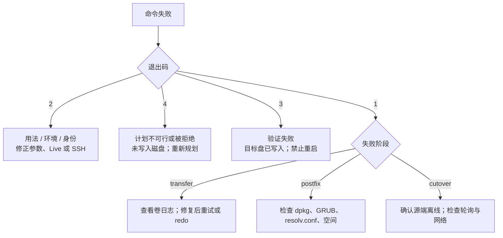

# 故障排查

## 排查顺序

1. 查看退出码；
2. 查看 `/run/migrator/failure`；
3. 查看 `/run/migrator/log` 的最后 50 行；
4. 根据阶段定位；
5. 修复后重新执行对应阶段，不要无条件重新执行完整流程。

```sh
cat /run/migrator/failure
tail -n 50 /run/migrator/log
```

退出码含义：



| 退出码 | 含义 |
|---|---|
| 1 | 运行时失败 |
| 2 | 用法、环境或身份错误 |
| 3 | 验证失败，目标盘已写入，禁止重启 |
| 4 | 计划不可行或被拒绝，未写入磁盘 |

## 不是迁移 Live

现象：任意阶段报「当前系统不是迁移 Live：找不到 /etc/migrator-live-release」，退出码 2。

各阶段都在迁移 Live 中执行，`plan` 与 `-n` 空运行也不例外：计划需要读取目标盘的信息，而普通系统上那块盘正被自身占用。

处理步骤：

1. 把目标设备启动到迁移 Live，确认标记文件存在：

   ```sh
   cat /etc/migrator-live-release
   ```

2. 只想知道本机能否完成迁移，不必进入 Live。运行体检脚本，它在任意系统上只读检查：

   ```sh
   sh -c "$(curl -fsSL https://gitee.com/tktogether/migrator/raw/master/tools/preflight.sh)"
   ```

标记文件存在却仍报错时，说明启动的是精简 Live（`boot=base`），缺少 `bash`、`systemctl` 或 `apt-get`。改用完整镜像。

## 登不进迁移 Live

现象：`ssh` 报 `Connection refused`、连接超时，或提示 `Permission denied (publickey)`。

三种原因分别检查。以下命令都在迁移 Live 的控制台上执行，或在能进入一次之后执行。

1. 端口。构建时在设置段选了随机端口，或者用了 `-p` / `-p random`，登录时都要带上同一个端口。端口的取值在构建结束时与私钥一起打印，形如 `端口  46496`。引导参数可以覆盖构建时的端口，因此以实际生效者为准：

   ```sh
   grep -r '^Port ' /etc/ssh/sshd_config.d/
   tr ' ' '\n' < /proc/cmdline | grep migrator.ssh_port
   ```

   第一条没有输出时 sshd 使用默认的 22。两条都给出数字时，以引导参数为准：`migrator-live-ssh.service` 在 sshd 启动前改写同一个文件。

2. 密码。构建时没有选第二项、也没有用 `-P` 的镜像不接受密码登录，root 的密码处于锁定状态：

   ```sh
   passwd -S root
   grep -r 'PasswordAuthentication' /etc/ssh/sshd_config.d/
   ```

   `passwd -S root` 输出中的第二个字段为 `L` 表示密码锁定，只能使用私钥。

3. 私钥。镜像中 root 的 `authorized_keys` 只包含构建时生成的那一把公钥：

   ```sh
   cat /root/.ssh/authorized_keys
   ```

   私钥丢失时，在有控制台的机器上从 GRUB 菜单选回原系统重新构建，会得到新的一把。没有控制台时无法进入，这是构建时保存私钥这一步不能跳过的原因。

还有一处容易忽略：`tools/live-cycle.sh` 通过轮询 ssh 判断 Live 是否就绪。镜像用了非 22 端口时，要给它 `-p <端口>`，否则它会一直等待 22 端口，直到超时。

## 连接与身份

| 现象 | 原因 | 处理 |
|---|---|---|
| `not a Live OS (no /etc/migrator-live-release)` | 当前系统不是完整迁移 Live | 启动迁移 Live |
| `donor ... is not a full Live OS` | 离线模式要求源端为完整 Live | 将源端启动到完整 Live，或改为在线模式 |
| `donor ... runs the base Live (busybox only)` | 源端使用基础 Live，缺少 bash 与 apt-get | 改用完整 Live |
| `cannot log in ... without a terminal` | 非交互环境无法输入密码 | 使用 `-i KEYFILE`，或转发 SSH agent |
| `DONOR ... is this machine` | 源端地址实际指向目标机自身 | 检查 IP、端口、NAT 映射与主机身份 |
| `donor ... is not the expected` | `expect=` 与实际源端不符 | 确认目标主机，或修正 `expect=` |
| `another migrator is running` | 同一 Live 中已有实例 | 执行 `migrator -s attach`，或等待当前实例结束 |

SSH 控制通道建立后，工具会生成一次性会话密钥并追加到源端 root 的 `authorized_keys`。该密钥不会在迁移结束后自动删除。需要清理时手工编辑源端：

```sh
vi /root/.ssh/authorized_keys
```

## 模式判定

| 现象 | 原因 | 处理 |
|---|---|---|
| `mode=online but the donor ... is a Live` | 显式指定在线，但源端处于 Live | 改为 `mode=offline`，或启动源端原系统 |
| `mode=offline but the donor ... runs its own OS` | 显式指定离线，但源端运行原系统 | 启动源端到 Live，或改为 `mode=online` |

不指定 `mode=` 时，工具按源端是否存在 `/etc/migrator-live-release` 自动判定。

## 计划与目标磁盘

| 现象 | 原因 | 处理 |
|---|---|---|
| `no target disk candidate` | 没有满足条件的磁盘 | 使用 `-d DISK` 指定非可移动、非 USB、容量不小于 20 GiB 的磁盘 |
| `N target disk candidates` | 存在多个候选磁盘 | 使用 `-d` 指定一个；或两块盘使用 `-o raid=1 -d DISK,DISK2` |
| `target disk ... is only ... less than 20 GiB` | 目标盘容量不足 | 更换磁盘，或确认是否应改为迁移到更小的卷 |
| `target disk ... is read-only` | 目标盘处于只读状态 | 检查块设备只读标记、虚拟化平台设置 |
| `target disk ... has a logical sector of ...` | 扇区大小不是 512 或 4096 | 更换磁盘或调整存储配置 |
| `fstab entry ... has no target and no nofail` | 源端 fstab 引用了未迁移的设备且没有 `nofail` | 在源端删除该条目，或添加 `nofail` |
| `VG ... spans N PVs` | 卷组跨多个物理卷 | 当前版本不支持；调整源端 LVM 布局 |
| `VG ... already exists on recipient disk ... not the target` | 目标端其它磁盘上有同名卷组 | 先重命名或清空该卷组 |
| `the root ... needs ... but ... has ...` | 文件级复制的目标容量不足 | 增大目标卷，或缩小源文件系统 |
| `no volume is mounted at / after planning` | 计划未能识别根卷 | 检查源端清单与 fstab |
| `raid=1 is implemented for the deb family only` | rhel 系源端使用 RAID1 目标 | 改用单盘，或等待该功能 |
| `boot-part=... not implemented yet` | 使用了保留选项 | 移除该选项，沿用源端布局 |
| `recipient has Secure Boot enabled and the donor has no ESP` | Secure Boot 目标端需要 shim | 在目标端关闭 Secure Boot，或改用 UEFI 源端 |

### 计划检查失败

`check` 失败时退出码为 4，未写入磁盘。常见原因：

- `inv_sha256` 不一致：计划生成后两端清单变化。重新执行 `-s plan`。
- 分区未按 MiB 对齐、越界或重叠：计划被手工修改。重新生成计划。
- `[sfdisk]` 与 `[sfdisk2]` 分区不一致：RAID1 的两块盘布局必须相同。
- `[volumes]` 容量与 `[sfdisk]`、`[lvm]` 不一致：检查计划或重新生成。
- `[mkfs]` 缺少或多出格式化命令：每个文件级、swap、ESP 卷必须恰好一条。
- `[identity]` 未覆盖 fstab 标识：重新生成计划。

只有确认变化不影响迁移时，才使用 `-o force=1` 跳过清单哈希检查。

## apply

| 现象 | 原因 | 处理 |
|---|---|---|
| 指纹不一致：`target ... does not match` | 计划生成后目标盘被替换或改写 | 重新生成计划；确认目标盘正确后才使用 `force=1` |
| 确认输入不匹配 | 操作人员输入的磁盘名称或容量与提示不一致 | 重新执行，按屏幕内容输入 |
| `anything mounted from the disk is refused` | 目标盘上仍有挂载 | 卸载后重试，或执行 `-s cleanup` |
| `still missing ... after apt` | 运行时工具安装失败 | 检查镜像可达性；或使用 `-o offline=1` 并预先安装 |

`apply` 失败时通常尚未完成分区或格式化。修复后重新执行 `-s apply`；工具会重新检查指纹与阶段状态。

## 离线传输

| 现象 | 原因 | 处理 |
|---|---|---|
| `tool versions differ` | 两端 Live 构建不同 | 使用同一份 ISO；确认后才使用 `force=1` |
| `partclone.xfs only on one side` | 一端缺少 XFS 支持 | 安装对应软件包，或避免 XFS 卷 |
| 某卷失败 | 网络中断、partclone 错误、目标盘问题 | 查看 `$RUN/vol-N.log`，修复后重新执行 `-s transfer` |
| watchdog 超时 | 管道长时间无进展 | 检查链路与源端负载；必要时增大 `-o watchdog=` |
| `data=raw` 警告 | 使用了不加密的原始通道 | 仅在可信局域网使用；否则改用 `data=ssh` |

单卷重做：

```sh
migrator -s transfer -o redo=<卷 ID 或源路径>
migrator -s transfer -o redo=all
```

## 在线传输与 agent

| 现象 | 原因 | 处理 |
|---|---|---|
| `online migration needs root on the donor` | 源端 SSH 用户不是 root | 使用 root，或配置可提权的登录方式 |
| `the donor has no bash` | 源端缺少 bash | 安装 bash，或改为离线模式 |
| `the donor has no findmnt` | 源端缺少 util-linux | 安装 util-linux |
| `arch=...` 不是 x86_64 | 架构不支持 | 当前 agent 仅支持 x86_64 |
| `migrator-agent ... does not run` | agent 缺失、为空或被截断 | 从目标端重新安装 agent；确认 `migrator-agent version` 有输出 |
| `dpkg ... still after ...s` | 源端软件包事务未完成 | 停止 `unattended-upgrades`，执行 `dpkg --configure -a`，确认 `dpkg --audit` 为空；或增大 `-o dpkg-wait=` |
| `the donor writes ... and the link carries ... this will not converge` | 源端写入速率接近或超过链路速率 | 降低源端写入负载，或接受较长冻结窗口；调整 `converge`、`max-est` |
| `nothing from the donor for ... s` | 源端静默，链路异常 | 检查网络；`-o stall=0` 可禁用该判定，但不建议 |
| 预检 I/O 错误 | COW 空间不足，常见于 `/run` 或低内存 | 使用 `-o precheck-dir=` 指向有空间的目录，增大 `precheck-cow`，或关闭 `precheck` |
| `no dmsetup on this box` | 目标 Live 缺少 dmsetup | 安装 `dmsetup` 或 `lvm2` |
| `only ... free under ... for the snapshots' COW` | 预检目录空间不足 | 更换目录或关闭预检 |
| 内存不足导致进程被终止 | Live 与小内存目标端不足以同时运行传输、预检与 chroot | 增加内存，或设置 `-o precheck=0 -o boottest=0` |

### 无法收敛时的选择

1. 降低源端写入负载；
2. 提高链路带宽；
3. 接受较长冻结窗口，增大 `max-est`；
4. 增加轮数与耐心预算 `passes`、`patience`；
5. 改为离线模式。

工具不会在增量无法收敛时提前冻结。若最终仍无法收敛，应重新评估迁移窗口。

## 冻结后的源端

| 现象 | 原因 | 处理 |
|---|---|---|
| 源端 SSH 认证通过但命令不执行 | 根文件系统冻结，PAM 写入日志时阻塞 | 不要通过 SSH 操作；使用 `cutover` 或 `cutover=rollback` |
| 目标端 cutover 等待轮询超时 | 源端 agent 未运行或无法访问目标端 | 检查 agent 进程与网络；在源端控制台执行 `fsfreeze -u /` 解冻 |
| 源端长时间未解冻 | 目标端未轮询，或轮询失败 | 1800 秒后自动解冻；也可在控制台手工解冻 |
| 源端关机或断电 | `cutover=poweroff` 的预期结果 | 无需处理，属正常行为 |

手工解冻适用于以下场景：

- 目标端崩溃，无法执行 rollback；
- 轮询网络不可用；
- 需要立即恢复源端服务。

在源端控制台执行：

```sh
fsfreeze -u /
```

若多个文件系统被冻结，应逐一解冻。冻结状态下不要尝试写磁盘或重启服务。

## postfix

| 现象 | 原因 | 处理 |
|---|---|---|
| `dpkg was interrupted` | 目标系统软件包事务未完成 | 在目标 chroot 中执行 `dpkg --configure -a`，再重试 |
| `grub-install failed in the target` | 源系统缺少目标固件的 GRUB 软件包，或 chroot 环境不完整 | 按错误提示在 rescue 环境中手工安装 GRUB，然后重新执行 `-s postfix` |
| rhel `dnf` 安装失败 | 目标系统软件仓库不可达 | 检查目标系统 `resolv.conf` 与仓库配置 |
| 手工 chroot 时 `No such file or directory` | `/etc/resolv.conf` 指向 `/run/systemd/resolve/stub-resolv.conf`，而 `/run` 未挂载 | 先挂载 `/run`，或临时写入 resolv.conf |
| `swapfile ... does not fit` | 目标空间不足 | 缩小 swap 文件，或从 fstab 删除该 swap |
| `the target has no /etc/default/grub` | 目标系统不使用 GRUB 默认配置 | 检查引导器类型；必要时手工维护内核命令行 |
| `the target has no /etc/fstab` | 目标系统缺少 fstab | 手工补齐，或检查复制是否完整 |

postfix 的每个文件改写都是幂等的。修复环境后重新执行 `-s postfix` 即可，不会重复产生差异。

## 验证

验证失败时退出码为 3。目标盘已写入，禁止重启。

```sh
grep ' FAIL ' /run/migrator/verify.log
tail -n 50 /run/migrator/log
```

| 失败检查 | 常见原因 | 处理 |
|---|---|---|
| `boot` | 默认启动项缺失、内核或 initrd 不存在 | 检查 GRUB 配置与 `/boot` 内容；必要时在 chroot 中执行 `update-grub` |
| `initramfs` | 缺少目标硬件驱动，或包含源端 LVM devices 文件 | 在源系统中安装对应驱动模块；使用 `-o driver=` 补充；重新执行 postfix |
| `fstab` | 目标设备不存在、swap UUID 不匹配、`RESUME=` 无效 | 修正 fstab 或计划中的 `[identity]` |
| `cmdline` | 内核命令行仍含 `rd.md.*`、`root=` 无法解析、缺少网卡命名参数 | 修正 GRUB 配置与内核命令行 |
| `filesystems` | 目标文件系统特性与源端不一致 | 检查 `mkfs` 命令；必要时重新格式化该卷并重传 |
| `bootloader` | BIOS/UEFI 不匹配、ESP 缺引导器、NVRAM 无启动项、BootOrder 异常 | 按目标固件重新安装 GRUB；检查 ESP 与 NVRAM |
| `network` | 配置仍指向源端网卡名或源端 MAC | 检查 `[network]` 与 netfix 结果 |
| `md` | 阵列未运行、成员缺失、`mdadm.conf` 不含本计划阵列、initramfs 缺 mdadm | 检查 md 状态与 initramfs |
| `misc` | machine-id、SELinux 重标记、可用空间等问题 | 按具体提示处理 |

### 试启动被跳过

| 提示 | 处理 |
|---|---|
| 内存低于 3072 MiB | 在更大内存的目标端上执行 `verify`，或保持跳过 |
| 可用内存低于 1536 MiB | 关闭其它进程后重试，或保持跳过 |
| QEMU 未安装 | 使用 `full` 版 Live；或在联网条件下允许安装 |
| `offline=1` 且 QEMU 缺失 | 预先安装 QEMU，或接受跳过 |

试启动跳过只产生警告，不影响退出码。

## 切换

| 现象 | 原因 | 处理 |
|---|---|---|
| `donor still answers on ...: not rebooting` | 源端仍在线 | 将源端网卡关闭或关机；确认后再启动目标端 |
| `the donor did not take ... within ... s` | 在线模式源端轮询未到达目标端 | 检查 agent、端口与网络；必要时在源端控制台解冻 |
| `kexec is not installed` | Live 缺少 kexec | 改用 `cutover=netdown` 或 `none` |
| `kexec could not load ...` | kexec 加载失败，源端已离线 | 通过固件重启目标端 |
| 目标端启动后与源端 IP 冲突 | 两台主机同时在线 | 立即将源端离线 |

切换前必须确认源端离线。两台主机同时使用同一 IP 会造成不可预测的网络行为，比停机更危险。

## 中继

| 现象 | 原因 | 处理 |
|---|---|---|
| `GatewayPorts ... -R would bind 127.0.0.1` | 中继 sshd 未允许发布转发端口 | 在中继设置 `GatewayPorts clientspecified` |
| `relay ... refuses port forwarding (AllowTcpForwarding no)` | 中继禁用 TCP 转发 | 在中继设置 `AllowTcpForwarding yes` |
| 隧道已建立但外部不可达 | 端口绑定在环回地址 | 同上，检查 `GatewayPorts` |
| `-o relay needs -i KEYFILE` | 未提供中继使用的私钥 | 使用 `-i` 指定中继 authorized_keys 对应的私钥 |
| 端口占用 | 2222、2223、2224 已被其它进程使用 | 释放端口或改用其它中继 |

中继配置错误通常表现为“隧道存在但连接超时”。应先检查 sshd 的两个开关，再排查数据复制。

## 迁移后网络不可用

目标系统启动后没有网络时：

1. 通过 BMC 或虚拟化控制台登录；
2. 查看验证摘要中的 MAC → 网卡名称对应关系；
3. 确认目标系统中网卡名称与配置一致；
4. 检查配置中的 MAC 是否已替换为目标网卡 MAC；
5. 若源端为静态配置，确认地址、网关、DNS 适用于目标网络；
6. 必要时临时启用 DHCP 或手工配置地址。

工具保留源端 IP 配置。跨网段迁移时，这是预期行为，需要人工调整。

## 日志丢失

`/run` 位于内存文件系统。以下操作会导致日志、计划与状态丢失：

- 重启目标端 Live；
- 重启源端 Live；
- 关闭电源。

需要保留时，在重启前复制：

```sh
mkdir -p /root/migrator-record
cp -a /run/migrator /root/migrator-record/
```

若目标系统已经完成 verify，迁移记录同时存在于目标系统的 `/root/migrator-<日期>/`。

## 清理与恢复

迁移中断后：

```sh
migrator -s cleanup
```

该命令会卸载目标树、停止卷组与阵列、恢复其它磁盘为读写、关闭源端数据 sshd 与 SSH 主连接。清理后可以重新执行计划与迁移。

若清理失败，检查：

- 是否有进程占用挂载点；
- 是否有活跃的 LVM 或 md 设备；
- 是否有残留的 SSH 隧道。

## 相关文档

- [常见问题](12-faq.md)
- [迁移模式](04-modes.md)
- [验证与验收](10-verify-and-acceptance.md)
- [安全与信任边界](13-security.md)
