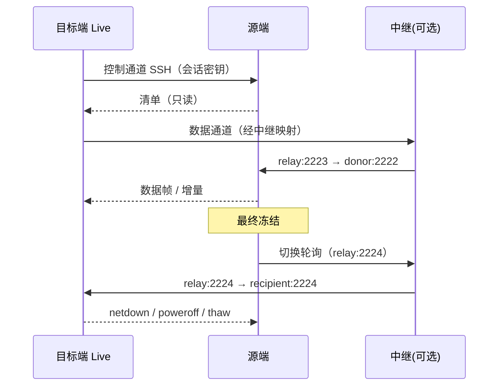

# 安全与信任边界

## 信任模型

migrator 需要在源端和目标端都拥有 root 权限，并建立 SSH 连接。它假定：

- 操作人员对两台主机拥有管理权限；
- 控制网络与数据网络处于可信环境，或通过可信中继连接；
- 目标磁盘在迁移前没有需要保留的数据；
- 源端磁盘是回滚依据，迁移期间不得被其它系统同时写入。

该工具不是为敌对网络中的匿名迁移设计的。它提供传输加密与完整性检查，但不提供端到端的身份认证体系。

## 源端只读承诺

### 磁盘

源端磁盘数据始终只读：

- 离线模式中源端运行 Live，原磁盘不被挂载；
- 在线模式中 agent 以只读方式打开块设备，写入追踪只记录元数据；
- 工具不对源端执行 `fsck`、`resize`、`mkfs` 或分区修改。

### 运行环境

在线模式会修改源端的运行环境：

1. 向 `/root/.ssh/authorized_keys` 追加一次性会话公钥；
2. 在 `/run` 下创建 tmpfs 挂载点并放入 agent 程序；
3. 创建轮询进程，在冻结后连接目标端。

这些修改不涉及源端磁盘数据，但会扩大源端 root 的 SSH 授权范围。

### 会话密钥

会话密钥由目标端在 `/run/migrator/id_ed25519` 生成，迁移结束后不会自动从源端 `authorized_keys` 删除。

建议：

- 迁移完成后手工删除对应公钥；
- 不在共享或长期运行的源端保留该公钥；
- 使用专用迁移密钥，不复用日常管理密钥。

## SSH 与传输

### 控制通道

- 使用 SSH ControlMaster 复用连接；
- 关闭主机密钥校验（`StrictHostKeyChecking=no`），`known_hosts` 位于临时目录；
- 会话密钥安装后，后续连接为仅密钥认证；
- 非交互环境强制 `BatchMode`，无法输入密码时会明确失败。

关闭主机密钥校验意味着 SSH 通道提供加密，但不验证对端主机身份。若控制网络存在中间人，攻击者可能截获或转发连接。该设计是为迁移 Live 的可重复部署与临时主机名服务的，不适合不可信网络。

### 数据通道

离线模式默认在源端启动第二个 sshd：

- 仅密钥认证；
- 不使用密码认证；
- 每个卷独立连接；
- 使用指定密码套件；
- 与 :22 的控制通道分离。

`-o data=raw` 使用 busybox `nc`：

- 不加密；
- 无完整性保护，只依赖 partclone 校验；
- 仅适用于可信局域网。

### 在线 agent

- agent 为静态二进制，运行时零依赖；
- 通过 SSH 会话传输数据帧；
- 每个数据帧独立压缩；
- 冻结后的轮询由源端主动连接目标端，避免在冻结根文件系统上建立新的 SSH 会话。

## 中继

中继模式把源端 root 的 SSH 端口与数据端口发布到中继主机：

- `relay:2222` → 源端 `:22`；
- `relay:2223` → 源端 `:2222`；
- `relay:2224` → 目标端 `:2224`。

安全要求：

- 中继主机应由可信方管理；
- 中继的 `authorized_keys` 只包含本次迁移使用的公钥；
- 迁移结束后关闭隧道与相关授权；
- 中继不得与其它租户共享固定端口；
- 中继的 `GatewayPorts` 会把端口绑定到非环回地址，应通过防火墙限制来源。

当前实现为单租户模型，不提供租户隔离、配额或审计。

## 发布物与安装

- 仓库是唯一来源，没有内置的厂商下载地址；
- `tools/install.sh` 要求 `MIGRATOR_URL` 指向自行托管的目录；
- 安装前校验 `SHA256SUMS`，且只接受一个 `migrator-<ver>.tar.gz`；
- 安装采用临时目录与原子替换，失败不会留下半安装状态；
- 发布方应自行生成 tarball 与校验和，并保护发布目录。

迁移 Live 构建时，两份脚本对密钥的处理不同：

- `rig/build-live.sh` 只把公钥写入 Live 的 root `authorized_keys`；
- `rig/build-live-debootstrap.sh` 会把 `KEY` 指定的私钥复制到 Live 的 `/root/rig-key`，供实验台与自包含引导使用。

后者只适用于受控实验环境，不得使用生产密钥。发布用的 Live 应使用专用密钥，并在分发前确认镜像中是否包含私钥。

## 日志与计划中的敏感信息

计划与日志可能包含：

- 主机名、DMI 型号与序列号；
- MAC 地址、IP 地址；
- 磁盘序列号、WWID、分区 GUID；
- 文件系统 UUID；
- LVM 与 md 阵列标识；
- 服务、用户与配置路径；
- 部分配置文件的原始内容与差异。

验证通过后，这些记录会复制到目标系统的 `/root/migrator-<日期>/`。应按内部运维资料管理，不应公开分发。

日志中的命令以可重放形式记录。若日志被未授权人员获取，可能暴露系统结构与管理方式。

## 数据保护

- 迁移不改变源磁盘的加密状态；源端未加密，目标端也未加密；
- 不支持 LUKS 或其他磁盘加密层；
- 传输加密由 SSH 提供，`data=raw` 除外；
- 目标盘在迁移后包含完整系统数据，应与源端同等保护；
- 目标系统上的 `/var/lib/migrator/orig/` 保留被修改配置文件的原始版本，可能包含敏感配置。

## 安全相关配置

### cloud-init

默认禁用 cloud-init 的网络与主机名重配置，防止目标端首次启动时被云平台覆盖。该处理也可能阻止合法的重新初始化流程。需要云平台接管时使用 `-o cloudinit=keep`。

### Secure Boot

目标端启用 Secure Boot 时：

- 源端必须为 UEFI；
- ESP 上应存在 `shimx64.efi`；
- 工具无法验证签名链，只按文件名判断；
- 迁移后若校验失败，应在固件中暂时禁用 Secure Boot，确认系统后再处理签名。

### SELinux

rhel 系在文件级复制或 SELinux 启用时，会在目标系统写入 `/.autorelabel`，使首次启动重新标记安全上下文。

## 最小权限建议

1. 使用专用迁移密钥，不复用日常管理密钥。
2. 迁移完成后从源端删除会话公钥。
3. 迁移期间限制源端 SSH 来源地址。
4. 中继使用独立主机与独立密钥，迁移完成后关闭隧道。
5. 不在不可信网络使用 `data=raw`。
6. 对计划、日志与迁移记录按敏感资料保管。
7. 切换前完成验证，不为赶时间跳过 verify。
8. 迁移后检查源端与新主机的网络隔离，避免同一 IP 同时在线。

## 相关文档

- [产品概览](01-overview.md)
- [迁移模式](04-modes.md)
- [故障排查](11-troubleshooting.md)
- [发布与安装布局](maintainers/release.md)
