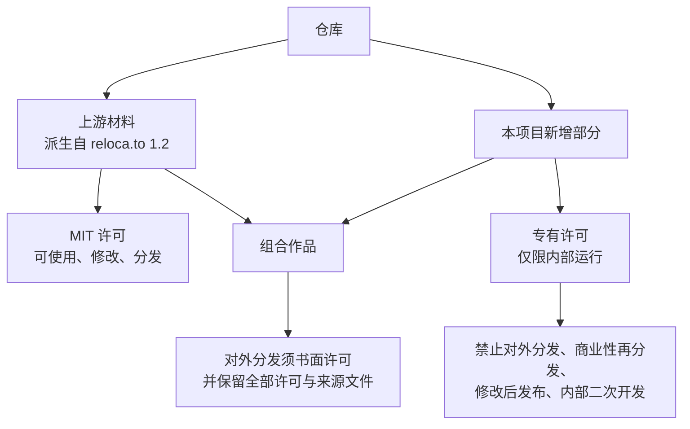

# 许可与再分发政策

本页说明 migrator 的许可结构、允许的使用方式与限制。完整法律文本以仓库根目录的 `LICENSE`、`LICENSE-UPSTREAM`、`NOTICE` 与 `TRADEMARK.md` 为准。

## 双许可结构

本仓库包含两类材料：

| 材料 | 范围 | 许可 | 文件 |
|---|---|---|---|
| 上游材料 | 派生自 reloca.to 1.2 的代码、脚本、文档及其修改 | MIT | `LICENSE-UPSTREAM` |
| 本项目新增部分 | 除上游材料外，由本项目版权方创作或修改的代码、脚本、文档、构建系统、测试、设计与文案 | 专有 | `LICENSE` |
| 组合作品 | 仓库、构建产物、迁移 Live、发布包 | 同时受上述两份许可约束 | `LICENSE`、`LICENSE-UPSTREAM` |

凡无法明确归属于本项目新增部分的内容，按上游材料处理。该规则用于避免扩大专有许可的适用范围。

## 允许的行为

在遵守许可条件的前提下，允许：

- 为自身或所在组织的内部迁移运维运行本软件；
- 为评估、测试或兼容性验证运行本软件；
- 制作不可对外提供的内部备份；
- 通过命令行选项、配置文件、环境变量与外部编排脚本使用本软件；
- 依据 MIT 许可使用、复制、修改、发布、分发、再许可和销售上游材料。

内部商业使用属于允许范围。例如，企业可以在自己的数据中心内使用本工具执行迁移，不构成商业性再分发。

## 禁止的行为

未经版权方书面许可，不得：

- 对外复制、发布、传播、提供、出租、出售、转让或再许可组合作品或本项目新增部分；
- 将组合作品或本项目新增部分用于商业性再分发，包括收费产品、托管服务、代维服务、云服务或其它对外服务；
- 修改、翻译、改编、拆解、反向工程、反编译本项目新增部分，或创建衍生作品；
- 进行内部二次开发、外包开发、二次封装、集成到其它产品或服务，或开发替代产品；
- 移除、遮蔽、修改或伪造版权、许可、来源、版本或作者标识；
- 使用“migrator”名称、标识或近似标识，造成来源混淆或暗示官方授权、合作或背书；
- 将本项目新增部分提供给第三方用于上述行为。

## 上游材料为什么仍是 MIT

本项目派生自 reloca.to 1.2。上游材料依据 MIT 许可发布，MIT 明确授予使用、复制、修改、发布、分发、再许可和销售的权利。这些权利不因本项目新增专有条款而改变。

因此：

- 不能把包含上游材料的整个仓库改为“禁止再分发”；
- 不能对上游材料施加与 MIT 冲突的限制；
- 上游材料的接收方仍可依据 MIT 许可使用、修改和分发上游材料；
- 本项目只能对本项目新增部分设定更严格的许可条件。

## 已分发的副本

MIT 许可不可撤销。在本许可调整之前已依据 MIT 许可合法分发的副本，其接收方仍享有该许可授予的权利。

本许可调整适用于：

- 新分发的版本；
- 本项目新增部分；
- 未包含在既有 MIT 副本中的新表达。

它不适用于已经合法获得的上游材料副本。

## 组合作品的分发

组合作品的对外分发须取得版权方书面许可。经许可分发时：

1. 必须同时提供 `LICENSE`、`LICENSE-UPSTREAM`、`NOTICE` 与 `TRADEMARK.md`；
2. 不得删除或修改版权、许可与来源说明；
3. 不得对上游材料施加与 MIT 许可冲突的限制；
4. 不得暗示官方来源、授权或背书。

## 名称与标识

“migrator”名称、发布物命名与标识不随代码许可授予。修改版本或衍生版本应使用明显不同的名称，移除项目标识，并明确说明来源与修改内容。

叙述性地提及本项目，或说明某环境“基于 migrator 构建”，在不造成混淆的前提下可以保留。

## 常见问题

### 可以在公司内部使用本工具执行迁移吗？

可以，包括商业性内部运维使用。该使用不属于对外分发或商业性再分发。

### 可以修改代码后在公司内部使用吗？

未经书面许可不可以。内部修改、扩展、封装与集成均属于内部二次开发，需要版权方书面许可。

### 可以基于本项目开发自己的迁移产品吗？

不可以。该行为属于修改后发布或衍生开发，需要版权方书面许可。

### 可以复制上游材料到其它项目吗？

可以。上游材料仍依据 MIT 许可提供，但应保留 `LICENSE-UPSTREAM` 中的版权声明与许可文本。

### 可以把本项目整体改成禁止再分发吗？

不能。上游材料的 MIT 权利不能被后续许可撤销或限制。当前结构是对新增部分设定专有条款，同时保留上游 MIT 许可。

### 许可边界如何确定？

以无法明确归属即按上游材料处理为原则。具体文件或代码块的边界、组合作品的分发方式与商业授权，应由法律顾问审核确认。

## 执行与限制

许可是法律授权，不是技术控制。源码可见不等于授权修改；许可限制的是复制、修改、分发、再分发与创建衍生作品等行为。对私下修改、内部使用范围与供应链分发，仍需通过合同、企业授权协议与内部管理制度约束。

若需要比本许可更强的控制，例如限制特定组织、按席位授权、禁止任何形式的源码提供，应采用受控分发与企业协议，并由法律顾问设计条款。

## 申请许可

商业性再分发、对外分发、二次开发、名称使用或其它超出许可范围的行为，应向版权方书面申请。版权方可按具体场景签订许可协议或企业授权协议。

## 法律说明

本页与仓库中的许可文件是项目版权方拟定的许可框架，不构成法律意见。对外发布、商业授权或再分发前，应由具备资质的法律顾问审核具体条款、上游材料边界与组合作品的分发方式。

## 相关文档

- [产品概览](01-overview.md)
- [安全与信任边界](13-security.md)
- [发布与安装布局](maintainers/release.md)
