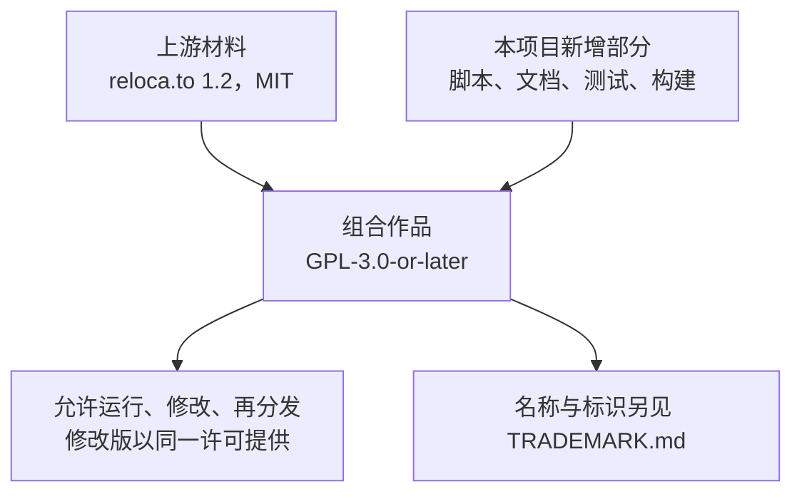

# 许可与再分发政策

本页说明 migrator 的许可结构、可以做什么、分发时要带什么。完整法律文本以仓库根目录的
`LICENSE`、`LICENSE-UPSTREAM`、`NOTICE` 与 `TRADEMARK.md` 为准。

## 许可结构

| 材料 | 范围 | 许可 | 文件 |
|---|---|---|---|
| 上游材料 | 派生自 reloca.to 1.2 的代码、脚本、文档及其修改 | MIT | `LICENSE-UPSTREAM` |
| 本项目新增部分 | 除上游材料外，由本项目版权方创作或修改的代码、脚本、文档、构建系统、测试、设计与文案 | GPL-3.0-or-later | `LICENSE` |
| 组合作品 | 仓库、构建产物、迁移 Live、发布包 | GPL-3.0-or-later | `LICENSE` |

凡无法明确归属于本项目新增部分的内容，按上游材料处理。

## 为什么整体是 GPL

MIT 允许再许可，因此可以把上游材料与新增部分合在一起，以 GPL-3.0-or-later 分发。这样做的
结果是：整份作品只有一套许可条件，使用方不需要分别判断某个文件属于哪一段；同时上游的版权
声明与许可文本必须原样保留，见 `LICENSE-UPSTREAM`。

上游材料本身仍可依 MIT 使用。两者冲突时，就上游材料而言以 MIT 为准。

## 可以做的

- 在任意数量的机器上运行，包括商业性使用；
- 修改代码，用于内部或对外发布；
- 再分发原版或修改版，包括商业性再分发、随产品分发、托管为服务；
- 收取分发费用或支持费用；
- 为迁移服务收费。

## 分发时的条件

分发原版或修改版时：

1. 随附 `LICENSE` 全文与 `LICENSE-UPSTREAM`、`NOTICE`、`TRADEMARK.md`；
2. 提供对应的完整源码；以二进制形式分发时，按 GPL 第 6 节的方式提供；
3. 修改过的文件标明改动，并注明日期；
4. 不得对接收方施加 GPL 之外的额外限制；
5. 不得使用项目名称与标识暗示官方来源，见下节。

第 2 条意味着：把 migrator 装进自己的产品、做成镜像或对外提供服务时，需要能提供对应版本的
源码。

## 名称与标识

“migrator”名称、发布物命名与标识不在代码许可范围内，适用 `TRADEMARK.md`。该政策只约束
名称与标识，不限制 GPL 授予的任何权利：

- 分发未经修改的副本可以使用项目名称，例如镜像站、发行版仓库；
- 发布修改版时应改用不同的名称，并说明其来源与改动；
- 叙述性提及，或说明某环境“基于 migrator 构建”，在不造成混淆的前提下可以保留。

## 与发行版打包的关系

GPL-3.0-or-later 符合 Debian 自由软件指导原则与 Ubuntu 的许可要求，可以进入两个发行版的
归档。仓库已包含 `debian/` 打包目录，许可在两处记录：

- `debian/copyright`：按机器可读格式分列上游 MIT 与本项目 GPL；
- 安装后的 `/usr/share/doc/migrator/`：`LICENSE`、`LICENSE-UPSTREAM`、`NOTICE`、
  `TRADEMARK.md`。

## 更早的版本

在许可调整之前发布的版本，仍按发布时所附的条款适用；调整适用于之后的版本与新分发的副本。
已经依据 MIT 许可获得的副本，其权利不因本次调整而改变。

## 常见问题

### 可以在公司内部使用吗？

可以。运行、修改、内部部署都不需要联系版权方。

### 可以修改后只在内部使用吗？

可以。GPL 只在分发时产生源码提供义务；内部使用不构成分发。

### 可以基于本项目做自己的迁移产品或托管服务吗？

可以，条件是按 GPL 提供源码，并改用不同的名称。商业性再分发本身不违反许可。

### 可以复制上游材料到其它项目吗？

可以。上游材料仍可依 MIT 使用，保留 `LICENSE-UPSTREAM` 中的版权声明与许可文本即可。

### 可以把本项目改成禁止再分发吗？

不能。上游材料的 MIT 授权不能被后续许可撤销，GPL 也不允许对接收方追加额外限制。

### 要交版权方审核吗？

不需要。使用与再分发依 `LICENSE` 进行即可。名称使用与品牌合作另见 `TRADEMARK.md`。

## 无担保

本作品按“现状”提供，不提供任何明示或默示担保。迁移涉及磁盘写入与系统切换，使用前应确认
目标磁盘、网络条件与数据备份。

## 相关文档

- [产品概览](01-overview.md)
- [安全与信任边界](13-security.md)
- [发布与安装布局](maintainers/release.md)
