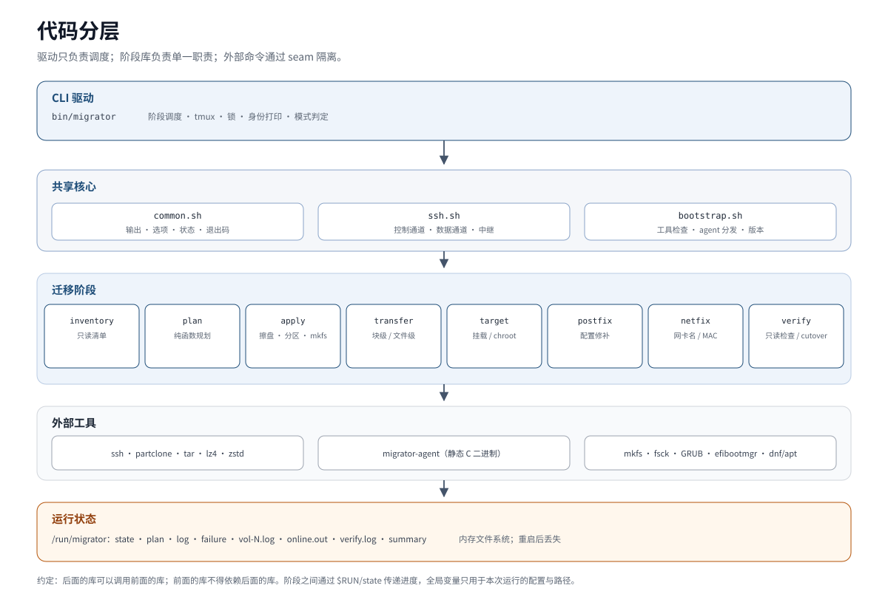
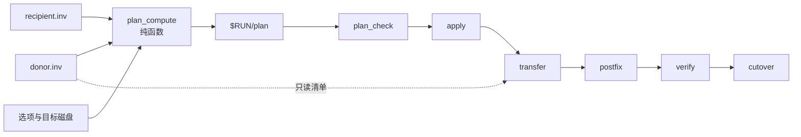
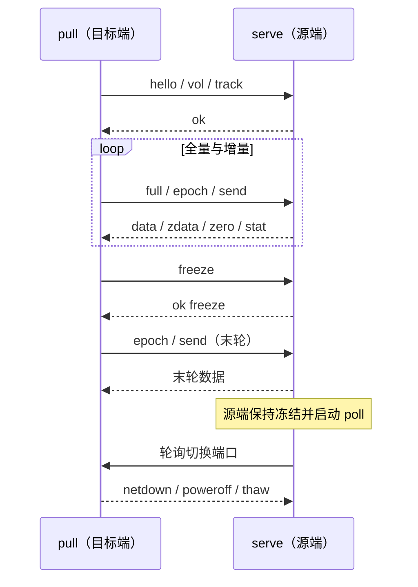

# 代码结构与数据流

## 分层



```text
bin/migrator
   |
   +-- lib/common.sh      输出、命令、选项、状态、锁、清理、退出码
   +-- lib/ssh.sh         控制通道、数据通道、身份校验、中继
   +-- lib/bootstrap.sh   两端工具、agent 分发、版本一致性
   +-- lib/inventory.sh   两端清单采集
   +-- lib/plan.sh        纯规划核心与计划校验
   +-- lib/apply.sh       目标盘写入
   +-- lib/transfer.sh    数据复制
   +-- lib/target.sh      目标树挂载
   +-- lib/postfix.sh     目标系统修补
   +-- lib/netfix.sh      网络配置改写
   +-- lib/verify.sh      验证与切换
   |
   +-- agent/             源端 serve、目标端 pull、写追踪、冻结、轮询
   +-- tools/             安装、自包含引导、中继、agent 测试
   +-- rig/               QEMU 实验台与 Live 构建
   +-- tests/             shellcheck 与表驱动测试
```

驱动按固定顺序加载库：

```text
common -> ssh -> bootstrap -> inventory -> plan -> apply
       -> transfer -> target -> postfix -> netfix -> verify
```

后面的库可以调用前面的函数；前面的库不得依赖后面的库。

## 数据流



```text
                 donor                         recipient
                   |                               |
            inventory.sh (只读)             inventory.sh (只读)
                   |                               |
                   +---------> plan_compute <------+
                                   |
                             $RUN/plan
                                   |
                              plan_check
                                   |
                                apply
                                   |
                             transfer  <---- agent / ssh / nc
                                   |
                               postfix
                                   |
                                verify
                                   |
                                cutover
```

### 清单

`inventory.sh` 可以独立流式执行。目标端通过 `rsh bash -s` 把脚本送到源端。源端只需要 bash、mawk 和基础工具，不需要 `common.sh`。

清单输出为制表符分隔的记录，格式见 [清单记录格式](inventory-format.md)。

### 计划

`plan_compute` 是纯函数：

```text
输入：donor.inv、recipient.inv、目标磁盘参数、选项
输出：计划文本（stdout）
错误：退出码 4，最后一行 `# ERROR: ...`
```

它不访问块设备，不读取 `$RUN`，不依赖环境变量。目标盘首 MiB 的指纹由 `plan_build` 在写入计划后补充。

`plan_check` 重新计算 apply 将要信任的内容。它读取计划、清单和当前磁盘状态，不写入任何设备。

### 写入

`apply` 的顺序固定：

1. 计划校验；
2. 指纹门禁；
3. 人工确认；
4. 停用目标盘上的 swap、VG、md、dm；
5. 清除旧签名；
6. 其它磁盘设为只读；
7. 分区；
8. 记录目标盘指纹；
9. 创建 md 阵列；
10. 创建 LVM；
11. 格式化并校验特性掩码；
12. 标记阶段完成。

`apply` 不连接源端。

### 传输

`transfer` 根据 `$RUN/state` 中的 `mode` 选择离线或在线路径：

- 离线：partclone 或 tar，经源端数据 sshd 或 `nc`；
- 在线：agent `pull`，块级卷统一会话，文件级卷由 tar 多轮增量，冻结后完成末轮。

每个卷的状态记录在 `$RUN/state`，键为 `vol.<src>`，值为 `pending`、`running`、`done`、`failed`。

### 修补

`postfix` 通过 `target_mount rw binds` 挂载目标树，按以下顺序执行：

```text
mountpoints -> fstab -> mdadm -> cmdline -> lvm -> network
-> initramfs -> bootloader -> swapfiles -> cloudinit -> selinux -> sysctl
```

文件改写采用纯函数：

```text
旧文件 --纯改写器--> 新内容
         |
      pf_apply
         |
   diff 输出 + 备份 + 原地截断写入
```

`pf_apply` 只在内容变化时写入，保留原 inode、属主、权限与 SELinux 标签。原文件备份到目标系统的 `/var/lib/migrator/orig/`。

### 验证

`verify` 以只读方式挂载目标树，按 `VF_CHECKS` 顺序执行检查：

```text
boot -> initramfs -> fstab -> cmdline -> filesystems
-> bootloader -> network -> md -> misc
```

每个检查通过 `vf_ok`、`vf_warn`、`vf_fail` 记录结果。任意 `vf_fail` 使退出码为 3。

验证使用 seam 函数隔离外部命令，便于测试：

```text
vf_initrd_list     vf_resolve_spec   vf_masks_of
vf_disk_head       vf_part_head      vf_partuuid
vf_efibootmgr      vf_boottest_disk  vf_boottest_run
```

### 切换

`cutover` 分两条路径：

- 离线：通过 SSH 控制通道向源端发送延迟命令，然后 ping 确认源端离线；
- 在线：通过源端轮询进程发送 `netdown`、`poweroff` 或 `thaw`，不建立新的 SSH 会话。

确认源端离线后才启动目标端。

## 状态模型

状态文件为 `$RUN/state`，每行 `key=value`，同一键保留最后一次写入。

| 键族 | 示例 | 用途 |
|---|---|---|
| `phase.*` | `phase.apply=done` | 阶段完成标记 |
| `vol.*` | `vol./dev/sda2=done` | 卷状态与时间戳 |
| `target.*` | `target.disk=/dev/sda` | 目标盘指纹 |
| `donor.*` | `donor.target=root@host:22` | 源端连接信息 |
| `agent.*` | `agent.path=/usr/local/sbin/migrator-agent` | agent 位置与版本 |
| `online.*` | `online.cutover_token=...` | 在线切换凭据 |
| `relay.*` | `relay.cutover_port=2224` | 中继端口 |

失败时写入 `$RUN/failure`：

```text
exit=<code> phase=<phase> volume=<volume> reason=<reason> log=<path>
```

## 退出码

退出码只在 `lib/common.sh` 定义：

| 变量 | 值 | 含义 |
|---|---|---|
| `EX_OK` | 0 | 成功 |
| `EX_FAIL` | 1 | 运行时失败 |
| `EX_ENV` | 2 | 用法、环境或身份错误 |
| `EX_VERIFY` | 3 | 验证失败，目标盘已写入 |
| `EX_PLAN` | 4 | 计划不可行或被拒绝 |

新增退出码会破坏文档、测试与外部集成的一致性。不得在库中直接使用数字。

## 锁与并发

- 每个 Live 只允许一个 migrator 实例；
- 锁文件为 `$RUN/lock`，使用 `flock`；
- tmux 重执行前必须释放锁，避免内层实例与 tmux 客户端互相阻塞；
- 第二个实例会提示使用 `-s attach`。

## agent 协议



### serve

源端运行 `migrator-agent serve`，从标准输入读取命令，向标准输出写帧。命令包括：

```text
hello
comp none|zstd[:LEVEL]
vol ID PATH
track MODE CHUNK
epoch SETTLE_MS MAX_MS
full ID
send ID
freeze
thaw
hash ID
quit [thaw]
```

帧类型：

```text
data ID OFF LEN
zdata ID OFF RAW COMP
zero ID OFF LEN
stat k=v ...
log TEXT
hash ID HEX
ok ...
err TEXT
```

压缩作用于每个数据帧的负载，不作用于会话。会话是交互式的，流压缩器会缓存短写，导致应答无法即时到达。

### pull

目标端运行 `migrator-agent pull`，驱动一个 serve 会话：

1. 首轮全量；
2. 逐轮增量；
3. 判断收敛；
4. 冻结；
5. 末轮增量；
6. 可选哈希校验；
7. 保持冻结并启动源端轮询。

收敛判断依据源端写入速率与链路速率。参数为 `--passes`、`--converge`、`--max-est`、`--patience`、`--settle`、`--stall`。

### 切换轮询

```text
源端：quit poll HOST PORT TOKEN
      -> 保持冻结，派生 migrator-agent poll
目标端：migrator-agent cutover --port PORT --token TOKEN netdown|poweroff|thaw|ping|exit
```

只有收到目标端应答才刷新轮询存活时间。仅建立 TCP 连接不算成功；中继等场景可能接受连接后立即关闭。

源端在 1800 秒内未收到应答时解冻。

## 扩展点

### E1：自建迁移 Live

- 标记文件 `/etc/migrator-live-release`，兼容读取上游 `/etc/xserver-live-release`；
- Live 烘焙全部运行时依赖与工具本体；
- 构建脚本见 `rig/build-live.sh` 与 `rig/build-live-debootstrap.sh`；
- 自包含引导见 `tools/live-entry.sh`。

### E2：中继

- 源端运行 `tools/relay-tunnel.sh`，建立 `relay:2222 -> donor:22` 与 `relay:2223 -> donor:2222`；
- 目标端使用 `-o relay=` 建立 `relay:2224 -> recipient:2224`；
- 传输层不做改动；
- 中继预检 `GatewayPorts` 与 `AllowTcpForwarding`；
- 当前为单租户、固定端口。

### E3：跨运行状态持久化

设计目标：agent 位图落盘、目标端检查点令牌、跨运行续传、失效时降级全量。

当前状态：部分实现。`serve --listen` 让会话（tracker 位图与冻结状态）活过链路中断，`attach` 作为重连客户端；通道断开后 `resume ID OFF` 从已覆盖位置续走全量，并补发断开窗口内的 pending 集。目标端落 journal（session、卷、size、have）后，pull 进程中断可由下一个 run 接手，前提是源端仍持有该 session；源端返回新 session 时 journal 被拒绝，降级为全量。尚未实现：任一端整机重启（记录位于内存），以及源端自身重启（停机期间的写入无人跟踪）。

### E4：试启动验证

- `-o boottest=1`；
- 目标盘 qcow2 叠加盘；
- 直接内核引导；
- 串口断言多用户；
- 低内存或缺少 QEMU 时降级为警告。

## 安全机制的位置

| 机制 | 代码位置 | 作用 |
|---|---|---|
| 同机守卫 | `lib/ssh.sh` `ssh_guard_same_box` | nonce、DMI 序列号、启动 MAC |
| 期望身份 | `lib/ssh.sh` `expect=` | 校验源端序列号或 MAC |
| 计划校验 | `lib/plan.sh` `plan_check` | 写入前验证布局与容量 |
| 目标盘指纹 | `lib/apply.sh` | 防止计划生成后磁盘被替换 |
| 验证门禁 | `lib/verify.sh` | 失败时阻止切换 |
| 源端离线确认 | `lib/verify.sh` | 防止两台主机同时使用同一 IP |
| 源端只读 | `lib/transfer.sh`、`agent/` | 只读打开源端块设备 |

## 相关文档

- [清单记录格式](inventory-format.md)
- [测试体系](testing.md)
- [QEMU 实验台](rig.md)
- [迁移 Live 构建](live-build.md)
