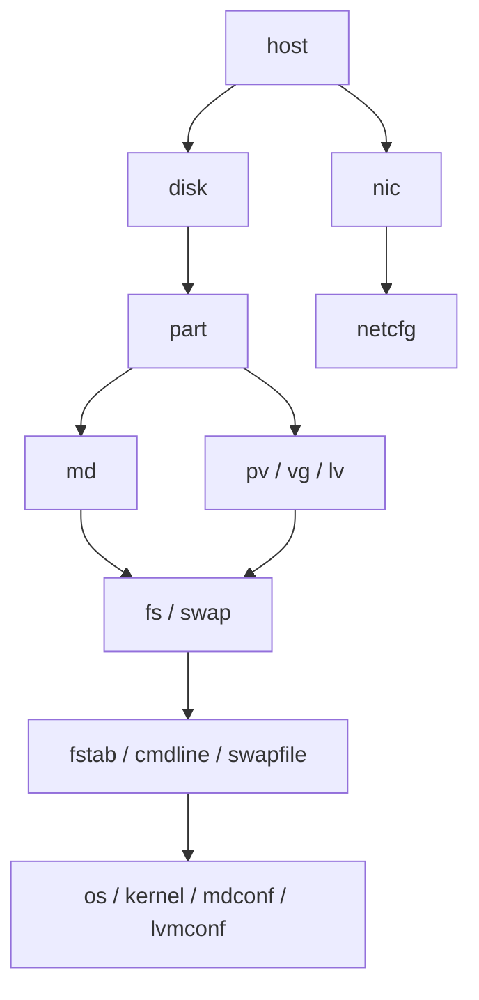

# 清单记录格式

`lib/inventory.sh` 输出制表符分隔的记录。每条记录一行，格式为：

```text
<type><TAB>key=value<TAB>key=value...
```

规则：

- 第一个字段是记录类型，后续字段为 `key=value`；
- 值中的制表符、换行与回车会替换为空格；
- 没有转义序列，值本身不包含制表符；
- 注释行以 `#` 开头，读取器忽略；
- 记录顺序不作为契约；按类型与键查找。

读取函数：

```bash
inv_records FILE TYPE              # 某类型的全部记录
inv_field RECORD KEY               # 一条记录的一个值
inv_lookup FILE TYPE MATCHKEY MATCHVAL FIELD
```

## 记录之间的关系



## 记录类型

### `host`

本机身份与引导环境。

| 键 | 含义 |
|---|---|
| `role=` | `donor` 或 `recipient` |
| `hostname=` | 主机名 |
| `live=` | 是否为迁移 Live |
| `fw=` | 实际固件：`bios` 或 `uefi` |
| `secureboot=` | Secure Boot 状态 |
| `bootnic=` / `bootmac=` / `bootip=` | 启动网卡、MAC、地址 |
| `gw=` | 默认网关 |
| `dmi_vendor=` / `dmi_product=` / `dmi_serial=` / `dmi_uuid=` | DMI 信息 |
| `ncpu=` / `ram=` | CPU 数、内存字节数 |
| `awk=` | `mawk`、`gawk` 或 `other` |
| `online=1` | 在线模式的源端 |
| `tar=1` | 存在 tar |

### `disk`

物理磁盘。

| 键 | 含义 |
|---|---|
| `dev=` | 设备路径 |
| `size=` / `lsec=` / `psec=` | 容量、逻辑扇区、物理扇区 |
| `model=` / `serial=` / `wwn=` / `byid=` | 标识 |
| `tran=` | 传输类型，例如 `sata`、`nvme`、`usb` |
| `rm=` / `ro=` | 可移动、只读 |
| `pttype=` / `ptuuid=` | 分区表类型与标识 |
| `drivers=` / `modalias=` | 驱动与硬件标识 |
| `usage=` | 当前用途：`old-os:*`、`md:*`、`lvm:*`、`fs:*`、`parts:N`、`sig:*`、`free` |

`usage` 用于判断目标盘当前是否为空，以及目标盘是否承载旧系统。

### `part`

分区。

| 键 | 含义 |
|---|---|
| `dev=` / `disk=` | 分区与所属磁盘 |
| `num=` | 分区号 |
| `start=` / `size=` | 起始扇区、扇区数 |
| `type=` | 分区类型代码或 GUID |
| `bootable=` | 启动标志 |
| `partuuid=` | 分区 UUID |
| `name=` | 分区名 |
| `fstype=` | 文件系统类型 |
| `ptype=` | `primary`、`logical`、`extended` |

### `md`

md 阵列。

| 键 | 含义 |
|---|---|
| `dev=` | 阵列设备 |
| `level=` | RAID 级别 |
| `uuid=` / `name=` / `metadata=` | 阵列标识 |
| `size=` | 容量 |
| `members=` | 成员设备列表 |
| `data_offset=` | 数据偏移扇区数 |
| `state=` | `clean`、`active`、`degraded`、`resync` |
| `ro=` | 是否只读 |

### `pv` / `vg` / `lv`

LVM 对象。

| 类型 | 键 |
|---|---|
| `pv` | `dev=`、`uuid=`、`vg=`、`size=`、`pe_start=` |
| `vg` | `name=`、`uuid=`、`size=`、`free=`、`pvs=` |
| `lv` | `path=`、`vg=`、`name=`、`uuid=`、`size=`、`segtype=` |

### `fs`

文件系统。

| 键 | 含义 |
|---|---|
| `dev=` / `type=` / `uuid=` / `label=` | 基本信息 |
| `fssize=` / `used=` | 总容量、已用空间 |
| `inodes_used=` / `inodes_total=` | inode 使用情况 |
| `min=` | 文件系统可缩到的最小容量 |
| `state=` | `clean`、`dirty`、`errors` |
| `bs=` / `isz=` / `ssz=` / `dirbs=` | 块、inode、扇区、目录块大小 |
| `features=` / `journal_features=` | 特性列表 |
| `masks=` | 原始特性掩码，用于目标端 `mkfs` 后比对 |
| `volid=` | vfat 卷 ID |

### `swap`

swap 设备。

| 键 | 含义 |
|---|---|
| `dev=` / `uuid=` / `label=` / `size=` | 基本信息 |

### `nic`

网卡。

| 键 | 含义 |
|---|---|
| `name=` / `mac=` | 名称与 MAC |
| `driver=` / `modalias=` / `pci=` | 驱动与总线位置 |
| `speed=` / `link=` | 速率与链路状态 |
| `firmware=` | 驱动所需固件 |
| `onboard=` | 板载标识 |

### `os`

源端操作系统信息，仅 donor 清单。

| 键 | 含义 |
|---|---|
| `root=` | 根设备 |
| `id=` / `like=` / `version=` / `family=` / `pretty=` | 发行版信息 |
| `hostname=` | 主机名 |
| `initramfs=` | `initramfs-tools`、`dracut` 或 `-` |
| `grub=` | `grub2` 或 `grub1` |
| `grubcfg=` | GRUB 配置路径 |
| `bls=` | 是否存在 BLS 条目 |
| `efidir=` | ESP 挂载点 |
| `selinux=` | SELinux 模式 |
| `cloudinit=` | 是否安装 cloud-init |
| `netcfg=` | 网络配置类型 |
| `primary_nic=` / `primary_mac=` / `primary_ip=` / `gw=` | 主网络配置 |
| `ifnames=` / `biosdevname=` | 网卡命名方式 |
| `machine_id=` | machine-id |
| `kernels=` | 内核数量 |
| `mdadm=` | 是否安装 mdadm |

### `kernel`

源端内核。仅 donor 清单。

| 键 | 含义 |
|---|---|
| `version=` | 内核版本 |
| `vmlinuz=` / `initrd=` | 内核与 initramfs 路径 |
| `aliases=` / `builtin=` | 模块别名与内建模块文件 |
| `pci_drivers=` | 目标硬件 modalias 对应的驱动映射 |

### `fstab`

源端 fstab 条目。

| 键 | 含义 |
|---|---|
| `spec=` | 设备标识 |
| `dev=` | 在源端解析到的设备 |
| `mount=` / `type=` / `opts=` | 挂载点、类型、选项 |
| `dump=` / `pass=` | dump 与 fsck 顺序 |
| `nofail=` | 是否带 `nofail` |

### `cmdline`

内核命令行来源。

| 键 | 含义 |
|---|---|
| `source=` | `grub-default`、`grub.d:*`、`kernel-cmdline`、`bls:*`、`grubenv` |
| `key=` | 变量名 |
| `value=` | 值 |

### `mdconf`

| 键 | 含义 |
|---|---|
| `file=` | 配置文件路径，缺失为 `-` |
| `arrays=` | ARRAY 行数 |
| `lines=` | ARRAY 行内容，分号分隔 |

### `lvmconf`

| 键 | 含义 |
|---|---|
| `file=` | `lvm.conf` 路径 |
| `filter=` / `global_filter=` | 过滤器配置 |
| `use_devicesfile=` | 是否使用 devices file |
| `devices_file=` | 是否存在 `/etc/lvm/devices/system.devices` |

### `swapfile`

| 键 | 含义 |
|---|---|
| `path=` | swap 文件路径 |
| `size=` | 文件大小 |
| `opts=` | fstab 选项 |

### `netcfg`

网络配置记录。

| 键 | 含义 |
|---|---|
| `file=` | 配置文件路径 |
| `kind=` | `ifcfg`、`keyfile`、`netplan`、`interfaces`、`networkd` |
| `iface=` / `mac=` | 接口与 MAC |
| `primary=` | 是否为主配置 |

## 采集行为

### recipient

只读采集本机：磁盘、分区、md、LVM、文件系统、swap、网卡。

### donor 离线

1. 拒绝处于 resync 的 md 阵列；
2. 将 md 阵列设为只读；
3. 激活卷组；
4. 从 fstab 找到已安装的根；
5. 以 `ro,noload` 或 `ro,norecovery` 挂载根、`/boot`、`/boot/efi`；
6. 采集 `os`、`kernel`、`fstab`、`cmdline`、`mdconf`、`lvmconf`、`swapfile`、`netcfg`；
7. 卸载，但保留阵列与卷组激活，供传输使用。

### donor 在线

1. 根为 `/`，按运行状态读取；
2. 不做存储准备；
3. 不卸载、不切换只读；
4. `host.online=1`。

### `--raw DIR`

每条解析命令的标准输出保存为 `DIR/<command>.txt`，标准错误保存为 `DIR/<command>.err`。源端配置文件树保留到 `DIR/tree/`。该模式用于诊断与制作测试夹具。

### `--root DIR`

在已挂载或已解包的源端树上采集，用于测试与离线分析。该模式不做存储准备、不发现、不挂载。

## 退出码

| 退出码 | 含义 |
|---|---|
| 0 | 成功 |
| 2 | 用法错误 |
| 4 | 源端不可用：阵列在同步、未找到已安装根等 |

## 相关文档

- [代码结构与数据流](architecture.md)
- [测试体系](testing.md)
- [计划文件](../07-plan-file.md)
