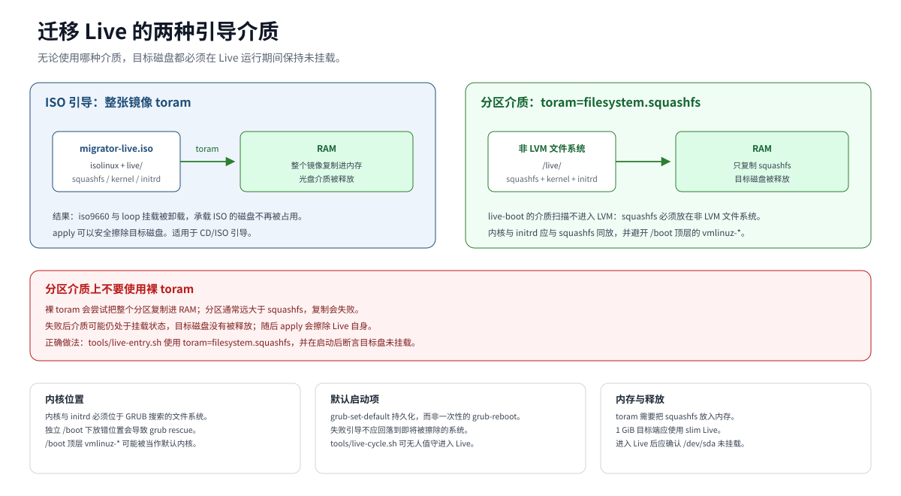

# 迁移 Live 构建

迁移 Live 是带 `/etc/migrator-live-release` 标记的完整 Debian bookworm 环境，包含 migrator、静态 agent、全部运行时工具、zram swap 与静态网络支持。



仓库提供两种构建方式：

| 脚本 | 适用环境 |
|---|---|
| `rig/build-live.sh` | 具备 mmdebstrap 的 Debian 系构建机，可在无特权容器中运行 |
| `rig/build-live-debootstrap.sh` | 无 mmdebstrap、但有 root 与 debootstrap 的 Debian/Ubuntu 构建机 |

## 共同产物

无论使用哪份脚本，构建结果都包含：

| 内容 | 位置或标记 |
|---|---|
| 迁移工具 | `/usr/local/sbin/migrator`、`/usr/local/lib/migrator/` |
| 静态 agent | `/usr/local/sbin/migrator-agent` |
| Live 标记 | `/etc/migrator-live-release` |
| zram swap | `migrator-zram.service` |
| 静态网络 | `migrator-live-net.service` |
| 公钥 | root 的 `authorized_keys` |

私钥不会烘焙进镜像。构建时使用的密钥对中，只有公钥进入 Live；私钥由运行脚本单独传输。

## `rig/build-live.sh`

### 环境变量

| 变量 | 默认 | 说明 |
|---|---|---|
| `RIG_OUT` | `$HOME/rig` | 输出目录 |
| `LIVE_PROFILE` | `full` | `full` 或 `slim` |
| `SUITE` | `bookworm` | Debian 套件 |
| `MIRROR` | `http://deb.debian.org/debian` | 镜像 |

### 流程

1. 创建 `$RIG_OUT`；
2. 若不存在则生成 rig 密钥对；
3. 使用 mmdebstrap 构建 minbase 系统并安装依赖；
4. 写入 Live 标记、网络配置、主机名；
5. 安装 zram 与静态网络服务；
6. 安装 migrator、库与 agent；
7. 生成 squashfs；
8. 生成 BIOS 引导 ISO。

### 输出

```text
$RIG_OUT/migrator-live.iso
$RIG_OUT/rig_ed25519
$RIG_OUT/rig_ed25519.pub
```

`full` 版 squashfs 使用 zstd，包含 QEMU；`slim` 版使用 xz，不包含 QEMU。`slim` 适合 1 GiB 内存目标端，但无法执行 `-o boottest=1`。

## `rig/build-live-debootstrap.sh`

### 环境变量

| 变量 | 默认 | 说明 |
|---|---|---|
| `BUILD_DIR` | `/root` | 构建与输出目录，需要约 6 GiB |
| `TARBALL` | `$BUILD_DIR/migrator2.tar.gz` | 源码快照，通常由 `git archive HEAD` 生成 |
| `REPO` | `$BUILD_DIR/migrator` | 源码解压目录 |
| `PROFILE` / `LIVE_PROFILE` | `slim` | `slim` 或 `full` |
| `MIRROR` | 清华镜像 | Debian 镜像 |
| `MK_OPTS` | 空 | 额外的 mksquashfs 参数 |
| `KEY` | `$BUILD_DIR/rig_ed25519` | 烘焙进 Live 的密钥对 |

### 流程

1. 检查 root、tarball、密钥；
2. 安装 debootstrap、squashfs-tools、xorriso、isolinux、syslinux-common、编译器与 libzstd；
3. 解压源码并编译 agent；
4. 使用 debootstrap 构建 minbase 系统；
5. 安装工具、库、agent、密钥、zram、静态网络；
6. 更新 initramfs，加入 virtio、squashfs、ext4、loop、isofs、overlay 等模块；
7. 生成 squashfs 与 ISO；
8. 额外输出内核、initrd 与 squashfs，供自包含引导使用。

### 输出

```text
$BUILD_DIR/migrator-live.iso
$BUILD_DIR/vmlinuz-live
$BUILD_DIR/initrd-live.img
$BUILD_DIR/live/live/filesystem.squashfs
```

该脚本从 `TARBALL` 构建，而不是直接使用工作区。发布物必须与源码一致；不要依赖运行时注入脚本修补 Live。

### 内存受限的构建机

`mksquashfs` 的 xz 压缩可能占用大量内存。共享内存的构建机上可使用：

```sh
MK_OPTS="-processors 1 -mem 700M" bash rig/build-live-debootstrap.sh
```

压缩器是构建过程中最容易被宿主 OOM killer 终止的步骤，且虚拟机被终止时不会留下日志。

## 引导参数

ISO 的 isolinux 配置使用：

```text
initrd=/live/initrd.img boot=live components toram
net.ifnames=0 biosdevname=0
systemd.default_timeout_start_sec=600
console=tty0 console=ttyS0,115200n8
```

| 参数 | 作用 |
|---|---|
| `toram` | 将整个 ISO 复制到内存，释放光盘介质，使目标磁盘可被擦除 |
| `net.ifnames=0 biosdevname=0` | 使用传统网卡名，保证 DHCP 与静态配置作用于 `eth0` |
| `systemd.default_timeout_start_sec=600` | 适应 QEMU TCG 等慢速引导环境 |
| `console=` | 串口调试；最后一个 `console=` 拥有 `/dev/console` |

在分区介质上不能使用裸 `toram`，因为 `toram` 会尝试复制整个分区并失败，可能使目标盘保持挂载。自包含引导应使用：

```text
toram=filesystem.squashfs
```

## 静态网络

Live 支持内核参数：

```text
migrator.ip=IP/PREFIX,GATEWAY,DNS1[,DNS2]
```

`migrator-live-net.service` 在启动时解析该参数并配置网卡。若 `net.ifnames=0` 未生效，服务会回退到第一个非 lo 接口。该机制用于无法依赖 DHCP 的环境。

## zram swap

`migrator-zram.service` 将内存的一半配置为 zstd 压缩 swap。该设计使 1 GiB 内存的目标端能够完成 postfix 的 initramfs 重建。

## 自包含引导

`tools/live-entry.sh` 把 squashfs、内核与 initrd 复制到目标机自身的一个非 LVM 文件系统，并写入 GRUB 条目，无需 ISO 或控制台。

```sh
tools/live-entry.sh -i 192.0.2.10/24,192.0.2.1,192.0.2.1 -s
```

关键约束：

1. **D25**：分区介质使用 `toram=filesystem.squashfs`，不能使用裸 `toram`。
2. **D28**：内核与 initrd 必须位于 GRUB 实际搜索的文件系统上；不一定是 `/boot`。
3. **D29**：存在独立 `/boot` 时，引导文件放在 `/boot` 但 GRUB 搜索 `/` 会导致 grub rescue。条目应按实际复制的文件系统生成。
4. **D30**：
   - live-boot 的介质扫描不进入 LVM，squashfs 必须放在非 LVM 文件系统；
   - `/boot` 顶层名为 `vmlinuz-*` 的文件会被 `update-grub` 当作最新内核，可能成为默认启动项；引导文件应放在 `live/` 子目录；
   - 使用 `grub-set-default` 持久化默认项，而不是只生效一次的 `grub-reboot`。

`tools/live-cycle.sh` 封装完整流程：

```sh
tools/live-cycle.sh -H root@host -S root@build-host:/root
```

步骤：

1. 读取目标机地址与默认网关；
2. 复制 `vmlinuz-live`、`initrd-live.img`、squashfs；
3. 在目标机上运行 `live-entry.sh`；
4. 重启并轮询 SSH；
5. 断言 `/etc/migrator-live-release`、zram swap、目标盘已由 `toram` 释放。

`-s` 使引导项成为持久默认项，适用于会擦除目标盘的迁移。无 `-s` 时为一次性引导项，普通重启可回到已安装系统。

## profile 选择

| 目标环境 | 建议 |
|---|---|
| 内存 ≥ 3 GiB，需要试启动 | `full` |
| 内存 1–2 GiB | `slim`，并关闭 `precheck` 与 `boottest` |
| 需要从 ISO 引导 | 任一 profile |
| 需要自包含引导 | `debootstrap` 脚本产出的内核、initrd 与 squashfs |

`slim` 版不包含 QEMU，`-o boottest=1` 会被跳过并产生警告。

## 构建检查

构建完成后应确认：

```sh
ls -lh migrator-live.iso
grep BUILD_ID live-rootfs/etc/migrator-live-release
```

ISO 引导后应确认：

```sh
cat /etc/migrator-live-release
migrator -V
swapon --show
test ! -e /dev/sda1 || echo "target disk still mounted"
```

自包含引导还应确认 `/dev/sda` 未被挂载：

```sh
findmnt -S /dev/sda >/dev/null && echo "target disk still mounted"
```

若仍被挂载，`apply` 会擦除 Live 自身。

## 相关文档

- [QEMU 实验台](rig.md)
- [测试体系](testing.md)
- [发布与安装布局](release.md)
