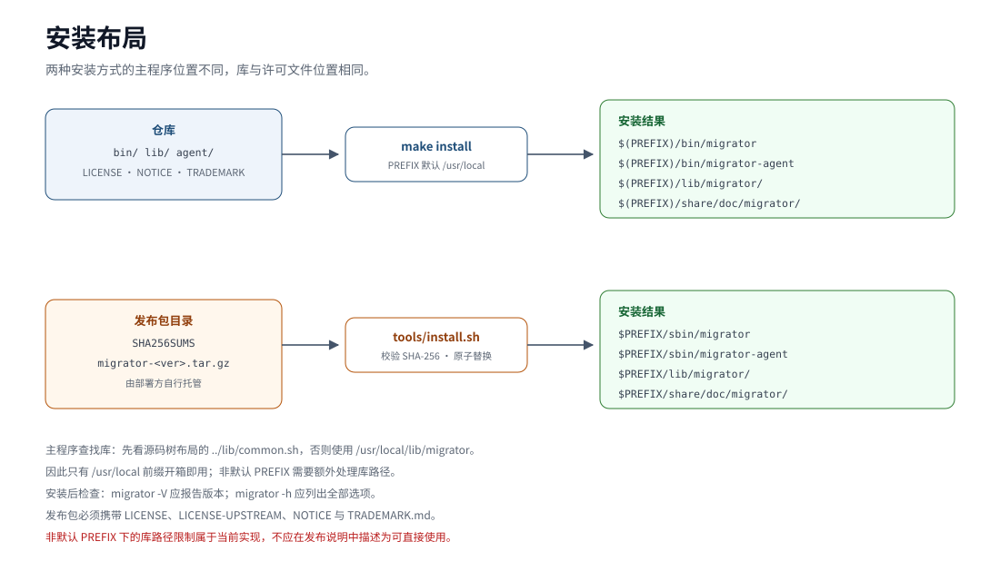

# 发布与安装布局

## 版本

仓库中的 `VERSION` 文件为 `1.2`，表示派生自 reloca.to 1.2。

运行时版本优先取 Git 描述：

```sh
git describe --always --dirty
```

没有 Git 信息时回退到 `VERSION`。`make install` 会把该值写入 `$(PREFIX)/lib/migrator/VERSION`；`tools/install.sh` 使用 tarball 内 `lib/VERSION` 的内容。

发布时应确保：

- tarball 文件名中的版本与 `lib/VERSION` 一致；
- `migrator -V` 报告该版本；
- 文档与发布说明引用同一版本。

## 安装布局



两种安装方式的目标路径不同：

| 方式 | 主程序 | agent | 库 | 许可与来源 |
|---|---|---|---|---|
| `make install` | `$(PREFIX)/bin/migrator` | `$(PREFIX)/bin/migrator-agent` | `$(PREFIX)/lib/migrator/` | `$(PREFIX)/share/doc/migrator/` |
| `tools/install.sh` | `$PREFIX/sbin/migrator` | `$PREFIX/sbin/migrator-agent` | `$PREFIX/lib/migrator/` | `$PREFIX/share/doc/migrator/` |

`PREFIX` 默认 `/usr/local`。

主程序的库查找逻辑为：

1. 主程序所在目录的上一级 `lib/common.sh`（适用于源码树的 `bin/` 布局）；
2. 否则使用 `/usr/local/lib/migrator`。

因此只有 `/usr/local` 前缀可以开箱即用。非默认 `PREFIX` 的安装需要额外处理库路径；发布说明中不应把非默认前缀描述为可直接使用。

`tools/install.sh` 采用原子替换：

- 先把库解压到 `$PREFIX/lib/.migrator.new.$$`；
- 移动主程序到临时文件；
- 最后统一重命名；
- 下载失败、校验失败或解包失败不会留下半安装状态。

## 发布包格式

`tools/install.sh` 期望 `MIGRATOR_URL` 指向的目录包含：

```text
SHA256SUMS
migrator-<ver>.tar.gz
```

`SHA256SUMS` 必须只列出一个 `migrator-*.tar.gz`，其格式应能被 `sha256sum -c` 使用：

```text
<sha256>  migrator-<ver>.tar.gz
```

tarball 的根目录必须为 `migrator-<ver>/`，并至少包含：

```text
migrator-<ver>/bin/migrator
migrator-<ver>/bin/migrator-agent   （可选）
migrator-<ver>/lib/common.sh
migrator-<ver>/lib/VERSION
migrator-<ver>/lib/*.sh
migrator-<ver>/LICENSE
migrator-<ver>/LICENSE-UPSTREAM
migrator-<ver>/NOTICE
migrator-<ver>/TRADEMARK.md
```

缺少 `bin/migrator`、`lib/common.sh` 或 `lib/VERSION` 时安装器拒绝继续。许可与来源文件是分发合规要求，发布包必须携带。

## 生成发布物


当前仓库没有内置的打包目标。发布方可以：

1. 从干净的 Git 工作区导出源码；
2. 编译静态 agent；
3. 组装 `migrator-<ver>/`；
4. 生成 tarball；
5. 生成 `SHA256SUMS`；
6. 放到自行托管的目录。

示例流程：

```sh
VER=1.2
make agent
mkdir -p dist/migrator-$VER/bin dist/migrator-$VER/lib
cp bin/migrator dist/migrator-$VER/bin/
cp agent/migrator-agent dist/migrator-$VER/bin/
cp lib/*.sh dist/migrator-$VER/lib/
cp VERSION dist/migrator-$VER/lib/VERSION
cp LICENSE LICENSE-UPSTREAM NOTICE TRADEMARK.md dist/migrator-$VER/
tar -czf dist/migrator-$VER.tar.gz -C dist migrator-$VER
cd dist
sha256sum migrator-$VER.tar.gz > SHA256SUMS
```

也可以使用 `git archive` 保留源码历史信息，再单独编译 agent。

发布前应确认：

- tarball 不包含 `.git`、构建缓存、测试夹具以外的大型文件；
- 不包含私钥、迁移记录、真实主机清单或日志；
- 包含完整许可与版权声明：`LICENSE`、`LICENSE-UPSTREAM`、`NOTICE` 与 `TRADEMARK.md`；
- agent 为静态链接，`ldd` 无动态依赖；
- `migrator -V` 与 `migrator -h` 在干净环境中可执行；
- `tools/install.sh` 能从 `file://` 与 HTTP(S) 两种来源安装。

## Debian 打包

仓库带 `debian/` 打包目录，产出两个包：

| 包 | 架构 | 内容 | 安装位置 |
|---|---|---|---|
| `migrator` | all | 驱动、库、手册页、许可文件 | `/usr/sbin/migrator`、`/usr/share/migrator/` |
| `migrator-agent` | any | 静态 agent | `/usr/lib/migrator/migrator-agent` |

驱动按候选路径查找库：`$HERE/../lib`、`$HERE/../lib/migrator`、`$HERE/../share/migrator`、
`/usr/local/lib/migrator`、`/usr/lib/migrator`、`/usr/share/migrator`。仓库布局与安装布局都能
直接运行，环境变量 `MIGRATOR_LIB` 优先。

```sh
make dist     # dist/migrator_<ver>.orig.tar.gz，不含 debian/
make deb      # 两个 deb；需要 dpkg-dev、debhelper、libzstd-dev
lintian       # 检查
```

源码包格式为 `3.0 (quilt)`，orig tarball 由 `make dist` 生成。提交到 Debian 时上传到
mentors.debian.net，或交由 sponsor 上传；Ubuntu 侧等 Debian 收录后同步，不单独维护。

## 发布检查清单

### 代码

- [ ] `make test` 通过；
- [ ] shellcheck 无失败；
- [ ] `make agent-test` 通过（在具备 root 与 loop 设备的环境）；
- [ ] 选项注册表、`-h`、文档一致；
- [ ] 计划夹具已审查。

### 迁移 Live

- [ ] 从 HEAD 重建 Live，不使用旧 ISO；
- [ ] `full` 与 `slim` 的选择符合目标环境；
- [ ] ISO 可引导，`/etc/migrator-live-release` 存在；
- [ ] Live 内 `migrator -V` 与 tarball 版本一致；
- [ ] Live 内包含静态 agent；
- [ ] 自包含引导路径可用（如发布）。

### 端到端

- [ ] 至少一条离线迁移完成；
- [ ] 至少一条在线迁移完成，包含冻结与切换；
- [ ] 至少一条固件变更方向完成；
- [ ] 至少一条缩容或多盘方向完成；
- [ ] 验证全部通过；
- [ ] 目标系统独立启动成功。

具体矩阵应根据本次变更涉及的范围选择，不要求每次覆盖全部组合。

### 发布物

- [ ] tarball 与 `SHA256SUMS` 一致；
- [ ] 安装器在干净 Live 中安装成功；
- [ ] 安装后 `migrator -V` 正常；
- [ ] 发布说明与版本一致；
- [ ] `LICENSE`、`LICENSE-UPSTREAM`、`NOTICE`、`TRADEMARK.md` 已随发布包分发；
- [ ] 许可文件与名称使用政策已由法律顾问确认。

## 许可与来源

本项目为 reloca.to 1.2 的派生作品，采用两层许可：

- 派生自上游的材料依据 MIT 许可提供，适用 `LICENSE-UPSTREAM`；
- 整份作品（上游材料与新增部分）依据 GPL-3.0-or-later 分发，全文见 `LICENSE`。

发布时必须保留：

- 上游版权声明 `Copyright (c) 2026 XServer`；
- MIT 许可全文 `LICENSE-UPSTREAM`；
- GPL-3.0 全文 `LICENSE`；
- 来源与许可范围说明 `NOTICE`；
- 名称与标识使用政策 `TRADEMARK.md`。

分发二进制时还应提供对应源码，或按 GPL 第 6 节给出获取方式。上游商标、域名、商店与联系方式不得用于推广。

## 不应发布的内容

以下内容不应进入公开仓库或发布物：

- `research/` 下的上游源码副本；
- 真实主机清单、计划、日志、迁移记录；
- SSH 私钥、会话密钥、Live 构建密钥；
- 含凭据的真机台账；
- 内部 IP、序列号、MAC 与磁盘标识；
- 未脱敏的测试输出。

## 文档同步

`docs/wiki/` 是文档源，GitHub Wiki 是它的渲染结果，地址为
`https://github.com/tktogether/migrator/wiki`。两者结构不同，需要转换：

- Wiki 只把仓库根目录下的文件显示为页面，子目录不生成页面；
- 页面标题取自文件名，文件名中的连字符显示为空格。

因此 `docs/wiki/` 中的 `01-overview.md` 在 Wiki 上是 `01-产品概览.md`，标题显示为
“01 产品概览”；维护者文档的 `maintainers/` 前缀改为 `维护者-` 前缀，与其他页面平铺在同一层。
页面内的相对链接在发布时改写为 Wiki 的绝对路径，同时生成 `_Sidebar.md` 与 `_Footer.md`。

修改 `docs/wiki/` 后执行：

```
tools/wiki-publish.sh            # 重新渲染并推送
tools/wiki-publish.sh --no-push  # 只渲染，用于检查结果
```

脚本在临时目录中克隆 Wiki 仓库，内容无变化时不产生提交。Wiki 页面不要直接编辑，下次发布会覆盖。

## 相关文档

- [安装与构建](../02-install.md)
- [迁移 Live 构建](live-build.md)
- [测试体系](testing.md)
- [安全与信任边界](../13-security.md)
