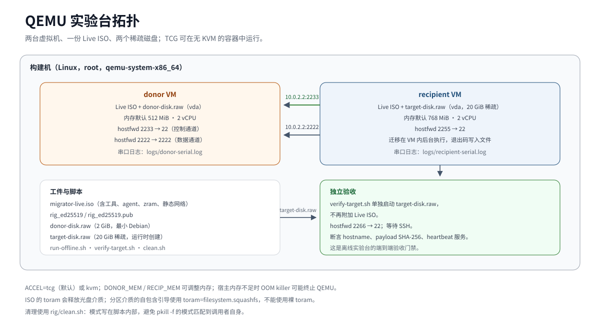
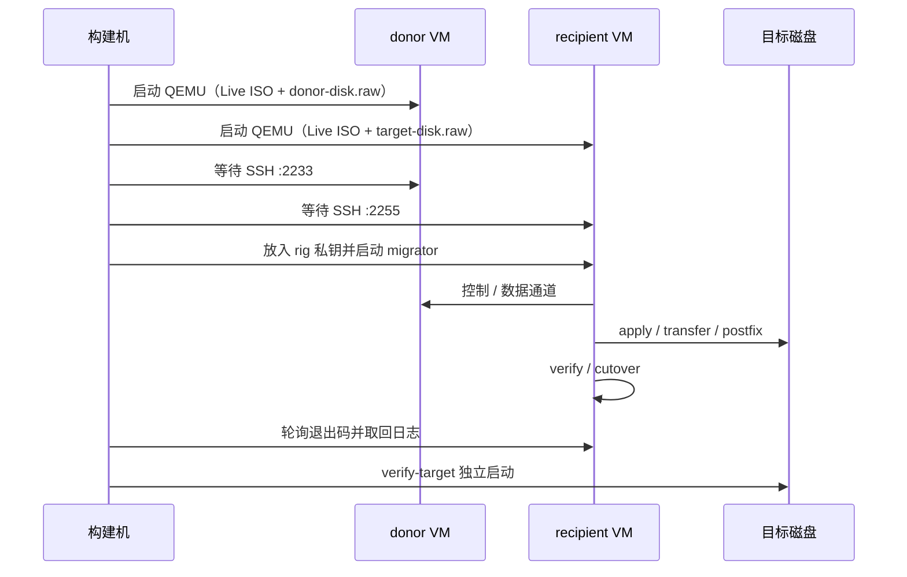

# QEMU 实验台

`rig/` 提供不依赖真实硬件的端到端验证环境。它构建迁移 Live、构建 donor 磁盘、启动两台 QEMU 虚拟机、执行迁移，并在迁移后独立启动目标磁盘进行验收。



## 环境要求

- Linux 构建机，具备 root；
- `qemu-system-x86_64`、`qemu-img`；
- `mmdebstrap`（`rig/build-live.sh`）或 `debootstrap`（`rig/build-live-debootstrap.sh`）；
- `squashfs-tools`、`xorriso`、`isolinux`、`syslinux-common`；
- C 编译器与 libzstd 静态库；
- 约 8 GiB 可用磁盘；
- 可访问 Debian 镜像。

容器环境没有 `/dev/kvm` 时使用 TCG 软件模拟。有条件时设置 `ACCEL=kvm`，可显著缩短运行时间。

## 构建顺序

```sh
make agent
bash rig/build-live.sh
bash rig/build-donor.sh
```

产物默认位于 `$HOME/rig`：

| 文件 | 内容 |
|---|---|
| `migrator-live.iso` | 迁移 Live ISO |
| `rig_ed25519` / `.pub` | 实验台密钥对 |
| `donor-disk.raw` | donor 的 2 GiB 稀疏磁盘 |
| `target-disk.raw` | 迁移目标盘，由运行脚本创建 |
| `logs/` | 串口与迁移日志 |

### Live 构建

`rig/build-live.sh` 使用 mmdebstrap 构建 Debian bookworm 最小系统，安装：

- 内核、live-boot、live-config、initramfs-tools；
- partclone、xfsprogs、e2fsprogs、dosfstools；
- mdadm、lvm2、fdisk、parted、gdisk、efibootmgr；
- grub-common、grub2-common、grub-pc-bin、grub-efi-amd64-bin；
- openssh-server、rsync、lz4、zstd、pv、tmux；
- 网络工具、curl、nano 等。

同时安装：

- `/usr/local/sbin/migrator` 与库；
- 静态 `migrator-agent`；
- `/etc/migrator-live-release` 标记；
- zram swap 服务；
- 静态网络服务；
- rig 公钥到 root 的 `authorized_keys`。

`slim` 版本不包含 QEMU，squashfs 使用 xz 压缩；`full` 版本包含 QEMU，使用 zstd 压缩。配置文件位于 `rig/build-live.sh` 顶部。

### donor 构建

`rig/build-donor.sh` 构建最小 Debian bookworm 系统，包含：

- 内核、initramfs-tools、openssh-server；
- 网络工具；
- grub2-common 与 grub-pc-bin；
- 测试负载与服务。

donor 必须携带 GRUB 软件包，因为 postfix 会在迁移树内执行 `grub-install`。缺少时迁移会在最后阶段失败。

磁盘为 2 GiB 稀疏文件，分区表与 ext4 根文件系统由脚本直接写入，不依赖 loop 挂载。

`DBCACHE` 可指向一个目录，缓存 deb 包，缩短重复构建时间。

## 运行离线迁移



```sh
setsid nohup bash rig/run-offline.sh > "$HOME/rig/run-offline.log" 2>&1 &
```

脚本执行：

1. 启动 donor VM：
   - Live ISO；
   - `donor-disk.raw` 作为 vda；
   - 512 MiB 内存；
   - 控制通道 `127.0.0.1:2233`；
   - 数据通道 `127.0.0.1:2222`；
2. 启动 recipient VM：
   - Live ISO；
   - 新建 20 GiB 稀疏 `target-disk.raw` 作为 vda；
   - 768 MiB 内存；
   - 控制通道 `127.0.0.1:2255`；
3. 等待两台 SSH 可用；
4. 把 rig 私钥复制到 recipient；
5. 在 recipient 的 tmux/后台会话中执行迁移；
6. 轮询 recipient 上的退出码文件；
7. 把迁移日志复制回构建机。

迁移命令默认为：

```sh
migrator -y -i /root/rig-key -d /dev/vda 10.0.2.2:2233
```

`10.0.2.2:2233` 是 QEMU slirp 网络中构建机的地址，`2233` 转发到 donor 的 SSH。

可通过 `MIGRATOR_EXTRA_OPTS` 追加选项：

```sh
MIGRATOR_EXTRA_OPTS="-o boottest=1" bash rig/run-offline.sh
```

注意：只有 `full` 版 Live 包含 QEMU，`slim` 版执行试启动会被跳过。

### 内存与加速

```sh
ACCEL=kvm bash rig/run-offline.sh
DONOR_MEM=1024 RECIP_MEM=2048 bash rig/run-offline.sh
```

默认 TCG 模式使用 `thread=multi` 与较小的 JIT 缓存。TCG 启动较慢，因此 Live 内核参数包含 `systemd.default_timeout_start_sec=600`，避免超过 systemd 默认服务超时。

宿主内存不足时，OOM killer 可能终止 QEMU 进程。应减少同时运行的虚拟机数量或降低单机内存。

## 验收

迁移完成后，独立启动目标磁盘：

```sh
bash rig/verify-target.sh
```

脚本：

1. 停止 donor 与 recipient；
2. 启动目标磁盘为独立 VM；
3. 等待 SSH 可用（`127.0.0.1:2266`）；
4. 断言主机名为 donor；
5. 校验测试数据的 SHA-256；
6. 断言测试服务的启用与运行状态。

这是离线实验台的端到端验收门禁。

## 清理

```sh
bash rig/clean.sh
```

该脚本：

- 终止 `run-offline.sh` 与 `verify-target.sh`；
- 通过 SSH 清理 VM 内的 tmux 与迁移进程；
- 终止 donor、recipient、target 的 QEMU 进程；
- 检查是否有残留 QEMU。

清理命令的模式写在脚本文件内部，避免调用者命令行中的模式匹配到自身。

## 监控

| 脚本 | 作用 |
|---|---|
| `rig/monitor.sh` | 轮询退出码与日志尾部，写入 `e2e-status.txt` |
| `rig/phase-watch.sh` | 每 45 秒记录当前阶段与最后一行日志 |

两者都设计为在构建机上长期运行，不修改虚拟机状态。

## 已知约束

1. **ISO 的 `toram`**：ISO 引导时 `toram` 会把整个镜像复制到内存，然后释放光盘介质，使目标磁盘可被擦除。分区介质上的 `toram` 语义不同，应使用 `toram=filesystem.squashfs`。
2. **网卡命名**：Live 内核参数必须包含 `net.ifnames=0 biosdevname=0`，否则 DHCP 与静态网络配置会作用于错误的接口名。
3. **控制台顺序**：最后一个 `console=` 拥有 `/dev/console`；串口调试时应把 `console=ttyS0` 放在最后。
4. **systemd 超时**：TCG 启动慢，Live 已设置更长的服务启动超时。
5. **主机名泄漏**：mmdebstrap 可能把构建机主机名写入镜像；构建脚本应显式覆盖 `/etc/hostname`。
6. **CPU 争用**：宿主严重超载时，TCG vCPU 可能长时间得不到调度。迁移阶段具备幂等性，环境恢复后可重新执行。
7. **随机 MAC**：真实虚拟机若使用随机 MAC，开机后 IP 会漂移。应按硬件事实识别主机，而不是按 IP 记录角色。

## 与真实硬件的差异

实验台无法覆盖：

- 真实固件与 NVRAM 行为；
- 物理网卡驱动与固件加载；
- 真实磁盘性能与 IOPS 瓶颈；
- 云平台的 EIP、私网映射与 cloud-init；
- 断电、网卡故障与宿主 OOM；
- Secure Boot 签名链；
- 大容量磁盘与 4K 扇区设备。

这些场景应在真实主机上验证。实验台的价值是快速回归阶段逻辑、计划生成与引导修补。

## 相关文档

- [迁移 Live 构建](live-build.md)
- [测试体系](testing.md)
- [代码结构与数据流](architecture.md)
