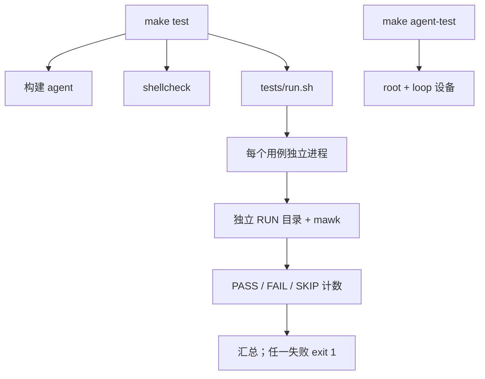

# 测试体系

## 快速运行



```sh
make test
```

该命令先构建 agent，再执行 `tests/run.sh`。默认不需要 root，几秒内完成。

运行单个用例：

```sh
bash tests/run.sh plan
bash tests/run.sh verify
```

也可直接执行用例文件：

```sh
bash tests/cases/plan.sh
```

## 测试组成

### shellcheck

`tests/run.sh` 首先对以下文件运行 shellcheck：

- `bin/migrator`；
- `lib/*.sh`；
- `tools/*.sh`；
- `tests/*.sh`；
- `tests/cases/*.sh`。

以 `#!/bin/sh` 开头的文件使用 `-s sh`，其余使用 `-s bash`。未安装 shellcheck 时输出 `SKIP`，不视为失败。构建机应自行安装 shellcheck 与 mawk；测试脚本没有提供自动安装这些工具的 Makefile 目标。

### 表驱动用例

每个 `tests/cases/*.sh` 在独立进程中运行，具备：

- 独立的 `RUN` 临时目录；
- `awk` 指向 mawk（若已安装），模拟 Live 环境；
- 不触碰宿主 `/run/migrator`；
- 不执行真实磁盘写入。

断言助手位于 `tests/lib.sh`：

| 函数 | 作用 |
|---|---|
| `assert_eq NAME EXPECTED ACTUAL` | 字符串相等 |
| `assert_has NAME NEEDLE HAYSTACK` | 包含子串 |
| `assert_ok NAME CMD...` | 命令退出 0 |
| `assert_fail NAME CMD...` | 命令退出非 0 |
| `assert_exit NAME CODE CMD...` | 命令退出指定码 |
| `skip NAME REASON` | 跳过，不计失败 |
| `t_end` | 输出统计并按失败数退出 |

用例输出以 `  PASS `、`  FAIL `、`  SKIP ` 开头，测试框架按前缀计数。用例崩溃且未输出 `FAIL` 时，框架记为失败。

## 用例覆盖

| 用例 | 覆盖内容 |
|---|---|
| `apply.sh` | apply 的空运行命令序列、指纹门禁、特性掩码、分区节点、清理 |
| `bootstrap.sh` | 工具清单与缺失检测，不触碰 apt 与 sshd |
| `common.sh` | 格式化、选项、状态、`run`/`-n`、`die`、确认、锁、清理顺序 |
| `driver.sh` | 命令行、`-h`、版本、非法参数、Live 门禁 |
| `guides.sh` | 站点指南数据与发布日期门控（存在 `site/` 时） |
| `install.sh` | 安装器的校验、解包、原子替换、许可文件安装与失败处理（需要 python3 与 curl/wget） |
| `inventory.sh` | 各解析器、modalias、donor 树采集、独立执行形式 |
| `netfix.sh` | 五类网络配置的纯改写器、MAC 改写、udev 规则、幂等性 |
| `options.sh` | 选项注册表与 `-h`、文档、站点的一致性；下划线归一化；拼写拒绝 |
| `plan.sh` | 全部计划夹具、容量算术、编号、identity 改写、mkfs 参数、拒绝消息、`plan_check` |
| `postfix.sh` | 纯改写器、`pf_apply` 契约、bios/uefi、rhel、幂等性、空运行 |
| `relay.sh` | relay 规格解析与切换端口覆盖 |
| `ssh.sh` | 函数契约，不建立连接 |
| `target.sh` | 挂载顺序与空运行保护 |
| `transfer.sh` | 管道构造、进度解析、swap 排除、树比较、watchdog、回环传输 |
| `verify.sh` | 绿色路径、硬检查的单点变异、警告路径、UEFI、cutover seam |

部分用例需要额外条件：

- 需要 root、loop 设备或 partclone 时，用例中的相应部分输出 `SKIP`，不失败；
- `install.sh` 需要 python3 与 curl 或 wget；
- `guides.sh` 需要 `site/` 目录；
- `options.sh` 的站点与 `docs/migrator.md` 检查在缺少对应文件时跳过。

## 夹具

计划用例使用：

```text
tests/fixtures/<case>/
  donor.inv
  recipient.inv
  expected.plan
```

`plan.sh` 对 `expected.plan` 做全文 diff，并对关键事实做显式断言：

- 弹性槽位位置与容量算术；
- 分区类型转换与编号；
- identity 改写；
- mkfs 参数；
- LVM 命令；
- 拒绝码与消息。

原始解析夹具位于 `tests/fixtures/raw/`，包含：

- `lsblk`、`sfdisk`、`dumpe2fs`、`xfs_db`、`mdadm`、`blkid` 输出；
- 真实系统的 `/etc/fstab`、网络配置与 GRUB 配置；
- 验证用的目标树。

夹具是证据，不是快照。修改夹具前应确认：

1. 变化来自真实行为，而不是为了让测试通过；
2. 差异已逐项审查；
3. 相关清单哈希与计划头同步更新；
4. 其它用例没有共享该夹具。

重命名或大规模改写时，正确做法通常是还原夹具，只修改与实际改动相关的字段，而不是整体重新生成。

## agent 测试

```sh
make agent-test
```

需要 root、`losetup`、`mkfs.ext4`、`sfdisk`。覆盖：

- ext4 整块 loop 设备，eBPF 与 ftrace 两种跟踪；
- ext4 位于 loop 设备的分区，按整盘跟踪并减去分区起始偏移；
- 块设备作为目标，使用 O_DIRECT 与 `BLKZEROOUT`；
- cutover 轮询：`pull --cutover` 后通过 `migrator-agent cutover` 执行 ping/thaw；
- vfat（不可冻结）位于仍必须冻结的文件系统之下。

该测试创建并销毁 loop 设备，不修改真实磁盘。`-k` 保留工作目录，便于排查。

## 测试环境变量

部分超时与路径可通过环境变量缩短，用于测试：

| 变量 | 作用 |
|---|---|
| `MIGRATOR_WATCHDOG_S` | 覆盖离线 watchdog 秒数 |
| `MIGRATOR_POLL_S` | 覆盖传输进度轮询间隔 |
| `MIGRATOR_PRINT_S` | 覆盖进度打印间隔 |
| `MIGRATOR_PROBE_S` | 覆盖链路探测时间 |
| `MIGRATOR_CUTOVER_WAIT_S` | 源端命令后、首次 ping 前的等待 |
| `MIGRATOR_CUTOVER_TIMEOUT_S` | ping 数上限 |
| `MIGRATOR_CUTOVER_POLL_S` | ping 之间的间隔 |
| `MIGRATOR_CUTOVER_AGENT_S` | 在线切换等待轮询的时间 |
| `TX_RSTATUS` / `TX_RLOG` | 迁移源端状态与日志路径 |
| `TX_SRC_RUN` | 源端命令执行器，测试中可替换为本地执行 |

## seam

测试通过替换函数或 `PATH` 中的命令实现隔离：

- `vf_initrd_list`、`vf_resolve_spec`、`vf_masks_of`、`vf_disk_head`、`vf_part_head`、`vf_partuuid`、`vf_efibootmgr`；
- `vf_boottest_disk`、`vf_boottest_run`；
- `co_ping`、`co_boot`；
- `tests/cases/apply.sh` 使用 `lsblk`、`blockdev`、`dd` 的 shim；
- `tests/cases/postfix.sh` 使用 `chroot`、`grub-install`、`efibootmgr`、`dd`、`mkswap` 的 shim。

新增外部命令调用时，应提供 seam 或 shim，避免测试触碰真实设备。

## 新增用例

1. 在 `tests/cases/` 下创建 `<name>.sh`；
2. 首行使用 `#!/bin/bash`；
3. source `../lib.sh`；
4. 按需 source 被测库；
5. 使用断言助手，避免直接 `exit`（`die` 会终止进程）；
6. 以 `t_end` 结束。

示例骨架：

```bash
#!/bin/bash
set -u
. "$(dirname "$0")/../lib.sh"
. "$REPO/lib/common.sh"

assert_eq "example" "1" "1"
t_end
```

测试框架会自动发现新文件，无需注册。

## 验收标准

合并前至少满足：

1. `make test` 全部通过，shellcheck 无失败；
2. 新增或修改的行为有对应用例；
3. 计划格式变更时，所有 `expected.plan` 已审查并更新；
4. 选项变更时，`options.sh` 通过；
5. 涉及传输时，`make agent-test` 通过；
6. 涉及 Live 行为时，在 `rig/` 或真实主机上完成端到端验证。

历史断言数量不作为验收依据。应以当前 HEAD 的实际运行结果为准。

## 相关文档

- [代码结构与数据流](architecture.md)
- [QEMU 实验台](rig.md)
- [迁移 Live 构建](live-build.md)
- [发布与安装布局](release.md)
